<a href="https://gola.apimart.ai/k-ZltbL1">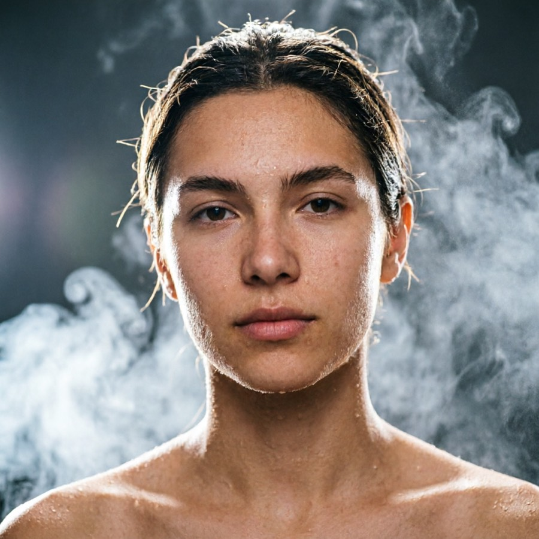</a>

# Awesome Qwen-Image 2.1 Prompts

> 🎨 252 curated Qwen-Image 2.1 prompts across 9 categories, with preview images.

[](https://github.com/sindresorhus/awesome) [](LICENSE) [](https://github.com/dvuueez33gok/awesome-qwen-image-prompts/actions)

[English](README.md) | [简体中文](README_zh.md) | [日本語](README_ja.md)

**[👉 Generate with Qwen-Image 2.1 on APIMart · apimart.ai/model/qwen-image-2](https://gola.apimart.ai/k-ZltbL1)**
[💰 Pricing](https://gola.apimart.ai/k-6uo0HF) · [🔑 Get an API key](https://gola.apimart.ai/k-iqrUDZ)


---

## Table of Contents

1. [Portrait & Avatar](#portrait--avatar) — 28
2. [Product & E-commerce](#product--e-commerce) — 28
3. [Poster & Typography](#poster--typography) — 28
4. [Infographic & Diagram](#infographic--diagram) — 28
5. [Anime & Illustration](#anime--illustration) — 28
6. [3D & Material](#3d--material) — 28
7. [Food & Lifestyle](#food--lifestyle) — 28
8. [Architecture & Interior](#architecture--interior) — 28
9. [Nature & Landscape](#nature--landscape) — 28
10. [All Prompts](#all-prompts)

## What is Qwen-Image 2.1?

Qwen-Image 2.1 is known for bilingual text rendering and Asian aesthetics. This collection gathers prompts that actually work, grouped by use case, with generated previews so you can see the result before you run it.

## Statistics

- **252** prompts in this collection
- **9** Category
- Last updated: 2026-10-23
- apimart.ai/model/qwen-image-2

## Browse by Category

[Portrait & Avatar](#portrait--avatar), [Product & E-commerce](#product--e-commerce), [Poster & Typography](#poster--typography), [Infographic & Diagram](#infographic--diagram), [Anime & Illustration](#anime--illustration), [3D & Material](#3d--material), [Food & Lifestyle](#food--lifestyle), [Architecture & Interior](#architecture--interior), [Nature & Landscape](#nature--landscape)

---

## All Prompts

### Portrait & Avatar

#### No. 1: Editorial Studio Portrait

**Description** — A portrait & avatar prompt tuned for Qwen-Image 2.1 — bilingual text rendering and Asian aesthetics.

**Prompt**

```text
editorial studio portrait, volumetric fog with rim light, 100mm macro, commercial product photography, 16:9 composition, highly detailed, professional quality
```

**Generated Images**

<div align="center"></div>

**Details**
- Category: Portrait & Avatar
- Aspect Ratio: 16:9
- Prompt Language: en

**[👉 Try this prompt](https://gola.apimart.ai/k-ZltbL1)**

---

#### No. 2: Candid Street Portrait

**Description** — A portrait & avatar prompt tuned for Qwen-Image 2.1 — bilingual text rendering and Asian aesthetics.

**Prompt**

```text
candid street portrait, soft window light, 85mm lens, shallow depth of field, 4:3 composition, highly detailed, professional quality
```

**Generated Images**

<div align="center">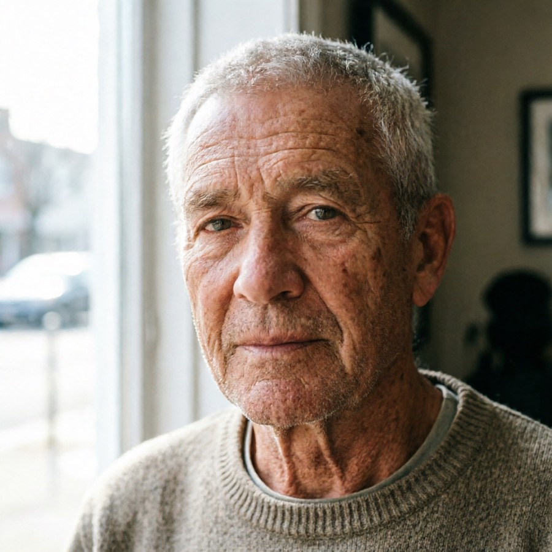</div>

**Details**
- Category: Portrait & Avatar
- Aspect Ratio: 4:3
- Prompt Language: en

**[👉 Try this prompt](https://gola.apimart.ai/k-ZltbL1)**

---

#### No. 3: Corporate Headshot

**Description** — A portrait & avatar prompt tuned for Qwen-Image 2.1 — bilingual text rendering and Asian aesthetics.

**Prompt**

```text
corporate headshot, hard directional key light with subtle fill, isometric 3D render look, 1:1 composition, highly detailed, professional quality
```

**Generated Images**

<div align="center">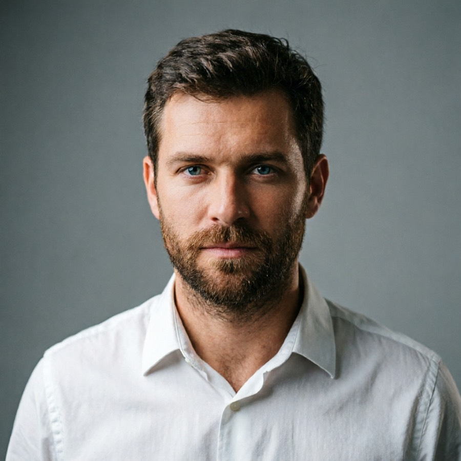</div>

**Details**
- Category: Portrait & Avatar
- Aspect Ratio: 1:1
- Prompt Language: en

**[👉 Try this prompt](https://gola.apimart.ai/k-ZltbL1)**

---

#### No. 4: Artistic Double Exposure Portrait

**Description** — A portrait & avatar prompt tuned for Qwen-Image 2.1 — bilingual text rendering and Asian aesthetics.

**Prompt**

```text
artistic double exposure portrait, golden hour backlight, top-down flat lay, 3:4 composition, highly detailed, professional quality
```

**Generated Images**

<div align="center"></div>

**Details**
- Category: Portrait & Avatar
- Aspect Ratio: 3:4
- Prompt Language: en

**[👉 Try this prompt](https://gola.apimart.ai/k-ZltbL1)**

---

#### No. 5: Cinematic Close-Up

**Description** — A portrait & avatar prompt tuned for Qwen-Image 2.1 — bilingual text rendering and Asian aesthetics.

**Prompt**

```text
cinematic close-up, moody low-key lighting, wide angle, architectural composition, 4:5 composition, highly detailed, professional quality
```

**Generated Images**

<div align="center">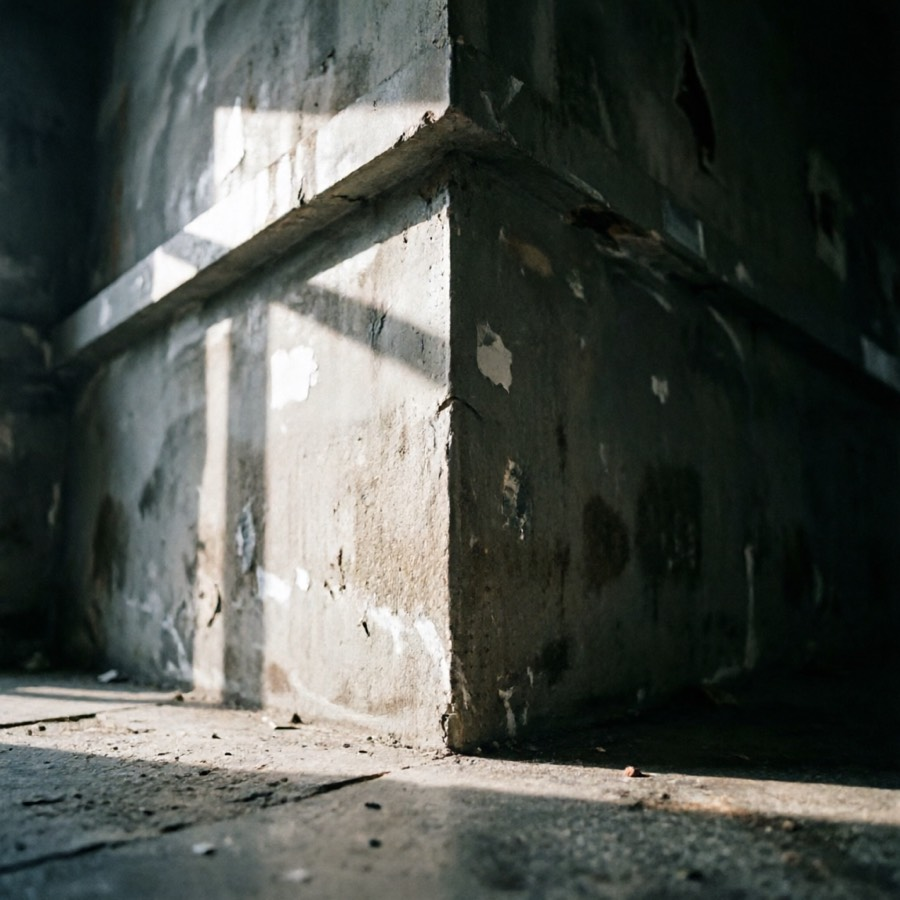</div>

**Details**
- Category: Portrait & Avatar
- Aspect Ratio: 4:5
- Prompt Language: en

**[👉 Try this prompt](https://gola.apimart.ai/k-ZltbL1)**

---

#### No. 6: Editorial Studio Portrait

**Description** — A portrait & avatar prompt tuned for Qwen-Image 2.1 — bilingual text rendering and Asian aesthetics.

**Prompt**

```text
editorial studio portrait, even diffused studio light, film grain, analog color science, 2:3 composition, highly detailed, professional quality
```

**Generated Images**

<div align="center">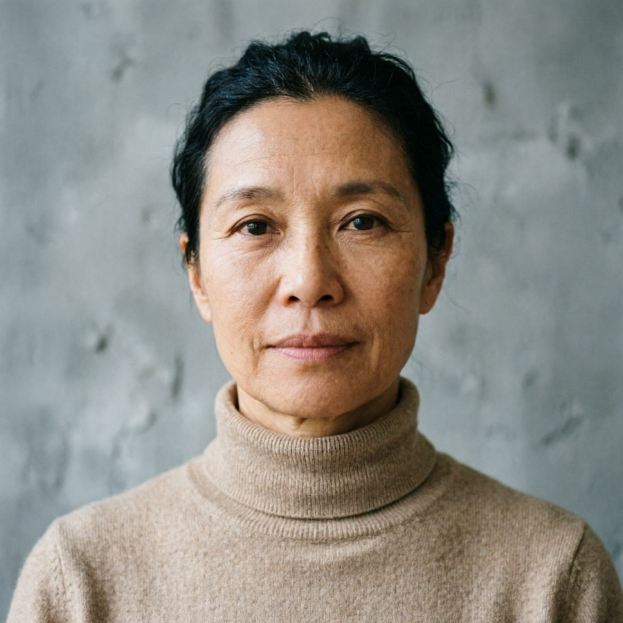</div>

**Details**
- Category: Portrait & Avatar
- Aspect Ratio: 2:3
- Prompt Language: en

**[👉 Try this prompt](https://gola.apimart.ai/k-ZltbL1)**

---

#### No. 7: Candid Street Portrait

**Description** — A portrait & avatar prompt tuned for Qwen-Image 2.1 — bilingual text rendering and Asian aesthetics.

**Prompt**

```text
candid street portrait, volumetric fog with rim light, isometric 3D render look, 16:9 composition, highly detailed, professional quality
```

**Generated Images**

<div align="center">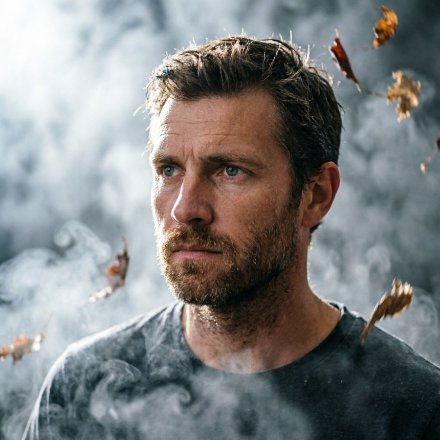</div>

**Details**
- Category: Portrait & Avatar
- Aspect Ratio: 16:9
- Prompt Language: en

**[👉 Try this prompt](https://gola.apimart.ai/k-ZltbL1)**

---

#### No. 8: Corporate Headshot

**Description** — A portrait & avatar prompt tuned for Qwen-Image 2.1 — bilingual text rendering and Asian aesthetics.

**Prompt**

```text
corporate headshot, soft window light, wide angle, architectural composition, 4:3 composition, highly detailed, professional quality
```

**Generated Images**

<div align="center">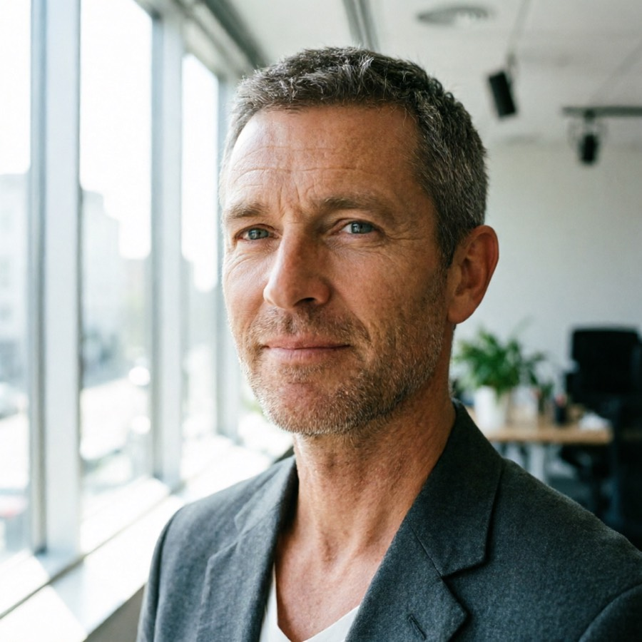</div>

**Details**
- Category: Portrait & Avatar
- Aspect Ratio: 4:3
- Prompt Language: en

**[👉 Try this prompt](https://gola.apimart.ai/k-ZltbL1)**

---

#### No. 9: Artistic Double Exposure Portrait

**Description** — A portrait & avatar prompt tuned for Qwen-Image 2.1 — bilingual text rendering and Asian aesthetics.

**Prompt**

```text
artistic double exposure portrait, hard directional key light with subtle fill, 100mm macro, commercial product photography, 1:1 composition, highly detailed, professional quality
```

**Generated Images**

<div align="center">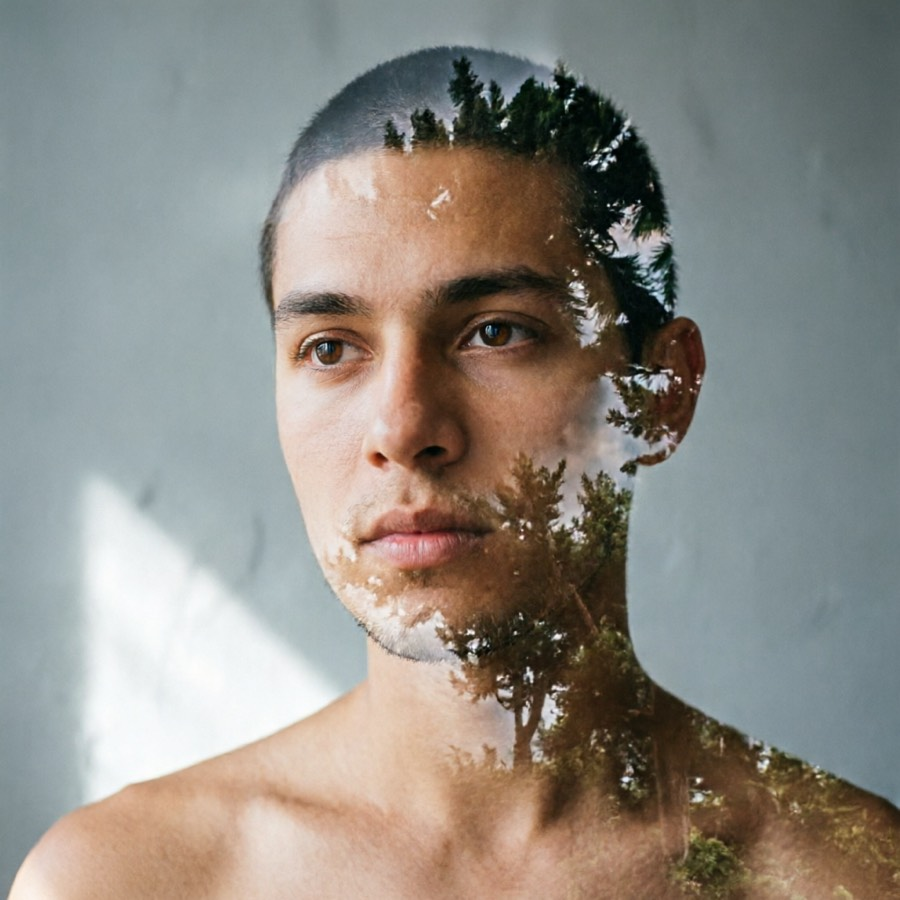</div>

**Details**
- Category: Portrait & Avatar
- Aspect Ratio: 1:1
- Prompt Language: en

**[👉 Try this prompt](https://gola.apimart.ai/k-ZltbL1)**

---

#### No. 10: Cinematic Close-Up

**Description** — A portrait & avatar prompt tuned for Qwen-Image 2.1 — bilingual text rendering and Asian aesthetics.

**Prompt**

```text
cinematic close-up, golden hour backlight, 85mm lens, shallow depth of field, 3:4 composition, highly detailed, professional quality
```

**Generated Images**

<div align="center">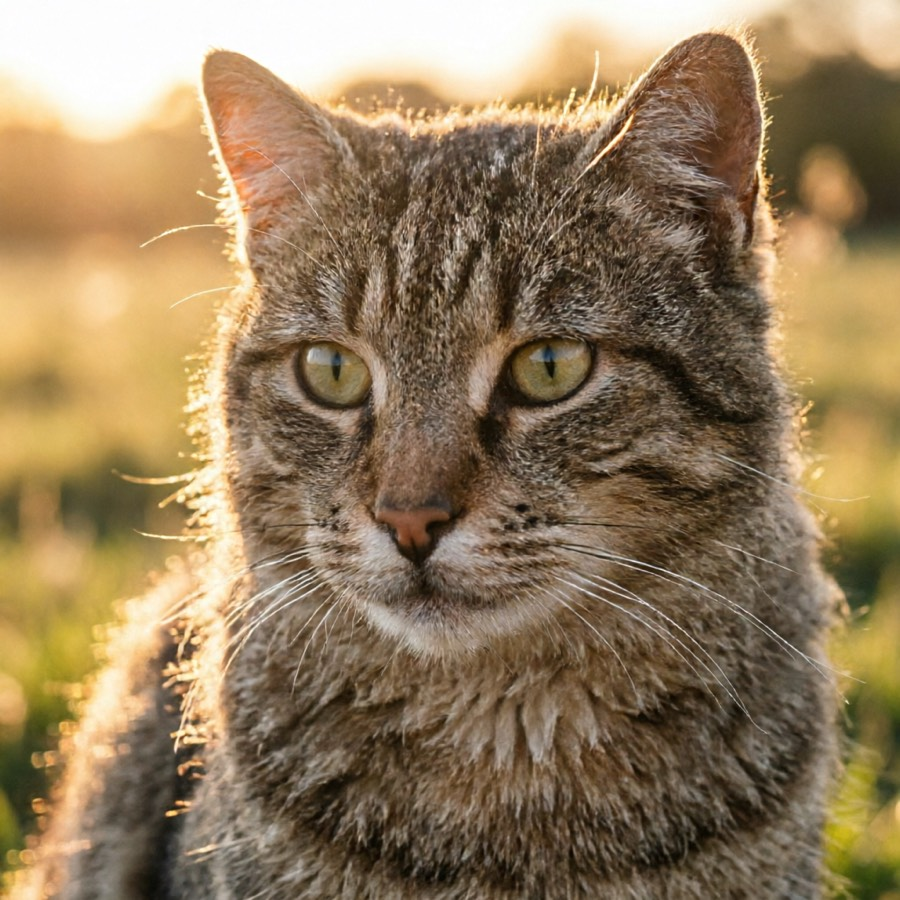</div>

**Details**
- Category: Portrait & Avatar
- Aspect Ratio: 3:4
- Prompt Language: en

**[👉 Try this prompt](https://gola.apimart.ai/k-ZltbL1)**

---

#### No. 11: Editorial Studio Portrait

**Description** — A portrait & avatar prompt tuned for Qwen-Image 2.1 — bilingual text rendering and Asian aesthetics.

**Prompt**

```text
editorial studio portrait, moody low-key lighting, top-down flat lay, 4:5 composition, highly detailed, professional quality
```

**Generated Images**

<div align="center">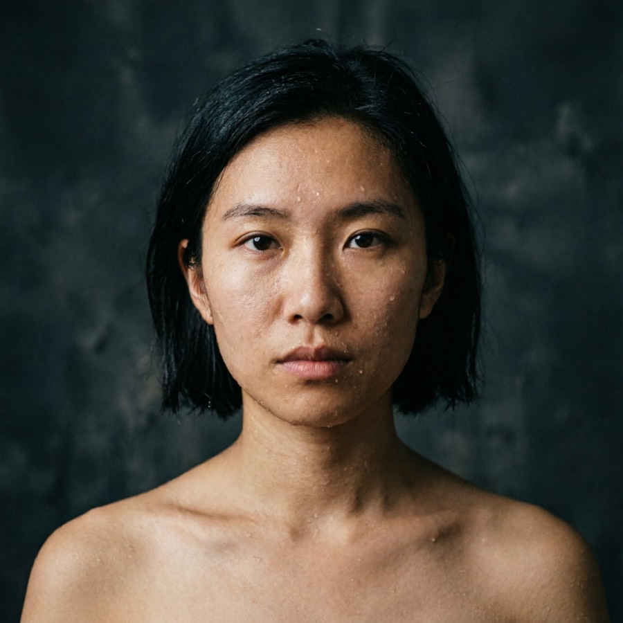</div>

**Details**
- Category: Portrait & Avatar
- Aspect Ratio: 4:5
- Prompt Language: en

**[👉 Try this prompt](https://gola.apimart.ai/k-ZltbL1)**

---

#### No. 12: Candid Street Portrait

**Description** — A portrait & avatar prompt tuned for Qwen-Image 2.1 — bilingual text rendering and Asian aesthetics.

**Prompt**

```text
candid street portrait, even diffused studio light, wide angle, architectural composition, 2:3 composition, highly detailed, professional quality
```

**Generated Images**

<div align="center">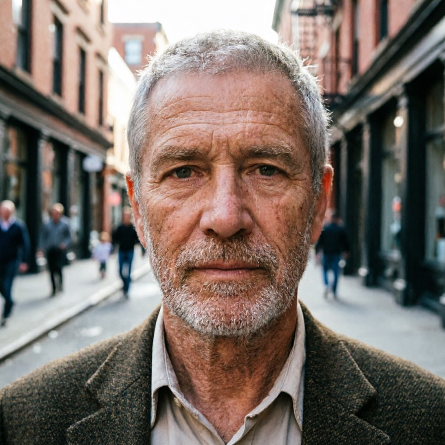</div>

**Details**
- Category: Portrait & Avatar
- Aspect Ratio: 2:3
- Prompt Language: en

**[👉 Try this prompt](https://gola.apimart.ai/k-ZltbL1)**

---

#### No. 13: Corporate Headshot

**Description** — A portrait & avatar prompt tuned for Qwen-Image 2.1 — bilingual text rendering and Asian aesthetics.

**Prompt**

```text
corporate headshot, volumetric fog with rim light, 85mm lens, shallow depth of field, 16:9 composition, highly detailed, professional quality
```

**Generated Images**

<div align="center">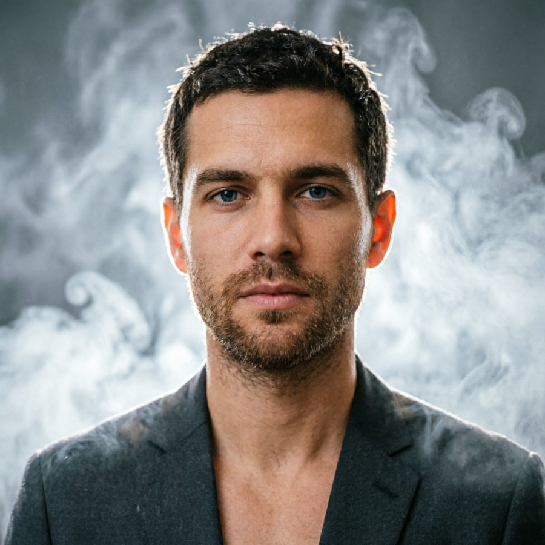</div>

**Details**
- Category: Portrait & Avatar
- Aspect Ratio: 16:9
- Prompt Language: en

**[👉 Try this prompt](https://gola.apimart.ai/k-ZltbL1)**

---

#### No. 14: Artistic Double Exposure Portrait

**Description** — A portrait & avatar prompt tuned for Qwen-Image 2.1 — bilingual text rendering and Asian aesthetics.

**Prompt**

```text
artistic double exposure portrait, soft window light, film grain, analog color science, 4:3 composition, highly detailed, professional quality
```

**Generated Images**

<div align="center">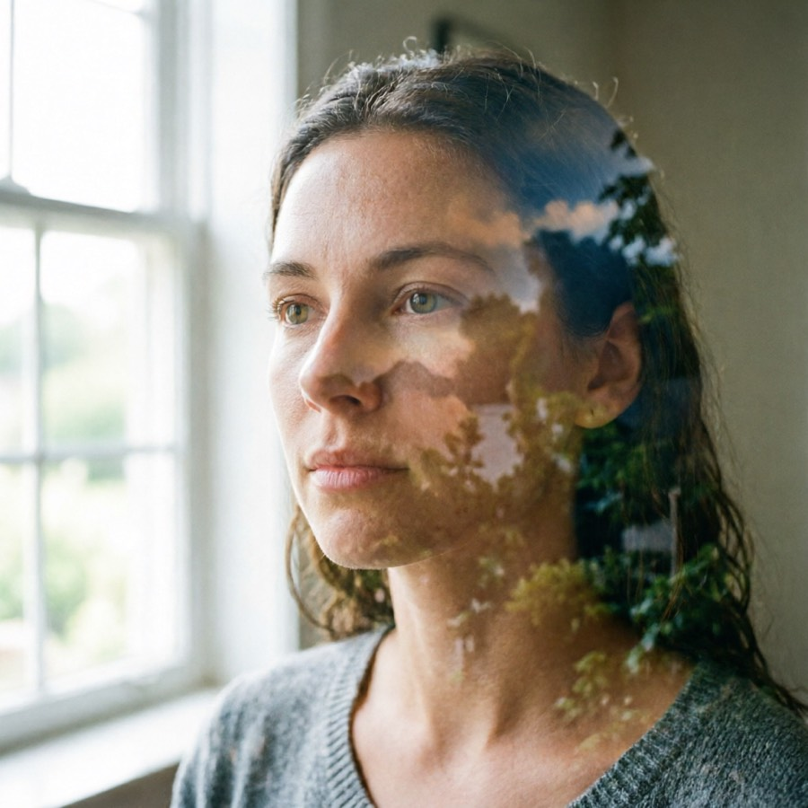</div>

**Details**
- Category: Portrait & Avatar
- Aspect Ratio: 4:3
- Prompt Language: en

**[👉 Try this prompt](https://gola.apimart.ai/k-ZltbL1)**

---

#### No. 15: Cinematic Close-Up

**Description** — A portrait & avatar prompt tuned for Qwen-Image 2.1 — bilingual text rendering and Asian aesthetics.

**Prompt**

```text
cinematic close-up, hard directional key light with subtle fill, isometric 3D render look, 1:1 composition, highly detailed, professional quality
```

**Generated Images**

<div align="center">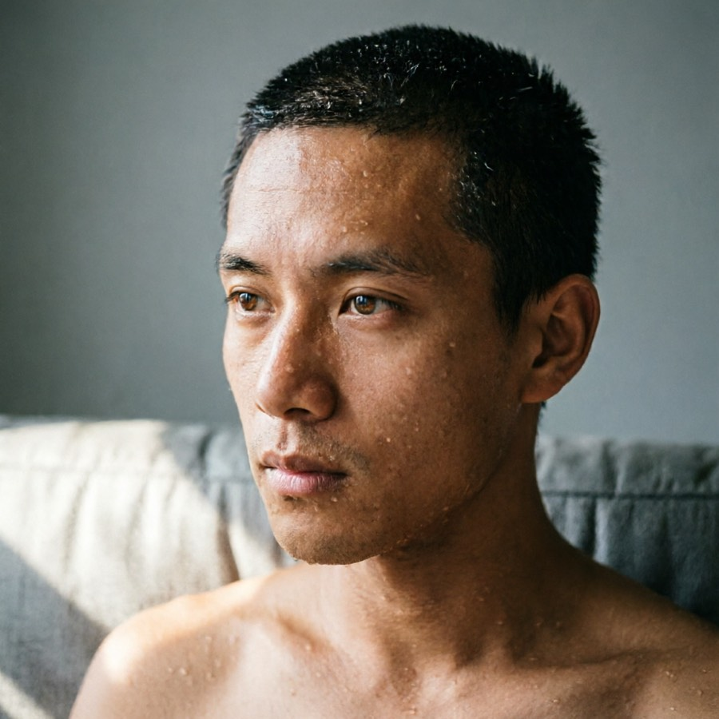</div>

**Details**
- Category: Portrait & Avatar
- Aspect Ratio: 1:1
- Prompt Language: en

**[👉 Try this prompt](https://gola.apimart.ai/k-ZltbL1)**

---

#### No. 16: Editorial Studio Portrait

**Description** — A portrait & avatar prompt tuned for Qwen-Image 2.1 — bilingual text rendering and Asian aesthetics.

**Prompt**

```text
editorial studio portrait, golden hour backlight, 100mm macro, commercial product photography, 3:4 composition, highly detailed, professional quality
```

**Generated Images**

<div align="center">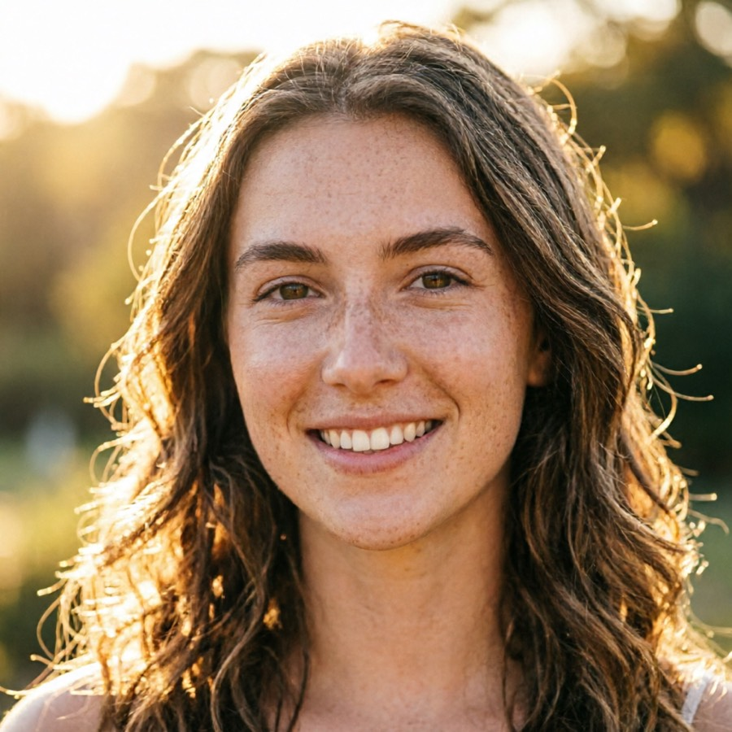</div>

**Details**
- Category: Portrait & Avatar
- Aspect Ratio: 3:4
- Prompt Language: en

**[👉 Try this prompt](https://gola.apimart.ai/k-ZltbL1)**

---

#### No. 17: Candid Street Portrait

**Description** — A portrait & avatar prompt tuned for Qwen-Image 2.1 — bilingual text rendering and Asian aesthetics.

**Prompt**

```text
candid street portrait, moody low-key lighting, 85mm lens, shallow depth of field, 4:5 composition, highly detailed, professional quality
```

**Generated Images**

<div align="center">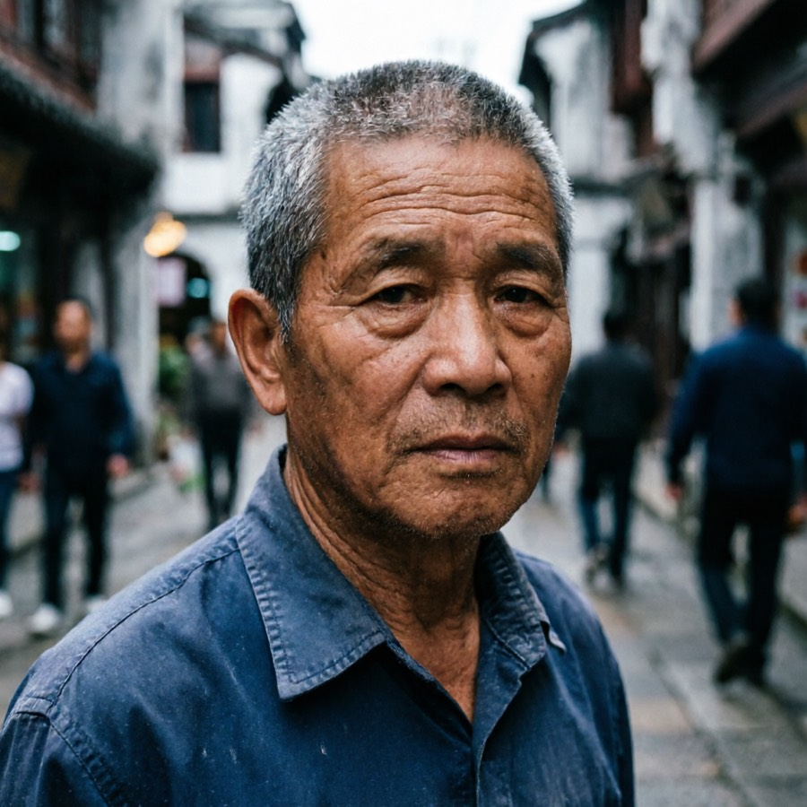</div>

**Details**
- Category: Portrait & Avatar
- Aspect Ratio: 4:5
- Prompt Language: en

**[👉 Try this prompt](https://gola.apimart.ai/k-ZltbL1)**

---

#### No. 18: Corporate Headshot

**Description** — A portrait & avatar prompt tuned for Qwen-Image 2.1 — bilingual text rendering and Asian aesthetics.

**Prompt**

```text
corporate headshot, even diffused studio light, isometric 3D render look, 2:3 composition, highly detailed, professional quality
```

**Generated Images**

<div align="center">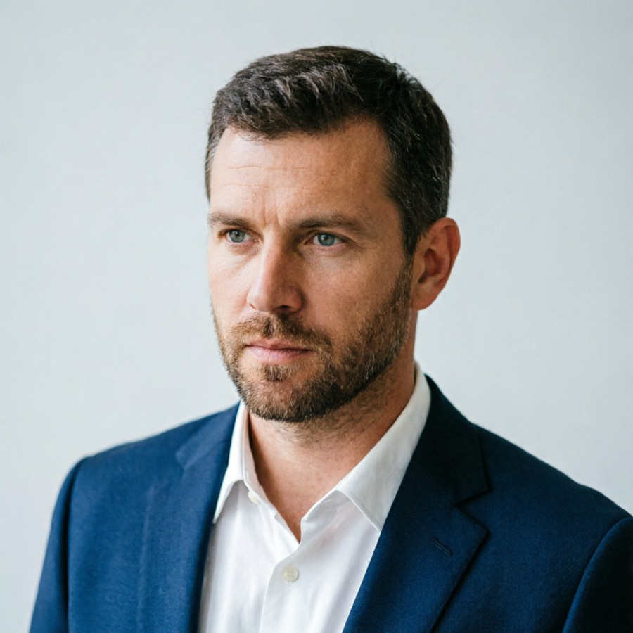</div>

**Details**
- Category: Portrait & Avatar
- Aspect Ratio: 2:3
- Prompt Language: en

**[👉 Try this prompt](https://gola.apimart.ai/k-ZltbL1)**

---

#### No. 19: Artistic Double Exposure Portrait

**Description** — A portrait & avatar prompt tuned for Qwen-Image 2.1 — bilingual text rendering and Asian aesthetics.

**Prompt**

```text
artistic double exposure portrait, volumetric fog with rim light, top-down flat lay, 16:9 composition, highly detailed, professional quality
```

**Generated Images**

<div align="center">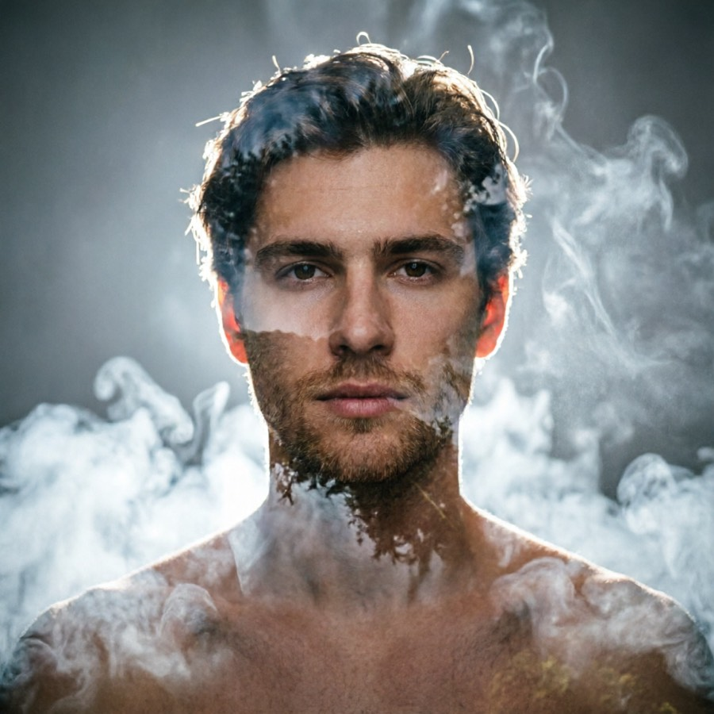</div>

**Details**
- Category: Portrait & Avatar
- Aspect Ratio: 16:9
- Prompt Language: en

**[👉 Try this prompt](https://gola.apimart.ai/k-ZltbL1)**

---

#### No. 20: Cinematic Close-Up

**Description** — A portrait & avatar prompt tuned for Qwen-Image 2.1 — bilingual text rendering and Asian aesthetics.

**Prompt**

```text
cinematic close-up, soft window light, wide angle, architectural composition, 4:3 composition, highly detailed, professional quality
```

**Generated Images**

<div align="center">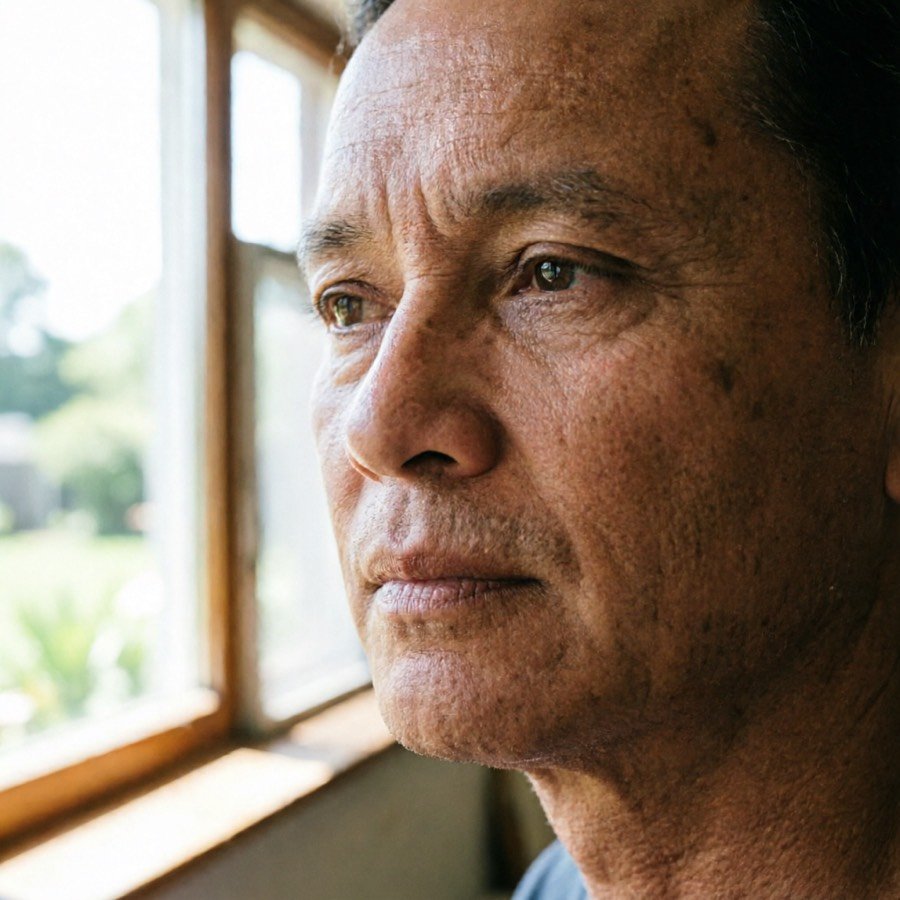</div>

**Details**
- Category: Portrait & Avatar
- Aspect Ratio: 4:3
- Prompt Language: en

**[👉 Try this prompt](https://gola.apimart.ai/k-ZltbL1)**

---

#### No. 21: Editorial Studio Portrait

**Description** — A portrait & avatar prompt tuned for Qwen-Image 2.1 — bilingual text rendering and Asian aesthetics.

**Prompt**

```text
editorial studio portrait, hard directional key light with subtle fill, film grain, analog color science, 1:1 composition, highly detailed, professional quality
```

**Generated Images**

<div align="center">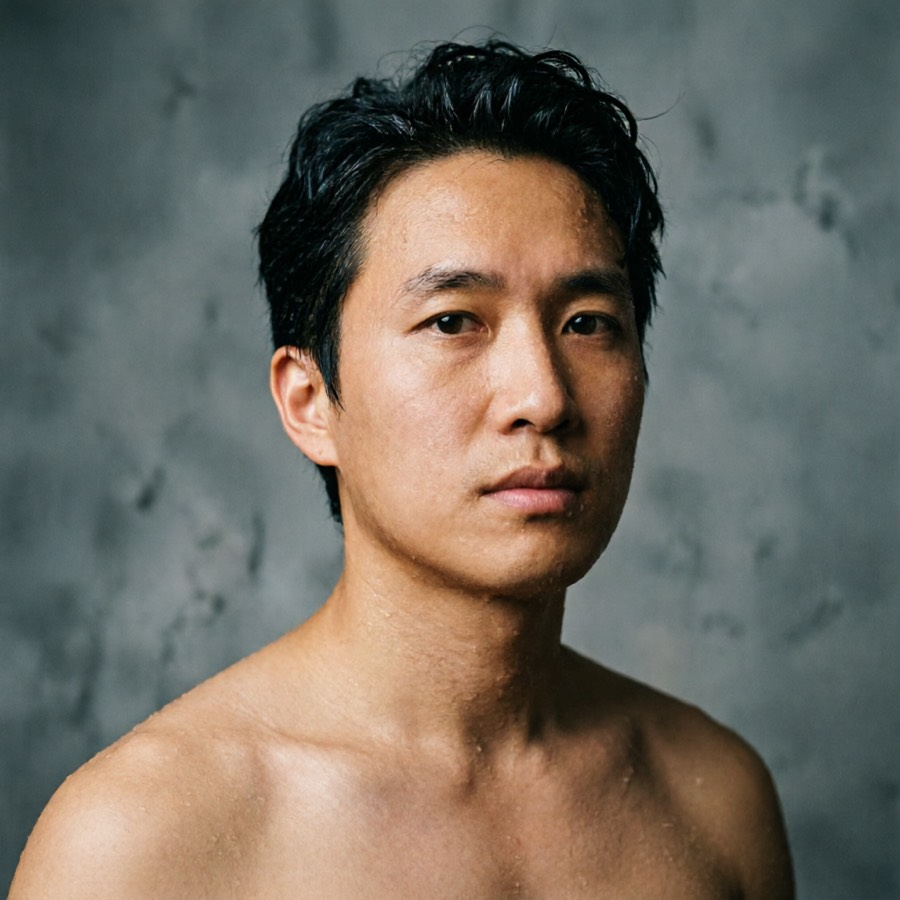</div>

**Details**
- Category: Portrait & Avatar
- Aspect Ratio: 1:1
- Prompt Language: en

**[👉 Try this prompt](https://gola.apimart.ai/k-ZltbL1)**

---

#### No. 22: Candid Street Portrait

**Description** — A portrait & avatar prompt tuned for Qwen-Image 2.1 — bilingual text rendering and Asian aesthetics.

**Prompt**

```text
candid street portrait, golden hour backlight, isometric 3D render look, 3:4 composition, highly detailed, professional quality
```

**Generated Images**

<div align="center">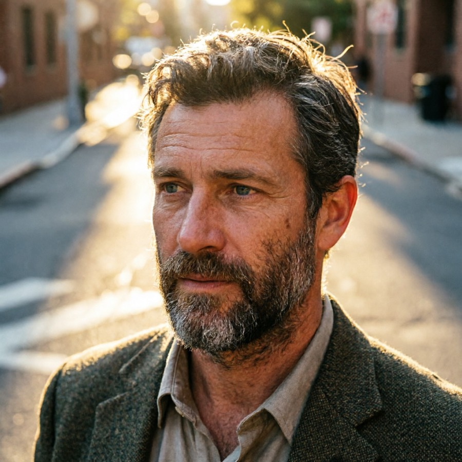</div>

**Details**
- Category: Portrait & Avatar
- Aspect Ratio: 3:4
- Prompt Language: en

**[👉 Try this prompt](https://gola.apimart.ai/k-ZltbL1)**

---

#### No. 23: Corporate Headshot

**Description** — A portrait & avatar prompt tuned for Qwen-Image 2.1 — bilingual text rendering and Asian aesthetics.

**Prompt**

```text
corporate headshot, moody low-key lighting, wide angle, architectural composition, 4:5 composition, highly detailed, professional quality
```

**Generated Images**

<div align="center">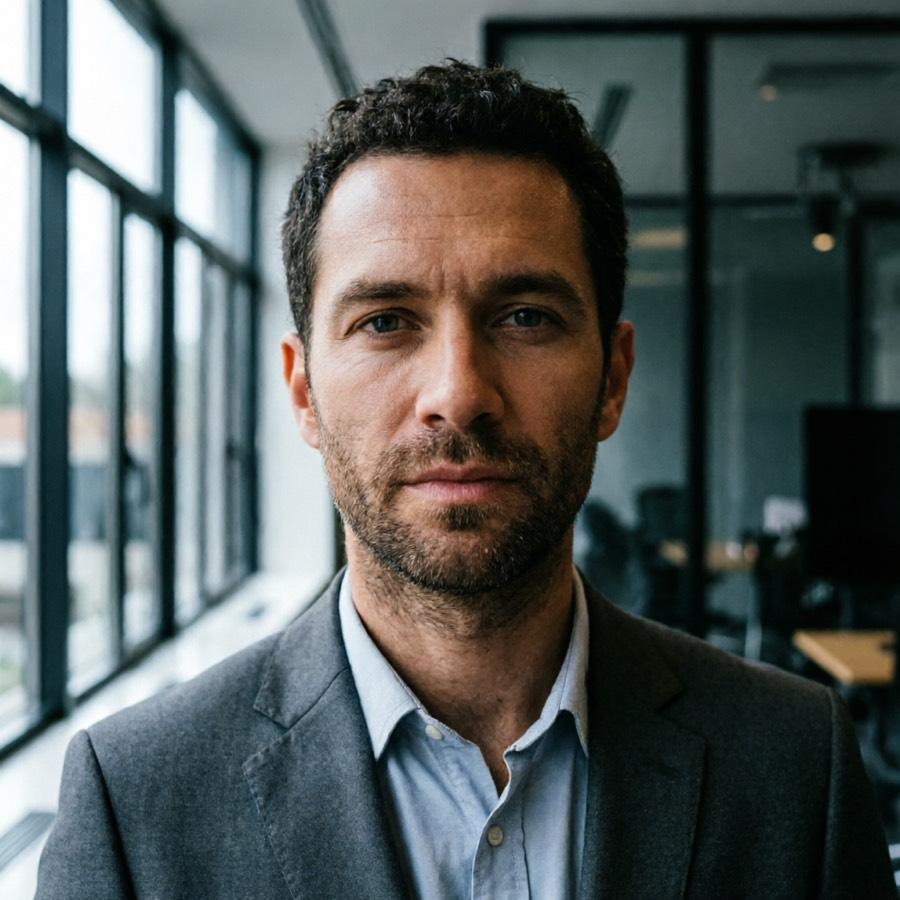</div>

**Details**
- Category: Portrait & Avatar
- Aspect Ratio: 4:5
- Prompt Language: en

**[👉 Try this prompt](https://gola.apimart.ai/k-ZltbL1)**

---

#### No. 24: Artistic Double Exposure Portrait

**Description** — A portrait & avatar prompt tuned for Qwen-Image 2.1 — bilingual text rendering and Asian aesthetics.

**Prompt**

```text
artistic double exposure portrait, even diffused studio light, 100mm macro, commercial product photography, 2:3 composition, highly detailed, professional quality
```

**Generated Images**

<div align="center">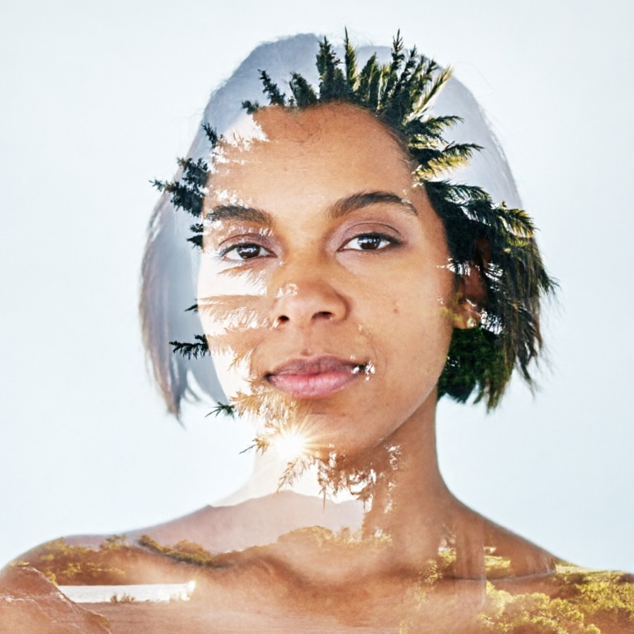</div>

**Details**
- Category: Portrait & Avatar
- Aspect Ratio: 2:3
- Prompt Language: en

**[👉 Try this prompt](https://gola.apimart.ai/k-ZltbL1)**

---

#### No. 25: Cinematic Close-Up

**Description** — A portrait & avatar prompt tuned for Qwen-Image 2.1 — bilingual text rendering and Asian aesthetics.

**Prompt**

```text
cinematic close-up, volumetric fog with rim light, 85mm lens, shallow depth of field, 16:9 composition, highly detailed, professional quality
```

**Generated Images**

<div align="center">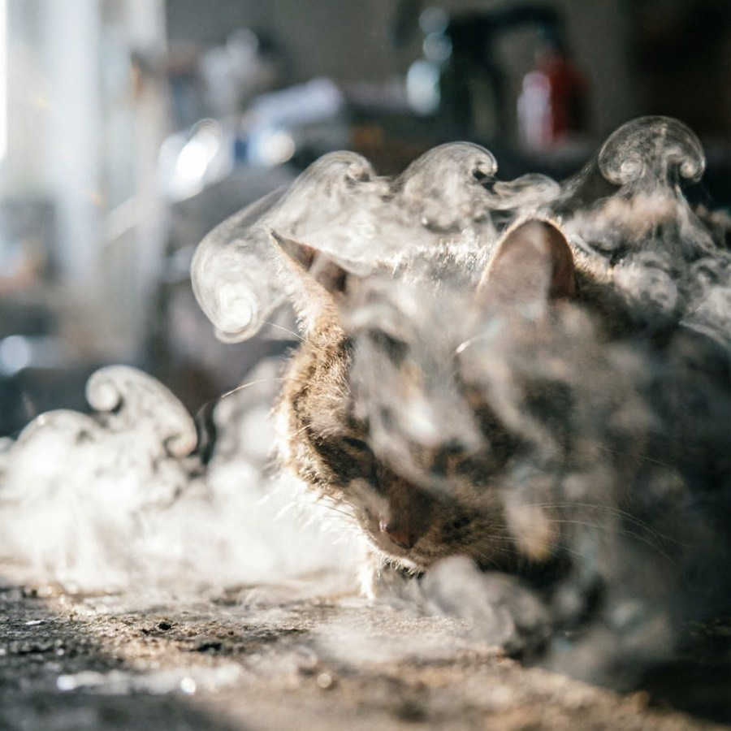</div>

**Details**
- Category: Portrait & Avatar
- Aspect Ratio: 16:9
- Prompt Language: en

**[👉 Try this prompt](https://gola.apimart.ai/k-ZltbL1)**

---

#### No. 26: Editorial Studio Portrait

**Description** — A portrait & avatar prompt tuned for Qwen-Image 2.1 — bilingual text rendering and Asian aesthetics.

**Prompt**

```text
editorial studio portrait, soft window light, top-down flat lay, 4:3 composition, highly detailed, professional quality
```

**Generated Images**

<div align="center">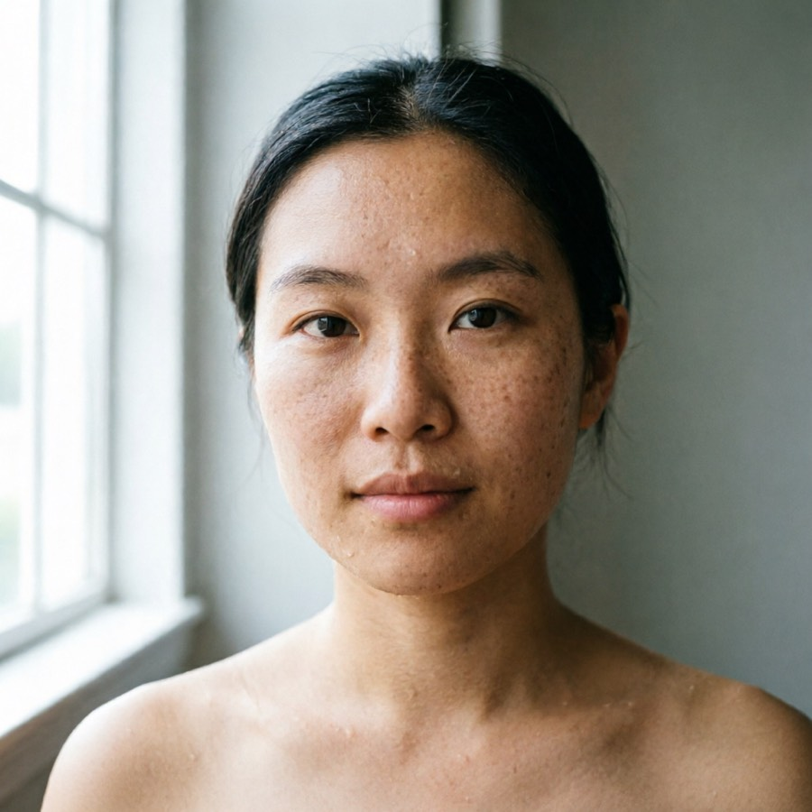</div>

**Details**
- Category: Portrait & Avatar
- Aspect Ratio: 4:3
- Prompt Language: en

**[👉 Try this prompt](https://gola.apimart.ai/k-ZltbL1)**

---

#### No. 27: Candid Street Portrait

**Description** — A portrait & avatar prompt tuned for Qwen-Image 2.1 — bilingual text rendering and Asian aesthetics.

**Prompt**

```text
candid street portrait, hard directional key light with subtle fill, wide angle, architectural composition, 1:1 composition, highly detailed, professional quality
```

**Generated Images**

<div align="center">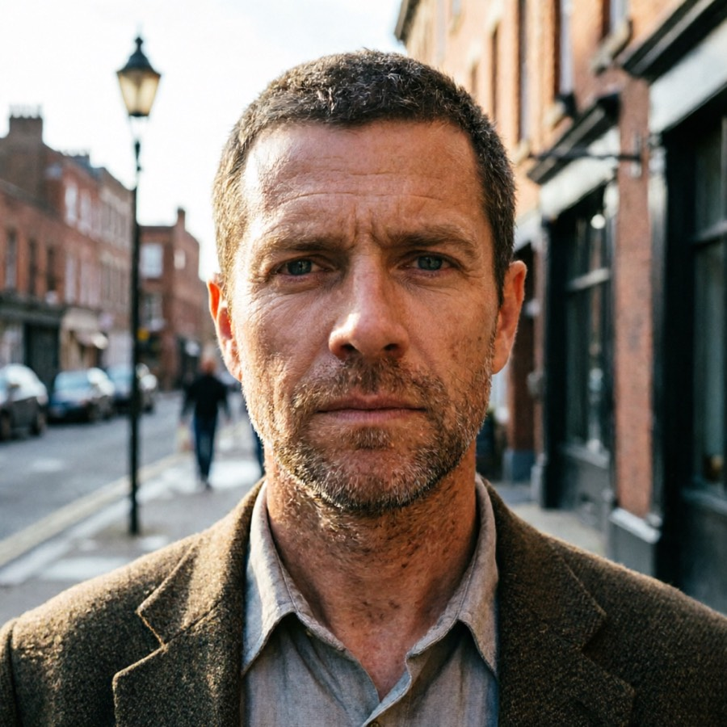</div>

**Details**
- Category: Portrait & Avatar
- Aspect Ratio: 1:1
- Prompt Language: en

**[👉 Try this prompt](https://gola.apimart.ai/k-ZltbL1)**

---

#### No. 28: Corporate Headshot

**Description** — A portrait & avatar prompt tuned for Qwen-Image 2.1 — bilingual text rendering and Asian aesthetics.

**Prompt**

```text
corporate headshot, golden hour backlight, 85mm lens, shallow depth of field, 3:4 composition, highly detailed, professional quality
```

**Generated Images**

<div align="center">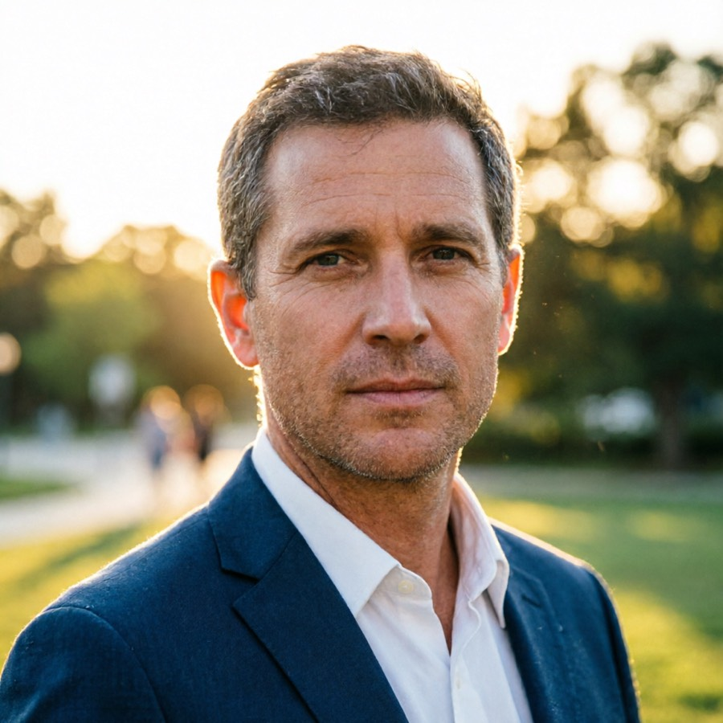</div>

**Details**
- Category: Portrait & Avatar
- Aspect Ratio: 3:4
- Prompt Language: en

**[👉 Try this prompt](https://gola.apimart.ai/k-ZltbL1)**

---

### Product & E-commerce

#### No. 29: Matte Ceramic Bottle

**Description** — A product & e-commerce prompt tuned for Qwen-Image 2.1 — bilingual text rendering and Asian aesthetics.

**Prompt**

```text
matte ceramic bottle, golden hour backlight, wide angle, architectural composition, 16:9 composition, highly detailed, professional quality
```

**Generated Images**

<div align="center">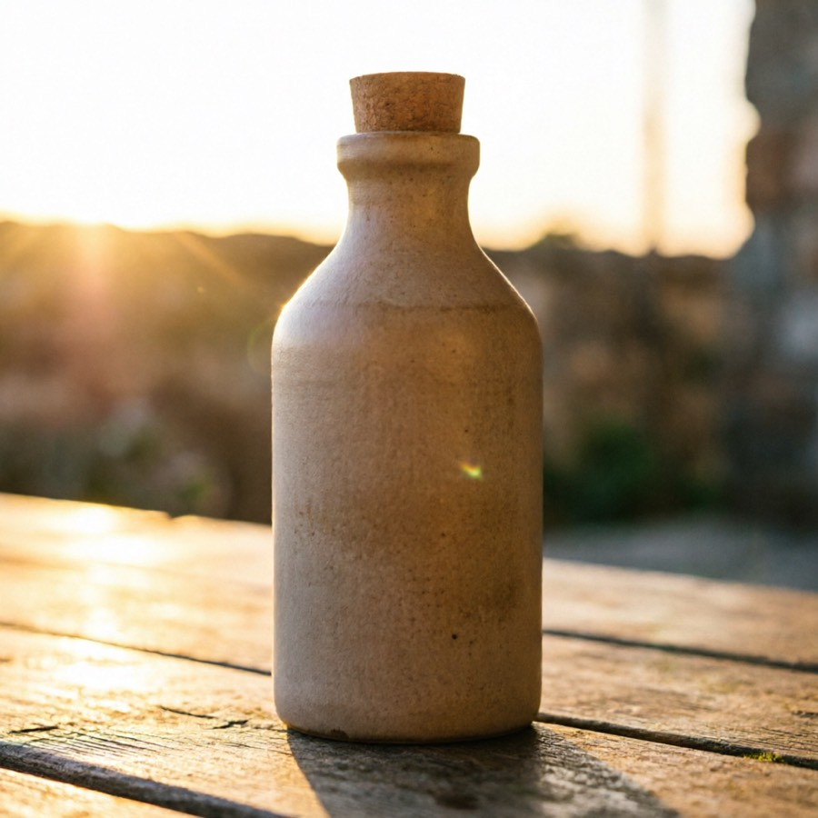</div>

**Details**
- Category: Product & E-commerce
- Aspect Ratio: 16:9
- Prompt Language: en

**[👉 Try this prompt](https://gola.apimart.ai/k-ZltbL1)**

---

#### No. 30: Floating Sneaker

**Description** — A product & e-commerce prompt tuned for Qwen-Image 2.1 — bilingual text rendering and Asian aesthetics.

**Prompt**

```text
floating sneaker, moody low-key lighting, 85mm lens, shallow depth of field, 4:3 composition, highly detailed, professional quality
```

**Generated Images**

<div align="center">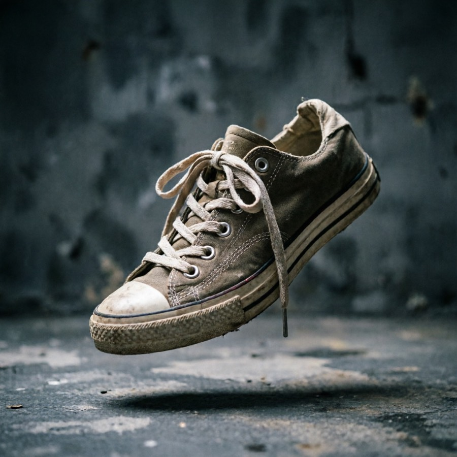</div>

**Details**
- Category: Product & E-commerce
- Aspect Ratio: 4:3
- Prompt Language: en

**[👉 Try this prompt](https://gola.apimart.ai/k-ZltbL1)**

---

#### No. 31: Glass Perfume Flacon

**Description** — A product & e-commerce prompt tuned for Qwen-Image 2.1 — bilingual text rendering and Asian aesthetics.

**Prompt**

```text
glass perfume flacon, even diffused studio light, 85mm lens, shallow depth of field, 1:1 composition, highly detailed, professional quality
```

**Generated Images**

<div align="center">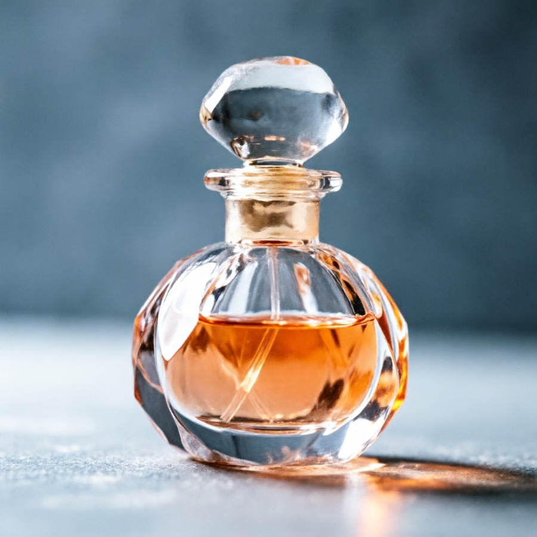</div>

**Details**
- Category: Product & E-commerce
- Aspect Ratio: 1:1
- Prompt Language: en

**[👉 Try this prompt](https://gola.apimart.ai/k-ZltbL1)**

---

#### No. 32: Minimal Skincare Set

**Description** — A product & e-commerce prompt tuned for Qwen-Image 2.1 — bilingual text rendering and Asian aesthetics.

**Prompt**

```text
minimal skincare set, volumetric fog with rim light, wide angle, architectural composition, 3:4 composition, highly detailed, professional quality
```

**Generated Images**

<div align="center">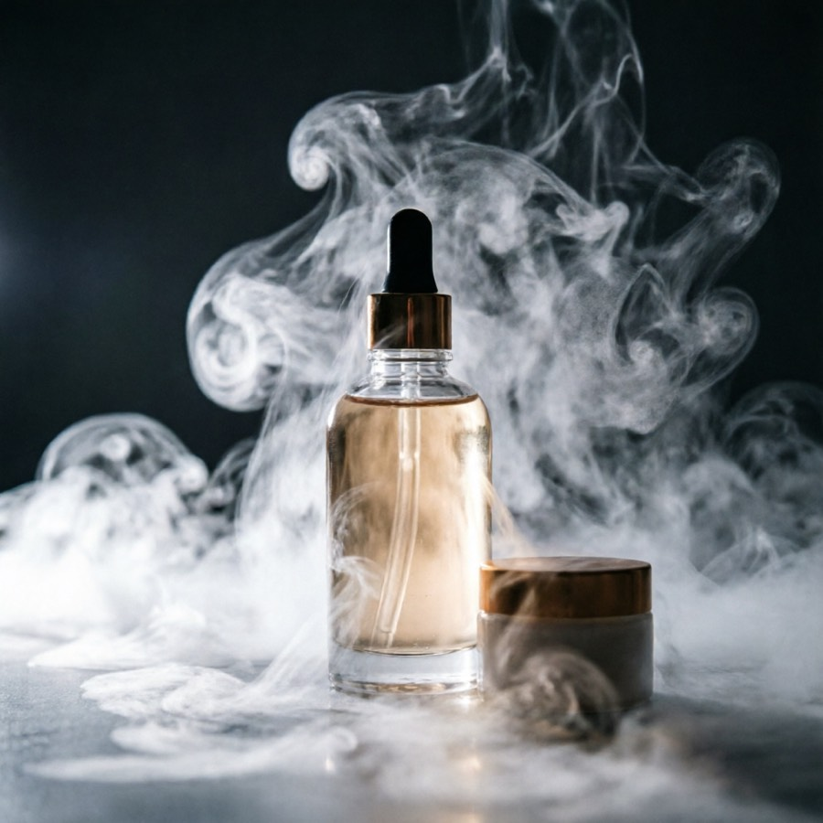</div>

**Details**
- Category: Product & E-commerce
- Aspect Ratio: 3:4
- Prompt Language: en

**[👉 Try this prompt](https://gola.apimart.ai/k-ZltbL1)**

---

#### No. 33: Premium Coffee Packaging

**Description** — A product & e-commerce prompt tuned for Qwen-Image 2.1 — bilingual text rendering and Asian aesthetics.

**Prompt**

```text
premium coffee packaging, soft window light, wide angle, architectural composition, 4:5 composition, highly detailed, professional quality
```

**Generated Images**

<div align="center">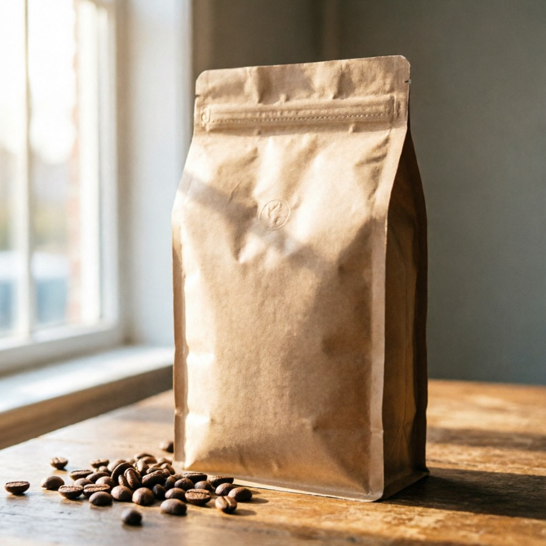</div>

**Details**
- Category: Product & E-commerce
- Aspect Ratio: 4:5
- Prompt Language: en

**[👉 Try this prompt](https://gola.apimart.ai/k-ZltbL1)**

---

#### No. 34: Matte Ceramic Bottle

**Description** — A product & e-commerce prompt tuned for Qwen-Image 2.1 — bilingual text rendering and Asian aesthetics.

**Prompt**

```text
matte ceramic bottle, hard directional key light with subtle fill, 85mm lens, shallow depth of field, 2:3 composition, highly detailed, professional quality
```

**Generated Images**

<div align="center">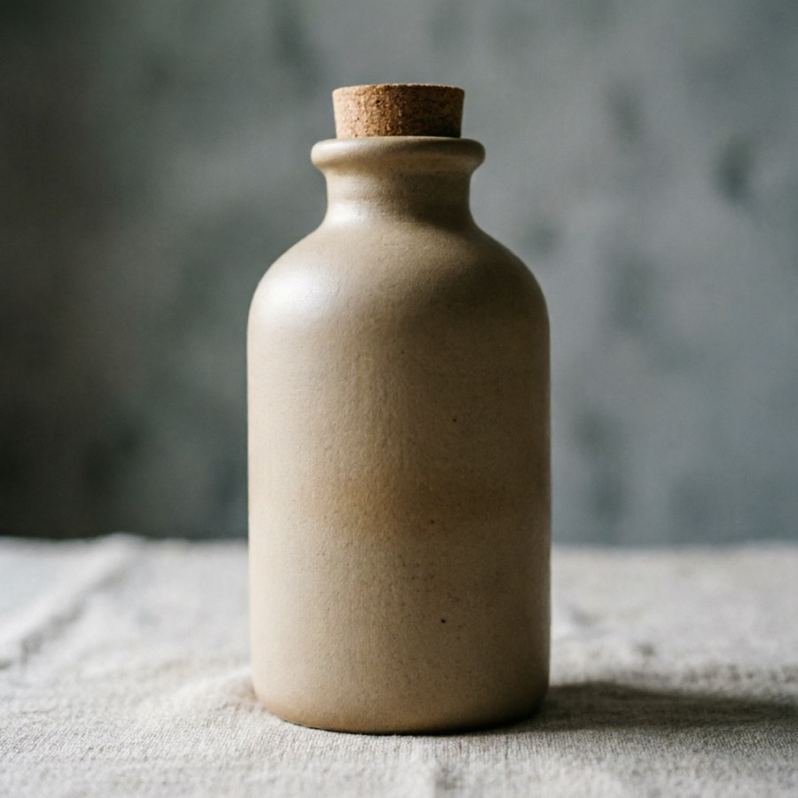</div>

**Details**
- Category: Product & E-commerce
- Aspect Ratio: 2:3
- Prompt Language: en

**[👉 Try this prompt](https://gola.apimart.ai/k-ZltbL1)**

---

#### No. 35: Floating Sneaker

**Description** — A product & e-commerce prompt tuned for Qwen-Image 2.1 — bilingual text rendering and Asian aesthetics.

**Prompt**

```text
floating sneaker, golden hour backlight, isometric 3D render look, 16:9 composition, highly detailed, professional quality
```

**Generated Images**

<div align="center">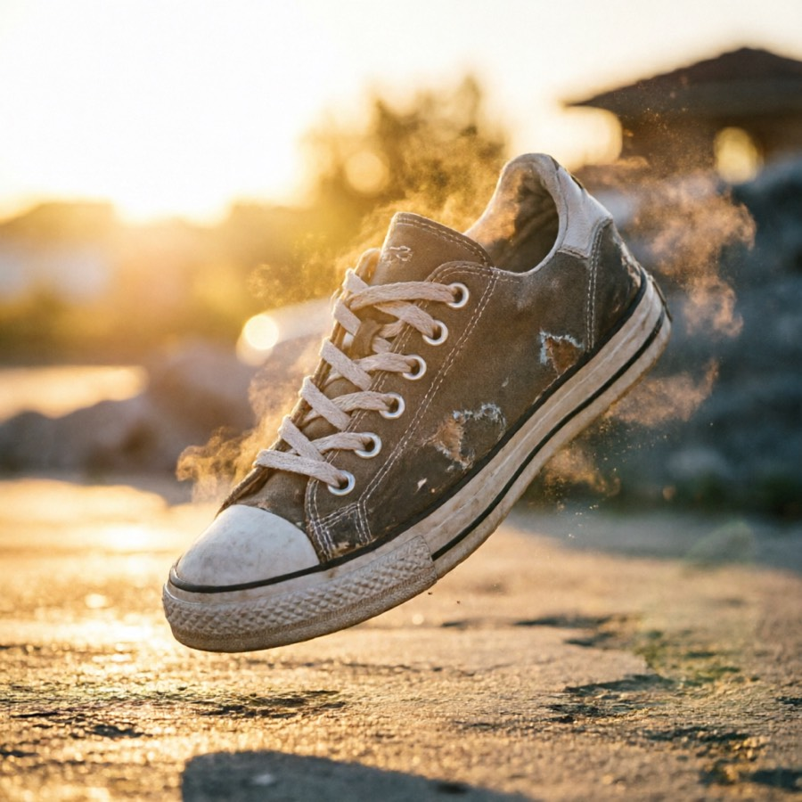</div>

**Details**
- Category: Product & E-commerce
- Aspect Ratio: 16:9
- Prompt Language: en

**[👉 Try this prompt](https://gola.apimart.ai/k-ZltbL1)**

---

#### No. 36: Glass Perfume Flacon

**Description** — A product & e-commerce prompt tuned for Qwen-Image 2.1 — bilingual text rendering and Asian aesthetics.

**Prompt**

```text
glass perfume flacon, moody low-key lighting, isometric 3D render look, 4:3 composition, highly detailed, professional quality
```

**Generated Images**

<div align="center">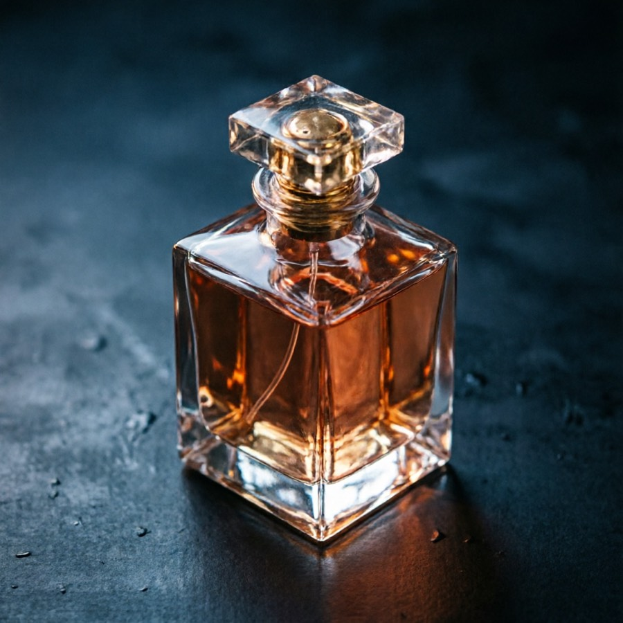</div>

**Details**
- Category: Product & E-commerce
- Aspect Ratio: 4:3
- Prompt Language: en

**[👉 Try this prompt](https://gola.apimart.ai/k-ZltbL1)**

---

#### No. 37: Minimal Skincare Set

**Description** — A product & e-commerce prompt tuned for Qwen-Image 2.1 — bilingual text rendering and Asian aesthetics.

**Prompt**

```text
minimal skincare set, even diffused studio light, 85mm lens, shallow depth of field, 1:1 composition, highly detailed, professional quality
```

**Generated Images**

<div align="center">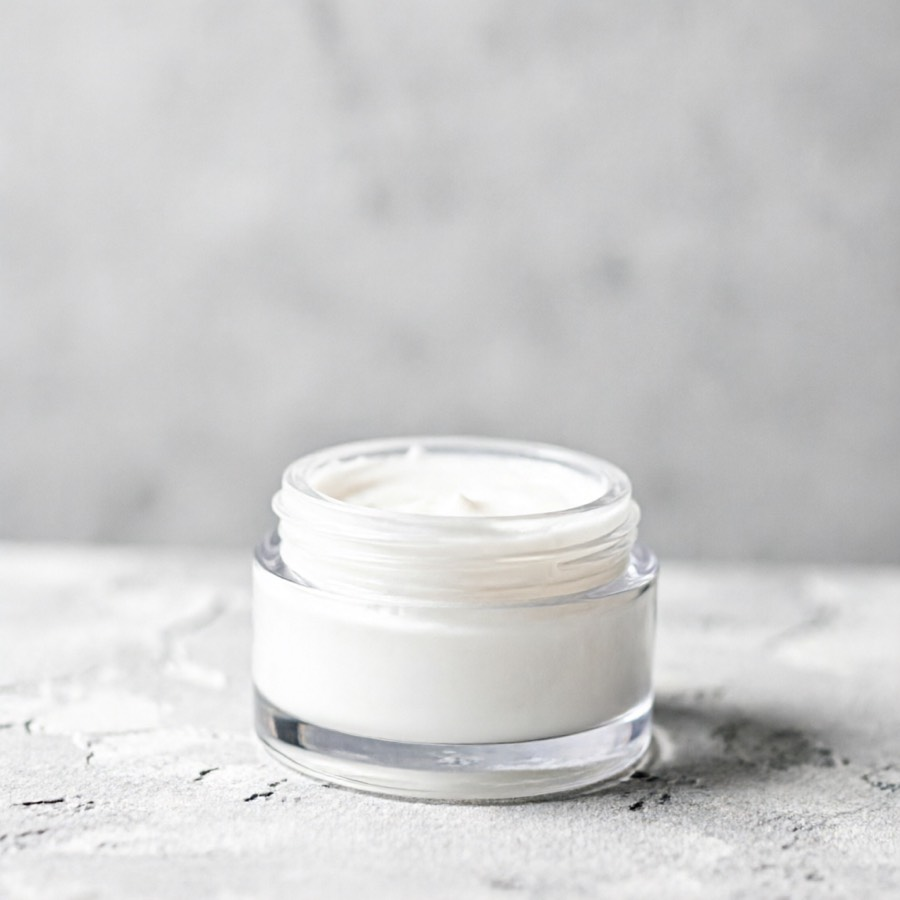</div>

**Details**
- Category: Product & E-commerce
- Aspect Ratio: 1:1
- Prompt Language: en

**[👉 Try this prompt](https://gola.apimart.ai/k-ZltbL1)**

---

#### No. 38: Premium Coffee Packaging

**Description** — A product & e-commerce prompt tuned for Qwen-Image 2.1 — bilingual text rendering and Asian aesthetics.

**Prompt**

```text
premium coffee packaging, volumetric fog with rim light, 85mm lens, shallow depth of field, 3:4 composition, highly detailed, professional quality
```

**Generated Images**

<div align="center">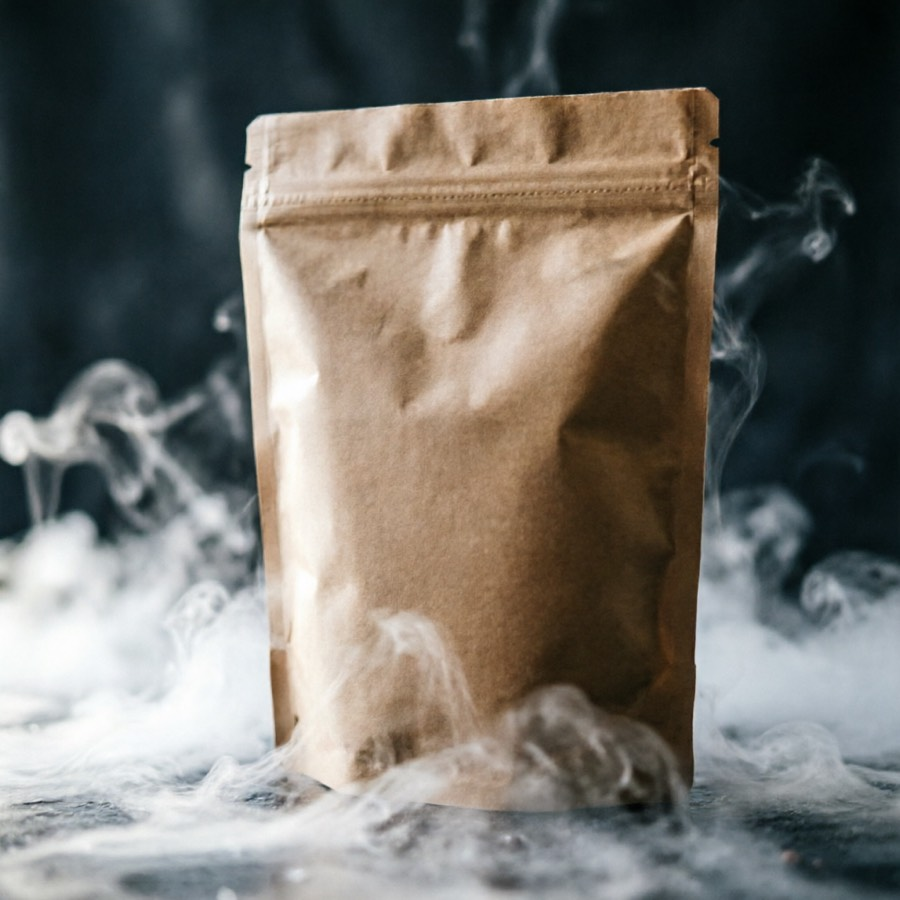</div>

**Details**
- Category: Product & E-commerce
- Aspect Ratio: 3:4
- Prompt Language: en

**[👉 Try this prompt](https://gola.apimart.ai/k-ZltbL1)**

---

#### No. 39: Matte Ceramic Bottle

**Description** — A product & e-commerce prompt tuned for Qwen-Image 2.1 — bilingual text rendering and Asian aesthetics.

**Prompt**

```text
matte ceramic bottle, soft window light, isometric 3D render look, 4:5 composition, highly detailed, professional quality
```

**Generated Images**

<div align="center">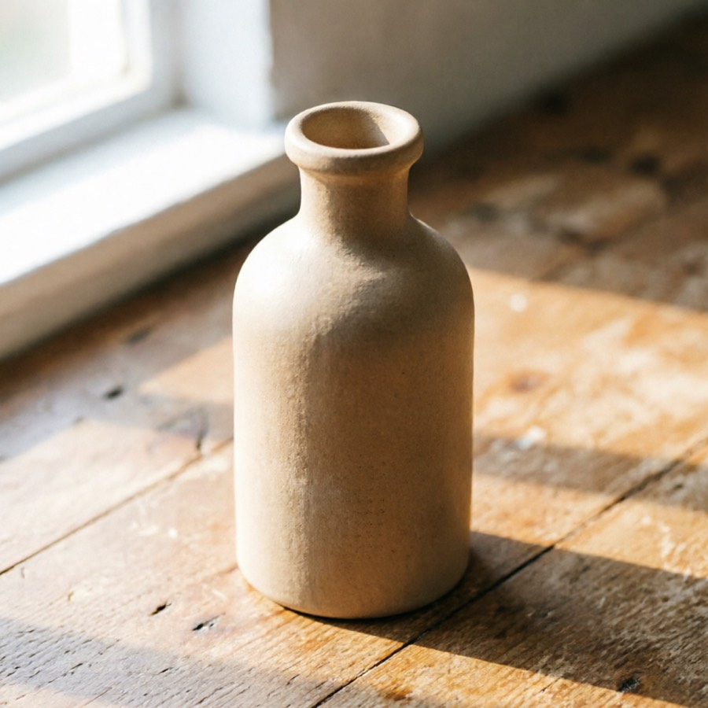</div>

**Details**
- Category: Product & E-commerce
- Aspect Ratio: 4:5
- Prompt Language: en

**[👉 Try this prompt](https://gola.apimart.ai/k-ZltbL1)**

---

#### No. 40: Floating Sneaker

**Description** — A product & e-commerce prompt tuned for Qwen-Image 2.1 — bilingual text rendering and Asian aesthetics.

**Prompt**

```text
floating sneaker, hard directional key light with subtle fill, wide angle, architectural composition, 2:3 composition, highly detailed, professional quality
```

**Generated Images**

<div align="center">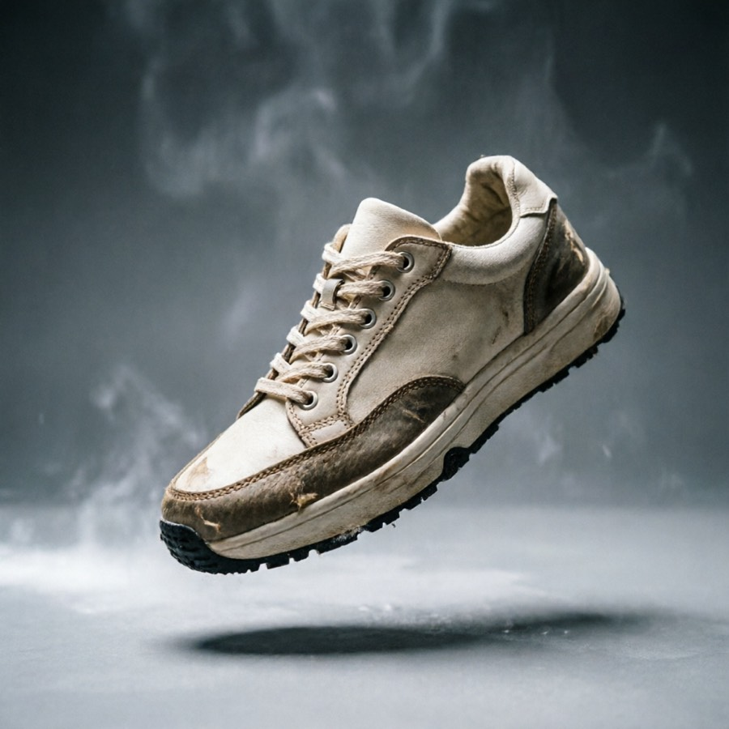</div>

**Details**
- Category: Product & E-commerce
- Aspect Ratio: 2:3
- Prompt Language: en

**[👉 Try this prompt](https://gola.apimart.ai/k-ZltbL1)**

---

#### No. 41: Glass Perfume Flacon

**Description** — A product & e-commerce prompt tuned for Qwen-Image 2.1 — bilingual text rendering and Asian aesthetics.

**Prompt**

```text
glass perfume flacon, golden hour backlight, wide angle, architectural composition, 16:9 composition, highly detailed, professional quality
```

**Generated Images**

<div align="center">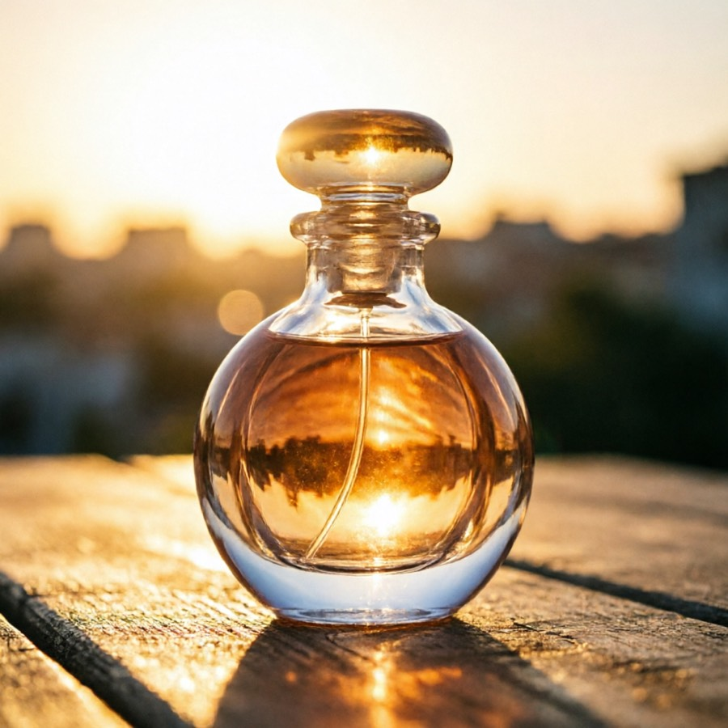</div>

**Details**
- Category: Product & E-commerce
- Aspect Ratio: 16:9
- Prompt Language: en

**[👉 Try this prompt](https://gola.apimart.ai/k-ZltbL1)**

---

#### No. 42: Minimal Skincare Set

**Description** — A product & e-commerce prompt tuned for Qwen-Image 2.1 — bilingual text rendering and Asian aesthetics.

**Prompt**

```text
minimal skincare set, moody low-key lighting, isometric 3D render look, 4:3 composition, highly detailed, professional quality
```

**Generated Images**

<div align="center">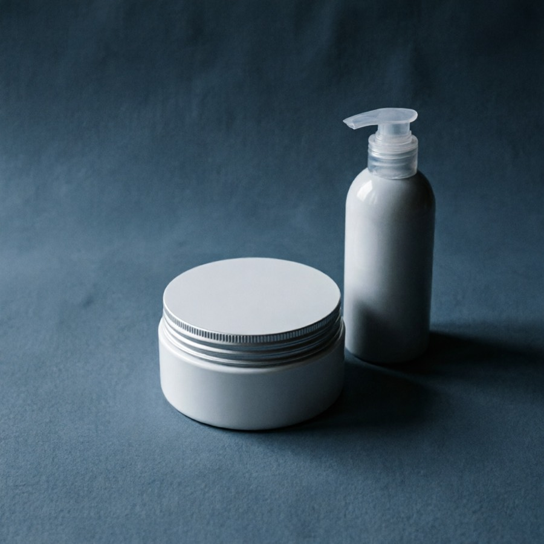</div>

**Details**
- Category: Product & E-commerce
- Aspect Ratio: 4:3
- Prompt Language: en

**[👉 Try this prompt](https://gola.apimart.ai/k-ZltbL1)**

---

#### No. 43: Premium Coffee Packaging

**Description** — A product & e-commerce prompt tuned for Qwen-Image 2.1 — bilingual text rendering and Asian aesthetics.

**Prompt**

```text
premium coffee packaging, even diffused studio light, isometric 3D render look, 1:1 composition, highly detailed, professional quality
```

**Generated Images**

<div align="center">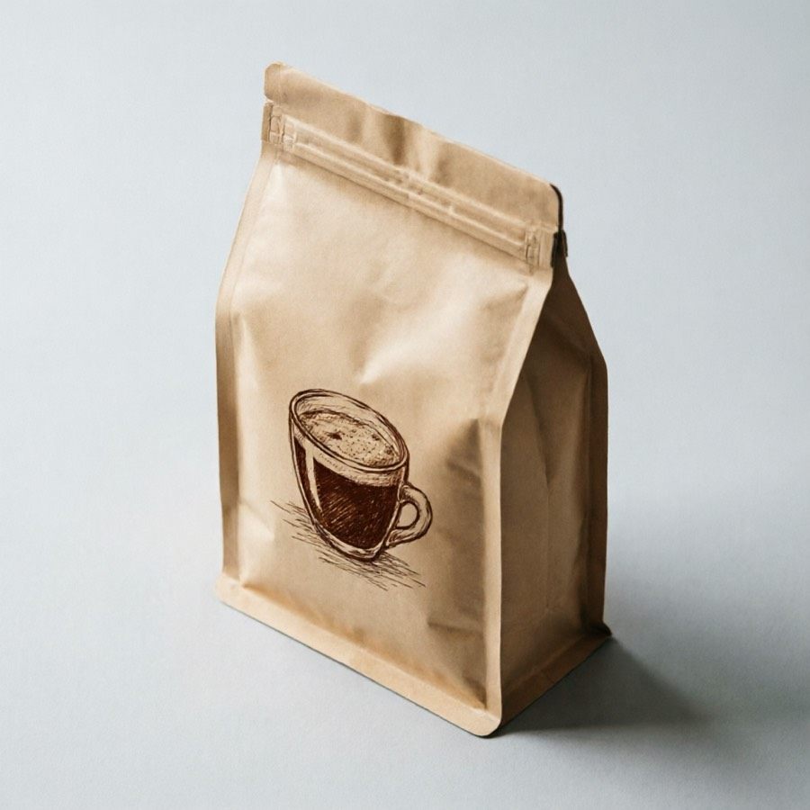</div>

**Details**
- Category: Product & E-commerce
- Aspect Ratio: 1:1
- Prompt Language: en

**[👉 Try this prompt](https://gola.apimart.ai/k-ZltbL1)**

---

#### No. 44: Matte Ceramic Bottle

**Description** — A product & e-commerce prompt tuned for Qwen-Image 2.1 — bilingual text rendering and Asian aesthetics.

**Prompt**

```text
matte ceramic bottle, volumetric fog with rim light, wide angle, architectural composition, 3:4 composition, highly detailed, professional quality
```

**Generated Images**

<div align="center">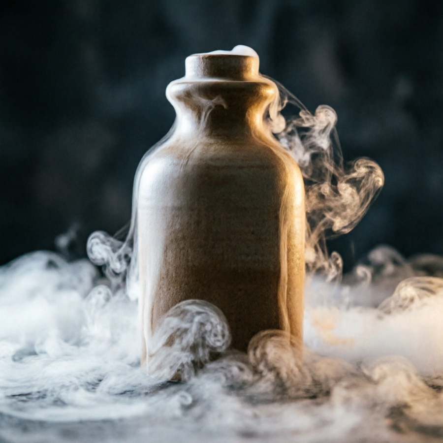</div>

**Details**
- Category: Product & E-commerce
- Aspect Ratio: 3:4
- Prompt Language: en

**[👉 Try this prompt](https://gola.apimart.ai/k-ZltbL1)**

---

#### No. 45: Floating Sneaker

**Description** — A product & e-commerce prompt tuned for Qwen-Image 2.1 — bilingual text rendering and Asian aesthetics.

**Prompt**

```text
floating sneaker, soft window light, 85mm lens, shallow depth of field, 4:5 composition, highly detailed, professional quality
```

**Generated Images**

<div align="center">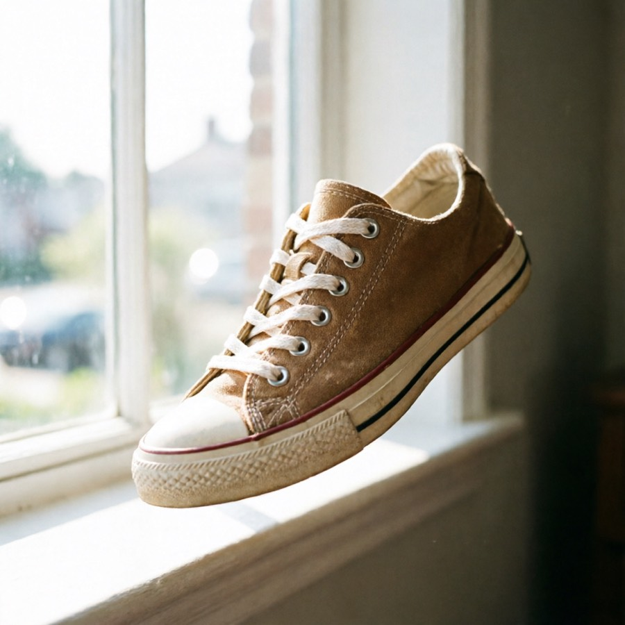</div>

**Details**
- Category: Product & E-commerce
- Aspect Ratio: 4:5
- Prompt Language: en

**[👉 Try this prompt](https://gola.apimart.ai/k-ZltbL1)**

---

#### No. 46: Glass Perfume Flacon

**Description** — A product & e-commerce prompt tuned for Qwen-Image 2.1 — bilingual text rendering and Asian aesthetics.

**Prompt**

```text
glass perfume flacon, hard directional key light with subtle fill, 85mm lens, shallow depth of field, 2:3 composition, highly detailed, professional quality
```

**Generated Images**

<div align="center">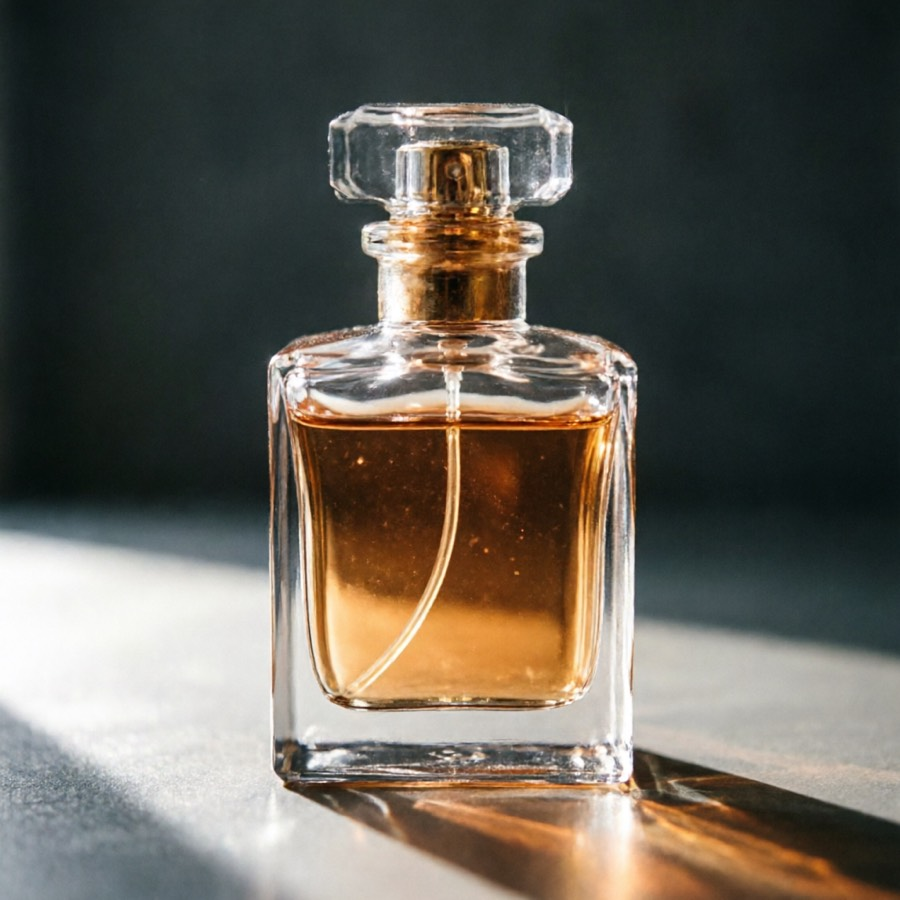</div>

**Details**
- Category: Product & E-commerce
- Aspect Ratio: 2:3
- Prompt Language: en

**[👉 Try this prompt](https://gola.apimart.ai/k-ZltbL1)**

---

#### No. 47: Minimal Skincare Set

**Description** — A product & e-commerce prompt tuned for Qwen-Image 2.1 — bilingual text rendering and Asian aesthetics.

**Prompt**

```text
minimal skincare set, golden hour backlight, wide angle, architectural composition, 16:9 composition, highly detailed, professional quality
```

**Generated Images**

<div align="center">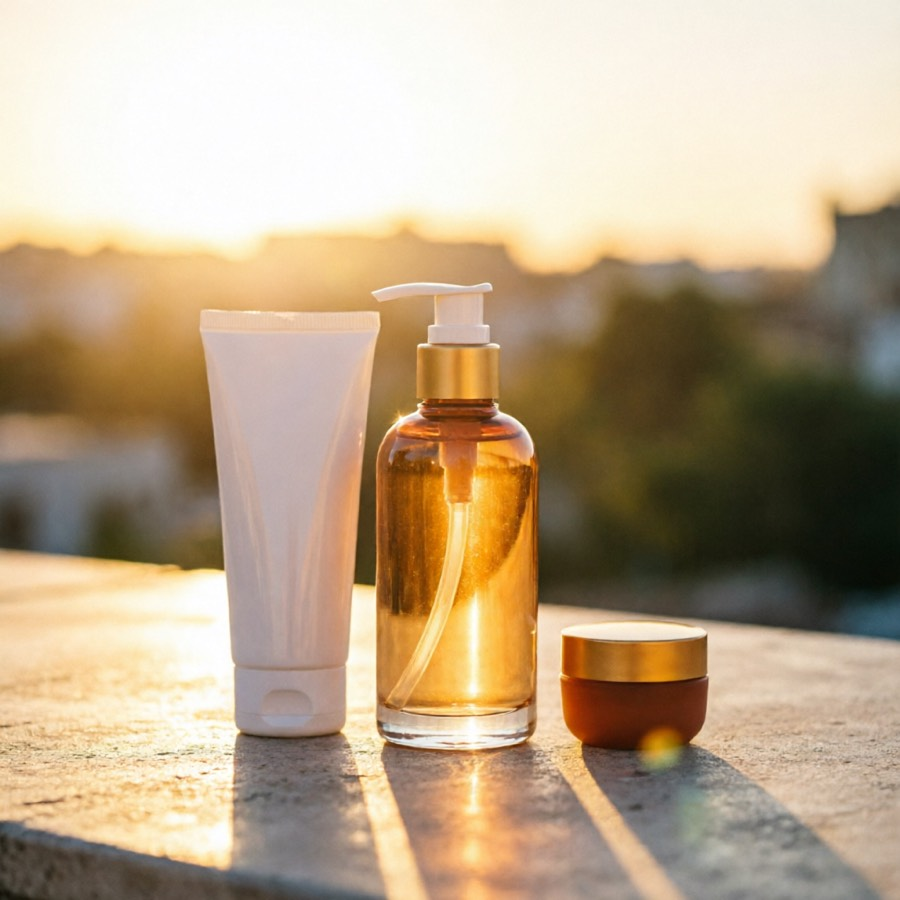</div>

**Details**
- Category: Product & E-commerce
- Aspect Ratio: 16:9
- Prompt Language: en

**[👉 Try this prompt](https://gola.apimart.ai/k-ZltbL1)**

---

#### No. 48: Premium Coffee Packaging

**Description** — A product & e-commerce prompt tuned for Qwen-Image 2.1 — bilingual text rendering and Asian aesthetics.

**Prompt**

```text
premium coffee packaging, moody low-key lighting, wide angle, architectural composition, 4:3 composition, highly detailed, professional quality
```

**Generated Images**

<div align="center">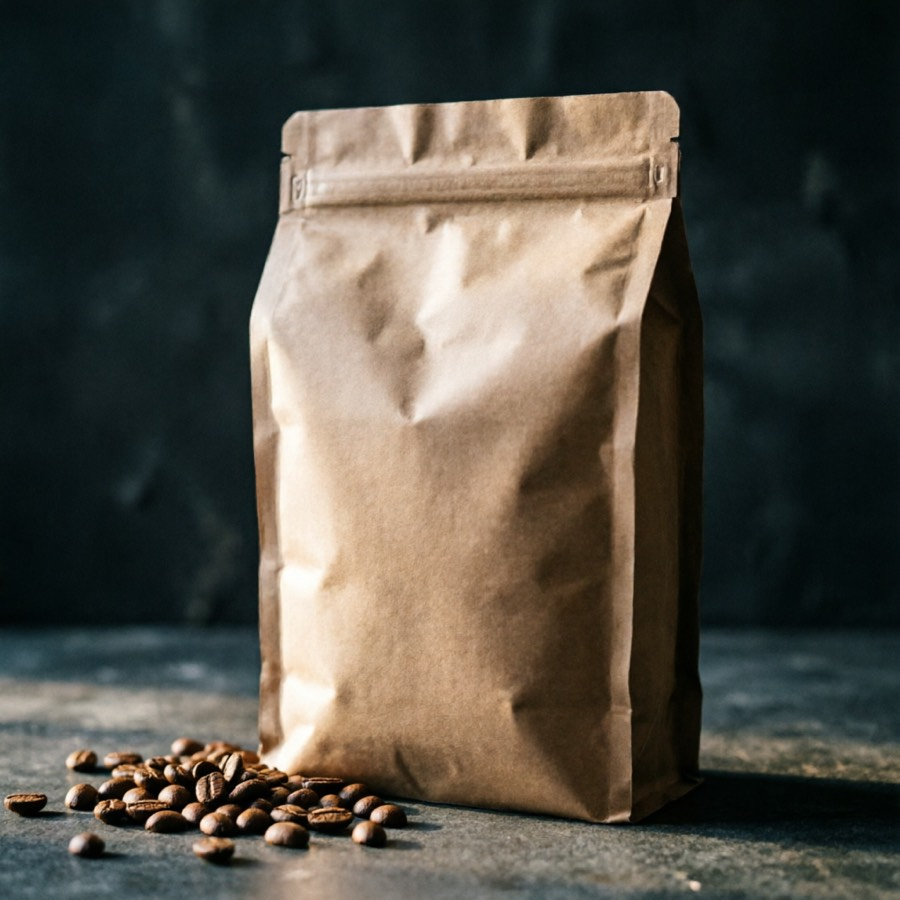</div>

**Details**
- Category: Product & E-commerce
- Aspect Ratio: 4:3
- Prompt Language: en

**[👉 Try this prompt](https://gola.apimart.ai/k-ZltbL1)**

---

#### No. 49: Matte Ceramic Bottle

**Description** — A product & e-commerce prompt tuned for Qwen-Image 2.1 — bilingual text rendering and Asian aesthetics.

**Prompt**

```text
matte ceramic bottle, even diffused studio light, 85mm lens, shallow depth of field, 1:1 composition, highly detailed, professional quality
```

**Generated Images**

<div align="center">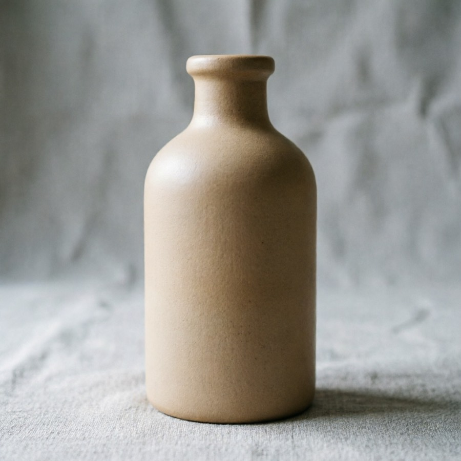</div>

**Details**
- Category: Product & E-commerce
- Aspect Ratio: 1:1
- Prompt Language: en

**[👉 Try this prompt](https://gola.apimart.ai/k-ZltbL1)**

---

#### No. 50: Floating Sneaker

**Description** — A product & e-commerce prompt tuned for Qwen-Image 2.1 — bilingual text rendering and Asian aesthetics.

**Prompt**

```text
floating sneaker, volumetric fog with rim light, isometric 3D render look, 3:4 composition, highly detailed, professional quality
```

**Generated Images**

<div align="center">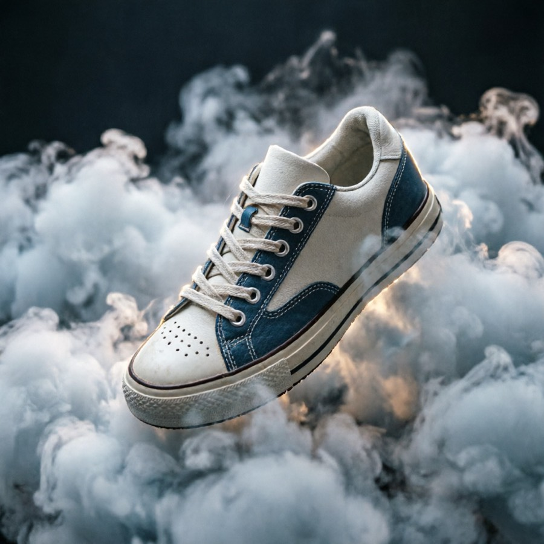</div>

**Details**
- Category: Product & E-commerce
- Aspect Ratio: 3:4
- Prompt Language: en

**[👉 Try this prompt](https://gola.apimart.ai/k-ZltbL1)**

---

#### No. 51: Glass Perfume Flacon

**Description** — A product & e-commerce prompt tuned for Qwen-Image 2.1 — bilingual text rendering and Asian aesthetics.

**Prompt**

```text
glass perfume flacon, soft window light, isometric 3D render look, 4:5 composition, highly detailed, professional quality
```

**Generated Images**

<div align="center">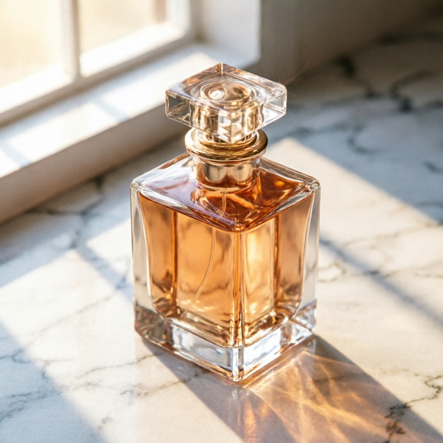</div>

**Details**
- Category: Product & E-commerce
- Aspect Ratio: 4:5
- Prompt Language: en

**[👉 Try this prompt](https://gola.apimart.ai/k-ZltbL1)**

---

#### No. 52: Minimal Skincare Set

**Description** — A product & e-commerce prompt tuned for Qwen-Image 2.1 — bilingual text rendering and Asian aesthetics.

**Prompt**

```text
minimal skincare set, hard directional key light with subtle fill, 85mm lens, shallow depth of field, 2:3 composition, highly detailed, professional quality
```

**Generated Images**

<div align="center"></div>

**Details**
- Category: Product & E-commerce
- Aspect Ratio: 2:3
- Prompt Language: en

**[👉 Try this prompt](https://gola.apimart.ai/k-ZltbL1)**

---

#### No. 53: Premium Coffee Packaging

**Description** — A product & e-commerce prompt tuned for Qwen-Image 2.1 — bilingual text rendering and Asian aesthetics.

**Prompt**

```text
premium coffee packaging, golden hour backlight, 85mm lens, shallow depth of field, 16:9 composition, highly detailed, professional quality
```

**Generated Images**

<div align="center"></div>

**Details**
- Category: Product & E-commerce
- Aspect Ratio: 16:9
- Prompt Language: en

**[👉 Try this prompt](https://gola.apimart.ai/k-ZltbL1)**

---

#### No. 54: Matte Ceramic Bottle

**Description** — A product & e-commerce prompt tuned for Qwen-Image 2.1 — bilingual text rendering and Asian aesthetics.

**Prompt**

```text
matte ceramic bottle, moody low-key lighting, isometric 3D render look, 4:3 composition, highly detailed, professional quality
```

**Generated Images**

<div align="center"></div>

**Details**
- Category: Product & E-commerce
- Aspect Ratio: 4:3
- Prompt Language: en

**[👉 Try this prompt](https://gola.apimart.ai/k-ZltbL1)**

---

#### No. 55: Floating Sneaker

**Description** — A product & e-commerce prompt tuned for Qwen-Image 2.1 — bilingual text rendering and Asian aesthetics.

**Prompt**

```text
floating sneaker, even diffused studio light, wide angle, architectural composition, 1:1 composition, highly detailed, professional quality
```

**Generated Images**

<div align="center"></div>

**Details**
- Category: Product & E-commerce
- Aspect Ratio: 1:1
- Prompt Language: en

**[👉 Try this prompt](https://gola.apimart.ai/k-ZltbL1)**

---

#### No. 56: Glass Perfume Flacon

**Description** — A product & e-commerce prompt tuned for Qwen-Image 2.1 — bilingual text rendering and Asian aesthetics.

**Prompt**

```text
glass perfume flacon, volumetric fog with rim light, wide angle, architectural composition, 3:4 composition, highly detailed, professional quality
```

**Generated Images**

<div align="center"></div>

**Details**
- Category: Product & E-commerce
- Aspect Ratio: 3:4
- Prompt Language: en

**[👉 Try this prompt](https://gola.apimart.ai/k-ZltbL1)**

---

### Poster & Typography

#### No. 57: Swiss-Style Exhibition Poster

**Description** — A poster & typography prompt tuned for Qwen-Image 2.1 — bilingual text rendering and Asian aesthetics.

**Prompt**

```text
swiss-style exhibition poster, hard directional key light with subtle fill, film grain, analog color science, 16:9 composition, highly detailed, professional quality
```

**Generated Images**

<div align="center"></div>

**Details**
- Category: Poster & Typography
- Aspect Ratio: 16:9
- Prompt Language: en

**[👉 Try this prompt](https://gola.apimart.ai/k-ZltbL1)**

---

#### No. 58: Risograph Concert Poster

**Description** — A poster & typography prompt tuned for Qwen-Image 2.1 — bilingual text rendering and Asian aesthetics.

**Prompt**

```text
risograph concert poster, golden hour backlight, wide angle, architectural composition, 4:3 composition, highly detailed, professional quality
```

**Generated Images**

<div align="center"></div>

**Details**
- Category: Poster & Typography
- Aspect Ratio: 4:3
- Prompt Language: en

**[👉 Try this prompt](https://gola.apimart.ai/k-ZltbL1)**

---

#### No. 59: Bold Typographic Movie Key Art

**Description** — A poster & typography prompt tuned for Qwen-Image 2.1 — bilingual text rendering and Asian aesthetics.

**Prompt**

```text
bold typographic movie key art, moody low-key lighting, isometric 3D render look, 1:1 composition, highly detailed, professional quality
```

**Generated Images**

<div align="center"></div>

**Details**
- Category: Poster & Typography
- Aspect Ratio: 1:1
- Prompt Language: en

**[👉 Try this prompt](https://gola.apimart.ai/k-ZltbL1)**

---

#### No. 60: Minimal Travel Poster

**Description** — A poster & typography prompt tuned for Qwen-Image 2.1 — bilingual text rendering and Asian aesthetics.

**Prompt**

```text
minimal travel poster, even diffused studio light, top-down flat lay, 3:4 composition, highly detailed, professional quality
```

**Generated Images**

<div align="center"></div>

**Details**
- Category: Poster & Typography
- Aspect Ratio: 3:4
- Prompt Language: en

**[👉 Try this prompt](https://gola.apimart.ai/k-ZltbL1)**

---

#### No. 61: Vintage Book Cover

**Description** — A poster & typography prompt tuned for Qwen-Image 2.1 — bilingual text rendering and Asian aesthetics.

**Prompt**

```text
vintage book cover, volumetric fog with rim light, wide angle, architectural composition, 4:5 composition, highly detailed, professional quality
```

**Generated Images**

<div align="center"></div>

**Details**
- Category: Poster & Typography
- Aspect Ratio: 4:5
- Prompt Language: en

**[👉 Try this prompt](https://gola.apimart.ai/k-ZltbL1)**

---

#### No. 62: Swiss-Style Exhibition Poster

**Description** — A poster & typography prompt tuned for Qwen-Image 2.1 — bilingual text rendering and Asian aesthetics.

**Prompt**

```text
swiss-style exhibition poster, soft window light, top-down flat lay, 2:3 composition, highly detailed, professional quality
```

**Generated Images**

<div align="center"></div>

**Details**
- Category: Poster & Typography
- Aspect Ratio: 2:3
- Prompt Language: en

**[👉 Try this prompt](https://gola.apimart.ai/k-ZltbL1)**

---

#### No. 63: Risograph Concert Poster

**Description** — A poster & typography prompt tuned for Qwen-Image 2.1 — bilingual text rendering and Asian aesthetics.

**Prompt**

```text
risograph concert poster, hard directional key light with subtle fill, 85mm lens, shallow depth of field, 16:9 composition, highly detailed, professional quality
```

**Generated Images**

<div align="center"></div>

**Details**
- Category: Poster & Typography
- Aspect Ratio: 16:9
- Prompt Language: en

**[👉 Try this prompt](https://gola.apimart.ai/k-ZltbL1)**

---

#### No. 64: Bold Typographic Movie Key Art

**Description** — A poster & typography prompt tuned for Qwen-Image 2.1 — bilingual text rendering and Asian aesthetics.

**Prompt**

```text
bold typographic movie key art, golden hour backlight, wide angle, architectural composition, 4:3 composition, highly detailed, professional quality
```

**Generated Images**

<div align="center"></div>

**Details**
- Category: Poster & Typography
- Aspect Ratio: 4:3
- Prompt Language: en

**[👉 Try this prompt](https://gola.apimart.ai/k-ZltbL1)**

---

#### No. 65: Minimal Travel Poster

**Description** — A poster & typography prompt tuned for Qwen-Image 2.1 — bilingual text rendering and Asian aesthetics.

**Prompt**

```text
minimal travel poster, moody low-key lighting, 100mm macro, commercial product photography, 1:1 composition, highly detailed, professional quality
```

**Generated Images**

<div align="center"></div>

**Details**
- Category: Poster & Typography
- Aspect Ratio: 1:1
- Prompt Language: en

**[👉 Try this prompt](https://gola.apimart.ai/k-ZltbL1)**

---

#### No. 66: Vintage Book Cover

**Description** — A poster & typography prompt tuned for Qwen-Image 2.1 — bilingual text rendering and Asian aesthetics.

**Prompt**

```text
vintage book cover, even diffused studio light, 85mm lens, shallow depth of field, 3:4 composition, highly detailed, professional quality
```

**Generated Images**

<div align="center"></div>

**Details**
- Category: Poster & Typography
- Aspect Ratio: 3:4
- Prompt Language: en

**[👉 Try this prompt](https://gola.apimart.ai/k-ZltbL1)**

---

#### No. 67: Swiss-Style Exhibition Poster

**Description** — A poster & typography prompt tuned for Qwen-Image 2.1 — bilingual text rendering and Asian aesthetics.

**Prompt**

```text
swiss-style exhibition poster, volumetric fog with rim light, 100mm macro, commercial product photography, 4:5 composition, highly detailed, professional quality
```

**Generated Images**

<div align="center"></div>

**Details**
- Category: Poster & Typography
- Aspect Ratio: 4:5
- Prompt Language: en

**[👉 Try this prompt](https://gola.apimart.ai/k-ZltbL1)**

---

#### No. 68: Risograph Concert Poster

**Description** — A poster & typography prompt tuned for Qwen-Image 2.1 — bilingual text rendering and Asian aesthetics.

**Prompt**

```text
risograph concert poster, soft window light, isometric 3D render look, 2:3 composition, highly detailed, professional quality
```

**Generated Images**

<div align="center"></div>

**Details**
- Category: Poster & Typography
- Aspect Ratio: 2:3
- Prompt Language: en

**[👉 Try this prompt](https://gola.apimart.ai/k-ZltbL1)**

---

#### No. 69: Bold Typographic Movie Key Art

**Description** — A poster & typography prompt tuned for Qwen-Image 2.1 — bilingual text rendering and Asian aesthetics.

**Prompt**

```text
bold typographic movie key art, hard directional key light with subtle fill, 85mm lens, shallow depth of field, 16:9 composition, highly detailed, professional quality
```

**Generated Images**

<div align="center"></div>

**Details**
- Category: Poster & Typography
- Aspect Ratio: 16:9
- Prompt Language: en

**[👉 Try this prompt](https://gola.apimart.ai/k-ZltbL1)**

---

#### No. 70: Minimal Travel Poster

**Description** — A poster & typography prompt tuned for Qwen-Image 2.1 — bilingual text rendering and Asian aesthetics.

**Prompt**

```text
minimal travel poster, golden hour backlight, film grain, analog color science, 4:3 composition, highly detailed, professional quality
```

**Generated Images**

<div align="center"></div>

**Details**
- Category: Poster & Typography
- Aspect Ratio: 4:3
- Prompt Language: en

**[👉 Try this prompt](https://gola.apimart.ai/k-ZltbL1)**

---

#### No. 71: Vintage Book Cover

**Description** — A poster & typography prompt tuned for Qwen-Image 2.1 — bilingual text rendering and Asian aesthetics.

**Prompt**

```text
vintage book cover, moody low-key lighting, isometric 3D render look, 1:1 composition, highly detailed, professional quality
```

**Generated Images**

<div align="center"></div>

**Details**
- Category: Poster & Typography
- Aspect Ratio: 1:1
- Prompt Language: en

**[👉 Try this prompt](https://gola.apimart.ai/k-ZltbL1)**

---

#### No. 72: Swiss-Style Exhibition Poster

**Description** — A poster & typography prompt tuned for Qwen-Image 2.1 — bilingual text rendering and Asian aesthetics.

**Prompt**

```text
swiss-style exhibition poster, even diffused studio light, film grain, analog color science, 3:4 composition, highly detailed, professional quality
```

**Generated Images**

<div align="center"></div>

**Details**
- Category: Poster & Typography
- Aspect Ratio: 3:4
- Prompt Language: en

**[👉 Try this prompt](https://gola.apimart.ai/k-ZltbL1)**

---

#### No. 73: Risograph Concert Poster

**Description** — A poster & typography prompt tuned for Qwen-Image 2.1 — bilingual text rendering and Asian aesthetics.

**Prompt**

```text
risograph concert poster, volumetric fog with rim light, wide angle, architectural composition, 4:5 composition, highly detailed, professional quality
```

**Generated Images**

<div align="center"></div>

**Details**
- Category: Poster & Typography
- Aspect Ratio: 4:5
- Prompt Language: en

**[👉 Try this prompt](https://gola.apimart.ai/k-ZltbL1)**

---

#### No. 74: Bold Typographic Movie Key Art

**Description** — A poster & typography prompt tuned for Qwen-Image 2.1 — bilingual text rendering and Asian aesthetics.

**Prompt**

```text
bold typographic movie key art, soft window light, isometric 3D render look, 2:3 composition, highly detailed, professional quality
```

**Generated Images**

<div align="center"></div>

**Details**
- Category: Poster & Typography
- Aspect Ratio: 2:3
- Prompt Language: en

**[👉 Try this prompt](https://gola.apimart.ai/k-ZltbL1)**

---

#### No. 75: Minimal Travel Poster

**Description** — A poster & typography prompt tuned for Qwen-Image 2.1 — bilingual text rendering and Asian aesthetics.

**Prompt**

```text
minimal travel poster, hard directional key light with subtle fill, top-down flat lay, 16:9 composition, highly detailed, professional quality
```

**Generated Images**

<div align="center"></div>

**Details**
- Category: Poster & Typography
- Aspect Ratio: 16:9
- Prompt Language: en

**[👉 Try this prompt](https://gola.apimart.ai/k-ZltbL1)**

---

#### No. 76: Vintage Book Cover

**Description** — A poster & typography prompt tuned for Qwen-Image 2.1 — bilingual text rendering and Asian aesthetics.

**Prompt**

```text
vintage book cover, golden hour backlight, wide angle, architectural composition, 4:3 composition, highly detailed, professional quality
```

**Generated Images**

<div align="center"></div>

**Details**
- Category: Poster & Typography
- Aspect Ratio: 4:3
- Prompt Language: en

**[👉 Try this prompt](https://gola.apimart.ai/k-ZltbL1)**

---

#### No. 77: Swiss-Style Exhibition Poster

**Description** — A poster & typography prompt tuned for Qwen-Image 2.1 — bilingual text rendering and Asian aesthetics.

**Prompt**

```text
swiss-style exhibition poster, moody low-key lighting, top-down flat lay, 1:1 composition, highly detailed, professional quality
```

**Generated Images**

<div align="center"></div>

**Details**
- Category: Poster & Typography
- Aspect Ratio: 1:1
- Prompt Language: en

**[👉 Try this prompt](https://gola.apimart.ai/k-ZltbL1)**

---

#### No. 78: Risograph Concert Poster

**Description** — A poster & typography prompt tuned for Qwen-Image 2.1 — bilingual text rendering and Asian aesthetics.

**Prompt**

```text
risograph concert poster, even diffused studio light, 85mm lens, shallow depth of field, 3:4 composition, highly detailed, professional quality
```

**Generated Images**

<div align="center"></div>

**Details**
- Category: Poster & Typography
- Aspect Ratio: 3:4
- Prompt Language: en

**[👉 Try this prompt](https://gola.apimart.ai/k-ZltbL1)**

---

#### No. 79: Bold Typographic Movie Key Art

**Description** — A poster & typography prompt tuned for Qwen-Image 2.1 — bilingual text rendering and Asian aesthetics.

**Prompt**

```text
bold typographic movie key art, volumetric fog with rim light, wide angle, architectural composition, 4:5 composition, highly detailed, professional quality
```

**Generated Images**

<div align="center"></div>

**Details**
- Category: Poster & Typography
- Aspect Ratio: 4:5
- Prompt Language: en

**[👉 Try this prompt](https://gola.apimart.ai/k-ZltbL1)**

---

#### No. 80: Minimal Travel Poster

**Description** — A poster & typography prompt tuned for Qwen-Image 2.1 — bilingual text rendering and Asian aesthetics.

**Prompt**

```text
minimal travel poster, soft window light, 100mm macro, commercial product photography, 2:3 composition, highly detailed, professional quality
```

**Generated Images**

<div align="center"></div>

**Details**
- Category: Poster & Typography
- Aspect Ratio: 2:3
- Prompt Language: en

**[👉 Try this prompt](https://gola.apimart.ai/k-ZltbL1)**

---

#### No. 81: Vintage Book Cover

**Description** — A poster & typography prompt tuned for Qwen-Image 2.1 — bilingual text rendering and Asian aesthetics.

**Prompt**

```text
vintage book cover, hard directional key light with subtle fill, 85mm lens, shallow depth of field, 16:9 composition, highly detailed, professional quality
```

**Generated Images**

<div align="center"></div>

**Details**
- Category: Poster & Typography
- Aspect Ratio: 16:9
- Prompt Language: en

**[👉 Try this prompt](https://gola.apimart.ai/k-ZltbL1)**

---

#### No. 82: Swiss-Style Exhibition Poster

**Description** — A poster & typography prompt tuned for Qwen-Image 2.1 — bilingual text rendering and Asian aesthetics.

**Prompt**

```text
swiss-style exhibition poster, golden hour backlight, 100mm macro, commercial product photography, 4:3 composition, highly detailed, professional quality
```

**Generated Images**

<div align="center"></div>

**Details**
- Category: Poster & Typography
- Aspect Ratio: 4:3
- Prompt Language: en

**[👉 Try this prompt](https://gola.apimart.ai/k-ZltbL1)**

---

#### No. 83: Risograph Concert Poster

**Description** — A poster & typography prompt tuned for Qwen-Image 2.1 — bilingual text rendering and Asian aesthetics.

**Prompt**

```text
risograph concert poster, moody low-key lighting, isometric 3D render look, 1:1 composition, highly detailed, professional quality
```

**Generated Images**

<div align="center"></div>

**Details**
- Category: Poster & Typography
- Aspect Ratio: 1:1
- Prompt Language: en

**[👉 Try this prompt](https://gola.apimart.ai/k-ZltbL1)**

---

#### No. 84: Bold Typographic Movie Key Art

**Description** — A poster & typography prompt tuned for Qwen-Image 2.1 — bilingual text rendering and Asian aesthetics.

**Prompt**

```text
bold typographic movie key art, even diffused studio light, 85mm lens, shallow depth of field, 3:4 composition, highly detailed, professional quality
```

**Generated Images**

<div align="center"></div>

**Details**
- Category: Poster & Typography
- Aspect Ratio: 3:4
- Prompt Language: en

**[👉 Try this prompt](https://gola.apimart.ai/k-ZltbL1)**

---

### Infographic & Diagram

#### No. 85: Exploded View Of A Camera

**Description** — A infographic & diagram prompt tuned for Qwen-Image 2.1 — bilingual text rendering and Asian aesthetics.

**Prompt**

```text
exploded view of a camera, moody low-key lighting, 100mm macro, commercial product photography, 16:9 composition, highly detailed, professional quality
```

**Generated Images**

<div align="center"></div>

**Details**
- Category: Infographic & Diagram
- Aspect Ratio: 16:9
- Prompt Language: en

**[👉 Try this prompt](https://gola.apimart.ai/k-ZltbL1)**

---

#### No. 86: Three-Step Recipe Card

**Description** — A infographic & diagram prompt tuned for Qwen-Image 2.1 — bilingual text rendering and Asian aesthetics.

**Prompt**

```text
three-step recipe card, even diffused studio light, 85mm lens, shallow depth of field, 4:3 composition, highly detailed, professional quality
```

**Generated Images**

<div align="center"></div>

**Details**
- Category: Infographic & Diagram
- Aspect Ratio: 4:3
- Prompt Language: en

**[👉 Try this prompt](https://gola.apimart.ai/k-ZltbL1)**

---

#### No. 87: Timeline Infographic

**Description** — A infographic & diagram prompt tuned for Qwen-Image 2.1 — bilingual text rendering and Asian aesthetics.

**Prompt**

```text
timeline infographic, volumetric fog with rim light, 85mm lens, shallow depth of field, 1:1 composition, highly detailed, professional quality
```

**Generated Images**

<div align="center"></div>

**Details**
- Category: Infographic & Diagram
- Aspect Ratio: 1:1
- Prompt Language: en

**[👉 Try this prompt](https://gola.apimart.ai/k-ZltbL1)**

---

#### No. 88: Scientific Cross-Section

**Description** — A infographic & diagram prompt tuned for Qwen-Image 2.1 — bilingual text rendering and Asian aesthetics.

**Prompt**

```text
scientific cross-section, soft window light, 85mm lens, shallow depth of field, 3:4 composition, highly detailed, professional quality
```

**Generated Images**

<div align="center"></div>

**Details**
- Category: Infographic & Diagram
- Aspect Ratio: 3:4
- Prompt Language: en

**[👉 Try this prompt](https://gola.apimart.ai/k-ZltbL1)**

---

#### No. 89: Comparison Chart With Icons

**Description** — A infographic & diagram prompt tuned for Qwen-Image 2.1 — bilingual text rendering and Asian aesthetics.

**Prompt**

```text
comparison chart with icons, hard directional key light with subtle fill, film grain, analog color science, 4:5 composition, highly detailed, professional quality
```

**Generated Images**

<div align="center"></div>

**Details**
- Category: Infographic & Diagram
- Aspect Ratio: 4:5
- Prompt Language: en

**[👉 Try this prompt](https://gola.apimart.ai/k-ZltbL1)**

---

#### No. 90: Exploded View Of A Camera

**Description** — A infographic & diagram prompt tuned for Qwen-Image 2.1 — bilingual text rendering and Asian aesthetics.

**Prompt**

```text
exploded view of a camera, golden hour backlight, film grain, analog color science, 2:3 composition, highly detailed, professional quality
```

**Generated Images**

<div align="center"></div>

**Details**
- Category: Infographic & Diagram
- Aspect Ratio: 2:3
- Prompt Language: en

**[👉 Try this prompt](https://gola.apimart.ai/k-ZltbL1)**

---

#### No. 91: Three-Step Recipe Card

**Description** — A infographic & diagram prompt tuned for Qwen-Image 2.1 — bilingual text rendering and Asian aesthetics.

**Prompt**

```text
three-step recipe card, moody low-key lighting, isometric 3D render look, 16:9 composition, highly detailed, professional quality
```

**Generated Images**

<div align="center"></div>

**Details**
- Category: Infographic & Diagram
- Aspect Ratio: 16:9
- Prompt Language: en

**[👉 Try this prompt](https://gola.apimart.ai/k-ZltbL1)**

---

#### No. 92: Timeline Infographic

**Description** — A infographic & diagram prompt tuned for Qwen-Image 2.1 — bilingual text rendering and Asian aesthetics.

**Prompt**

```text
timeline infographic, even diffused studio light, isometric 3D render look, 4:3 composition, highly detailed, professional quality
```

**Generated Images**

<div align="center"></div>

**Details**
- Category: Infographic & Diagram
- Aspect Ratio: 4:3
- Prompt Language: en

**[👉 Try this prompt](https://gola.apimart.ai/k-ZltbL1)**

---

#### No. 93: Scientific Cross-Section

**Description** — A infographic & diagram prompt tuned for Qwen-Image 2.1 — bilingual text rendering and Asian aesthetics.

**Prompt**

```text
scientific cross-section, volumetric fog with rim light, isometric 3D render look, 1:1 composition, highly detailed, professional quality
```

**Generated Images**

<div align="center"></div>

**Details**
- Category: Infographic & Diagram
- Aspect Ratio: 1:1
- Prompt Language: en

**[👉 Try this prompt](https://gola.apimart.ai/k-ZltbL1)**

---

#### No. 94: Comparison Chart With Icons

**Description** — A infographic & diagram prompt tuned for Qwen-Image 2.1 — bilingual text rendering and Asian aesthetics.

**Prompt**

```text
comparison chart with icons, soft window light, top-down flat lay, 3:4 composition, highly detailed, professional quality
```

**Generated Images**

<div align="center"></div>

**Details**
- Category: Infographic & Diagram
- Aspect Ratio: 3:4
- Prompt Language: en

**[👉 Try this prompt](https://gola.apimart.ai/k-ZltbL1)**

---

#### No. 95: Exploded View Of A Camera

**Description** — A infographic & diagram prompt tuned for Qwen-Image 2.1 — bilingual text rendering and Asian aesthetics.

**Prompt**

```text
exploded view of a camera, hard directional key light with subtle fill, top-down flat lay, 4:5 composition, highly detailed, professional quality
```

**Generated Images**

<div align="center"></div>

**Details**
- Category: Infographic & Diagram
- Aspect Ratio: 4:5
- Prompt Language: en

**[👉 Try this prompt](https://gola.apimart.ai/k-ZltbL1)**

---

#### No. 96: Three-Step Recipe Card

**Description** — A infographic & diagram prompt tuned for Qwen-Image 2.1 — bilingual text rendering and Asian aesthetics.

**Prompt**

```text
three-step recipe card, golden hour backlight, wide angle, architectural composition, 2:3 composition, highly detailed, professional quality
```

**Generated Images**

<div align="center"></div>

**Details**
- Category: Infographic & Diagram
- Aspect Ratio: 2:3
- Prompt Language: en

**[👉 Try this prompt](https://gola.apimart.ai/k-ZltbL1)**

---

#### No. 97: Timeline Infographic

**Description** — A infographic & diagram prompt tuned for Qwen-Image 2.1 — bilingual text rendering and Asian aesthetics.

**Prompt**

```text
timeline infographic, moody low-key lighting, wide angle, architectural composition, 16:9 composition, highly detailed, professional quality
```

**Generated Images**

<div align="center"></div>

**Details**
- Category: Infographic & Diagram
- Aspect Ratio: 16:9
- Prompt Language: en

**[👉 Try this prompt](https://gola.apimart.ai/k-ZltbL1)**

---

#### No. 98: Scientific Cross-Section

**Description** — A infographic & diagram prompt tuned for Qwen-Image 2.1 — bilingual text rendering and Asian aesthetics.

**Prompt**

```text
scientific cross-section, even diffused studio light, wide angle, architectural composition, 4:3 composition, highly detailed, professional quality
```

**Generated Images**

<div align="center"></div>

**Details**
- Category: Infographic & Diagram
- Aspect Ratio: 4:3
- Prompt Language: en

**[👉 Try this prompt](https://gola.apimart.ai/k-ZltbL1)**

---

#### No. 99: Comparison Chart With Icons

**Description** — A infographic & diagram prompt tuned for Qwen-Image 2.1 — bilingual text rendering and Asian aesthetics.

**Prompt**

```text
comparison chart with icons, volumetric fog with rim light, 100mm macro, commercial product photography, 1:1 composition, highly detailed, professional quality
```

**Generated Images**

<div align="center"></div>

**Details**
- Category: Infographic & Diagram
- Aspect Ratio: 1:1
- Prompt Language: en

**[👉 Try this prompt](https://gola.apimart.ai/k-ZltbL1)**

---

#### No. 100: Exploded View Of A Camera

**Description** — A infographic & diagram prompt tuned for Qwen-Image 2.1 — bilingual text rendering and Asian aesthetics.

**Prompt**

```text
exploded view of a camera, soft window light, 100mm macro, commercial product photography, 3:4 composition, highly detailed, professional quality
```

**Generated Images**

<div align="center"></div>

**Details**
- Category: Infographic & Diagram
- Aspect Ratio: 3:4
- Prompt Language: en

**[👉 Try this prompt](https://gola.apimart.ai/k-ZltbL1)**

---

#### No. 101: Three-Step Recipe Card

**Description** — A infographic & diagram prompt tuned for Qwen-Image 2.1 — bilingual text rendering and Asian aesthetics.

**Prompt**

```text
three-step recipe card, hard directional key light with subtle fill, 85mm lens, shallow depth of field, 4:5 composition, highly detailed, professional quality
```

**Generated Images**

<div align="center"></div>

**Details**
- Category: Infographic & Diagram
- Aspect Ratio: 4:5
- Prompt Language: en

**[👉 Try this prompt](https://gola.apimart.ai/k-ZltbL1)**

---

#### No. 102: Timeline Infographic

**Description** — A infographic & diagram prompt tuned for Qwen-Image 2.1 — bilingual text rendering and Asian aesthetics.

**Prompt**

```text
timeline infographic, golden hour backlight, 85mm lens, shallow depth of field, 2:3 composition, highly detailed, professional quality
```

**Generated Images**

<div align="center"></div>

**Details**
- Category: Infographic & Diagram
- Aspect Ratio: 2:3
- Prompt Language: en

**[👉 Try this prompt](https://gola.apimart.ai/k-ZltbL1)**

---

#### No. 103: Scientific Cross-Section

**Description** — A infographic & diagram prompt tuned for Qwen-Image 2.1 — bilingual text rendering and Asian aesthetics.

**Prompt**

```text
scientific cross-section, moody low-key lighting, 85mm lens, shallow depth of field, 16:9 composition, highly detailed, professional quality
```

**Generated Images**

<div align="center"></div>

**Details**
- Category: Infographic & Diagram
- Aspect Ratio: 16:9
- Prompt Language: en

**[👉 Try this prompt](https://gola.apimart.ai/k-ZltbL1)**

---

#### No. 104: Comparison Chart With Icons

**Description** — A infographic & diagram prompt tuned for Qwen-Image 2.1 — bilingual text rendering and Asian aesthetics.

**Prompt**

```text
comparison chart with icons, even diffused studio light, film grain, analog color science, 4:3 composition, highly detailed, professional quality
```

**Generated Images**

<div align="center"></div>

**Details**
- Category: Infographic & Diagram
- Aspect Ratio: 4:3
- Prompt Language: en

**[👉 Try this prompt](https://gola.apimart.ai/k-ZltbL1)**

---

#### No. 105: Exploded View Of A Camera

**Description** — A infographic & diagram prompt tuned for Qwen-Image 2.1 — bilingual text rendering and Asian aesthetics.

**Prompt**

```text
exploded view of a camera, volumetric fog with rim light, film grain, analog color science, 1:1 composition, highly detailed, professional quality
```

**Generated Images**

<div align="center"></div>

**Details**
- Category: Infographic & Diagram
- Aspect Ratio: 1:1
- Prompt Language: en

**[👉 Try this prompt](https://gola.apimart.ai/k-ZltbL1)**

---

#### No. 106: Three-Step Recipe Card

**Description** — A infographic & diagram prompt tuned for Qwen-Image 2.1 — bilingual text rendering and Asian aesthetics.

**Prompt**

```text
three-step recipe card, soft window light, isometric 3D render look, 3:4 composition, highly detailed, professional quality
```

**Generated Images**

<div align="center"></div>

**Details**
- Category: Infographic & Diagram
- Aspect Ratio: 3:4
- Prompt Language: en

**[👉 Try this prompt](https://gola.apimart.ai/k-ZltbL1)**

---

#### No. 107: Timeline Infographic

**Description** — A infographic & diagram prompt tuned for Qwen-Image 2.1 — bilingual text rendering and Asian aesthetics.

**Prompt**

```text
timeline infographic, hard directional key light with subtle fill, isometric 3D render look, 4:5 composition, highly detailed, professional quality
```

**Generated Images**

<div align="center"></div>

**Details**
- Category: Infographic & Diagram
- Aspect Ratio: 4:5
- Prompt Language: en

**[👉 Try this prompt](https://gola.apimart.ai/k-ZltbL1)**

---

#### No. 108: Scientific Cross-Section

**Description** — A infographic & diagram prompt tuned for Qwen-Image 2.1 — bilingual text rendering and Asian aesthetics.

**Prompt**

```text
scientific cross-section, golden hour backlight, isometric 3D render look, 2:3 composition, highly detailed, professional quality
```

**Generated Images**

<div align="center"></div>

**Details**
- Category: Infographic & Diagram
- Aspect Ratio: 2:3
- Prompt Language: en

**[👉 Try this prompt](https://gola.apimart.ai/k-ZltbL1)**

---

#### No. 109: Comparison Chart With Icons

**Description** — A infographic & diagram prompt tuned for Qwen-Image 2.1 — bilingual text rendering and Asian aesthetics.

**Prompt**

```text
comparison chart with icons, moody low-key lighting, top-down flat lay, 16:9 composition, highly detailed, professional quality
```

**Generated Images**

<div align="center"></div>

**Details**
- Category: Infographic & Diagram
- Aspect Ratio: 16:9
- Prompt Language: en

**[👉 Try this prompt](https://gola.apimart.ai/k-ZltbL1)**

---

#### No. 110: Exploded View Of A Camera

**Description** — A infographic & diagram prompt tuned for Qwen-Image 2.1 — bilingual text rendering and Asian aesthetics.

**Prompt**

```text
exploded view of a camera, even diffused studio light, top-down flat lay, 4:3 composition, highly detailed, professional quality
```

**Generated Images**

<div align="center"></div>

**Details**
- Category: Infographic & Diagram
- Aspect Ratio: 4:3
- Prompt Language: en

**[👉 Try this prompt](https://gola.apimart.ai/k-ZltbL1)**

---

#### No. 111: Three-Step Recipe Card

**Description** — A infographic & diagram prompt tuned for Qwen-Image 2.1 — bilingual text rendering and Asian aesthetics.

**Prompt**

```text
three-step recipe card, volumetric fog with rim light, wide angle, architectural composition, 1:1 composition, highly detailed, professional quality
```

**Generated Images**

<div align="center"></div>

**Details**
- Category: Infographic & Diagram
- Aspect Ratio: 1:1
- Prompt Language: en

**[👉 Try this prompt](https://gola.apimart.ai/k-ZltbL1)**

---

#### No. 112: Timeline Infographic

**Description** — A infographic & diagram prompt tuned for Qwen-Image 2.1 — bilingual text rendering and Asian aesthetics.

**Prompt**

```text
timeline infographic, soft window light, wide angle, architectural composition, 3:4 composition, highly detailed, professional quality
```

**Generated Images**

<div align="center"></div>

**Details**
- Category: Infographic & Diagram
- Aspect Ratio: 3:4
- Prompt Language: en

**[👉 Try this prompt](https://gola.apimart.ai/k-ZltbL1)**

---

### Anime & Illustration

#### No. 113: Anime Rainy Window Scene

**Description** — A anime & illustration prompt tuned for Qwen-Image 2.1 — bilingual text rendering and Asian aesthetics.

**Prompt**

```text
anime rainy window scene, golden hour backlight, 85mm lens, shallow depth of field, 16:9 composition, highly detailed, professional quality
```

**Generated Images**

<div align="center"></div>

**Details**
- Category: Anime & Illustration
- Aspect Ratio: 16:9
- Prompt Language: en

**[👉 Try this prompt](https://gola.apimart.ai/k-ZltbL1)**

---

#### No. 114: Watercolor Botanical Study

**Description** — A anime & illustration prompt tuned for Qwen-Image 2.1 — bilingual text rendering and Asian aesthetics.

**Prompt**

```text
watercolor botanical study, moody low-key lighting, isometric 3D render look, 4:3 composition, highly detailed, professional quality
```

**Generated Images**

<div align="center"></div>

**Details**
- Category: Anime & Illustration
- Aspect Ratio: 4:3
- Prompt Language: en

**[👉 Try this prompt](https://gola.apimart.ai/k-ZltbL1)**

---

#### No. 115: Paper-Cut Village Landscape

**Description** — A anime & illustration prompt tuned for Qwen-Image 2.1 — bilingual text rendering and Asian aesthetics.

**Prompt**

```text
paper-cut village landscape, even diffused studio light, 100mm macro, commercial product photography, 1:1 composition, highly detailed, professional quality
```

**Generated Images**

<div align="center"></div>

**Details**
- Category: Anime & Illustration
- Aspect Ratio: 1:1
- Prompt Language: en

**[👉 Try this prompt](https://gola.apimart.ai/k-ZltbL1)**

---

#### No. 116: Gouache Children Book Spread

**Description** — A anime & illustration prompt tuned for Qwen-Image 2.1 — bilingual text rendering and Asian aesthetics.

**Prompt**

```text
gouache children book spread, volumetric fog with rim light, isometric 3D render look, 3:4 composition, highly detailed, professional quality
```

**Generated Images**

<div align="center"></div>

**Details**
- Category: Anime & Illustration
- Aspect Ratio: 3:4
- Prompt Language: en

**[👉 Try this prompt](https://gola.apimart.ai/k-ZltbL1)**

---

#### No. 117: Retro Manga Panel

**Description** — A anime & illustration prompt tuned for Qwen-Image 2.1 — bilingual text rendering and Asian aesthetics.

**Prompt**

```text
retro manga panel, soft window light, 100mm macro, commercial product photography, 4:5 composition, highly detailed, professional quality
```

**Generated Images**

<div align="center"></div>

**Details**
- Category: Anime & Illustration
- Aspect Ratio: 4:5
- Prompt Language: en

**[👉 Try this prompt](https://gola.apimart.ai/k-ZltbL1)**

---

#### No. 118: Anime Rainy Window Scene

**Description** — A anime & illustration prompt tuned for Qwen-Image 2.1 — bilingual text rendering and Asian aesthetics.

**Prompt**

```text
anime rainy window scene, hard directional key light with subtle fill, isometric 3D render look, 2:3 composition, highly detailed, professional quality
```

**Generated Images**

<div align="center"></div>

**Details**
- Category: Anime & Illustration
- Aspect Ratio: 2:3
- Prompt Language: en

**[👉 Try this prompt](https://gola.apimart.ai/k-ZltbL1)**

---

#### No. 119: Watercolor Botanical Study

**Description** — A anime & illustration prompt tuned for Qwen-Image 2.1 — bilingual text rendering and Asian aesthetics.

**Prompt**

```text
watercolor botanical study, golden hour backlight, wide angle, architectural composition, 16:9 composition, highly detailed, professional quality
```

**Generated Images**

<div align="center"></div>

**Details**
- Category: Anime & Illustration
- Aspect Ratio: 16:9
- Prompt Language: en

**[👉 Try this prompt](https://gola.apimart.ai/k-ZltbL1)**

---

#### No. 120: Paper-Cut Village Landscape

**Description** — A anime & illustration prompt tuned for Qwen-Image 2.1 — bilingual text rendering and Asian aesthetics.

**Prompt**

```text
paper-cut village landscape, moody low-key lighting, film grain, analog color science, 4:3 composition, highly detailed, professional quality
```

**Generated Images**

<div align="center"></div>

**Details**
- Category: Anime & Illustration
- Aspect Ratio: 4:3
- Prompt Language: en

**[👉 Try this prompt](https://gola.apimart.ai/k-ZltbL1)**

---

#### No. 121: Gouache Children Book Spread

**Description** — A anime & illustration prompt tuned for Qwen-Image 2.1 — bilingual text rendering and Asian aesthetics.

**Prompt**

```text
gouache children book spread, even diffused studio light, wide angle, architectural composition, 1:1 composition, highly detailed, professional quality
```

**Generated Images**

<div align="center"></div>

**Details**
- Category: Anime & Illustration
- Aspect Ratio: 1:1
- Prompt Language: en

**[👉 Try this prompt](https://gola.apimart.ai/k-ZltbL1)**

---

#### No. 122: Retro Manga Panel

**Description** — A anime & illustration prompt tuned for Qwen-Image 2.1 — bilingual text rendering and Asian aesthetics.

**Prompt**

```text
retro manga panel, volumetric fog with rim light, film grain, analog color science, 3:4 composition, highly detailed, professional quality
```

**Generated Images**

<div align="center"></div>

**Details**
- Category: Anime & Illustration
- Aspect Ratio: 3:4
- Prompt Language: en

**[👉 Try this prompt](https://gola.apimart.ai/k-ZltbL1)**

---

#### No. 123: Anime Rainy Window Scene

**Description** — A anime & illustration prompt tuned for Qwen-Image 2.1 — bilingual text rendering and Asian aesthetics.

**Prompt**

```text
anime rainy window scene, soft window light, wide angle, architectural composition, 4:5 composition, highly detailed, professional quality
```

**Generated Images**

<div align="center"></div>

**Details**
- Category: Anime & Illustration
- Aspect Ratio: 4:5
- Prompt Language: en

**[👉 Try this prompt](https://gola.apimart.ai/k-ZltbL1)**

---

#### No. 124: Watercolor Botanical Study

**Description** — A anime & illustration prompt tuned for Qwen-Image 2.1 — bilingual text rendering and Asian aesthetics.

**Prompt**

```text
watercolor botanical study, hard directional key light with subtle fill, 85mm lens, shallow depth of field, 2:3 composition, highly detailed, professional quality
```

**Generated Images**

<div align="center"></div>

**Details**
- Category: Anime & Illustration
- Aspect Ratio: 2:3
- Prompt Language: en

**[👉 Try this prompt](https://gola.apimart.ai/k-ZltbL1)**

---

#### No. 125: Paper-Cut Village Landscape

**Description** — A anime & illustration prompt tuned for Qwen-Image 2.1 — bilingual text rendering and Asian aesthetics.

**Prompt**

```text
paper-cut village landscape, golden hour backlight, top-down flat lay, 16:9 composition, highly detailed, professional quality
```

**Generated Images**

<div align="center"></div>

**Details**
- Category: Anime & Illustration
- Aspect Ratio: 16:9
- Prompt Language: en

**[👉 Try this prompt](https://gola.apimart.ai/k-ZltbL1)**

---

#### No. 126: Gouache Children Book Spread

**Description** — A anime & illustration prompt tuned for Qwen-Image 2.1 — bilingual text rendering and Asian aesthetics.

**Prompt**

```text
gouache children book spread, moody low-key lighting, 85mm lens, shallow depth of field, 4:3 composition, highly detailed, professional quality
```

**Generated Images**

<div align="center"></div>

**Details**
- Category: Anime & Illustration
- Aspect Ratio: 4:3
- Prompt Language: en

**[👉 Try this prompt](https://gola.apimart.ai/k-ZltbL1)**

---

#### No. 127: Retro Manga Panel

**Description** — A anime & illustration prompt tuned for Qwen-Image 2.1 — bilingual text rendering and Asian aesthetics.

**Prompt**

```text
retro manga panel, even diffused studio light, top-down flat lay, 1:1 composition, highly detailed, professional quality
```

**Generated Images**

<div align="center"></div>

**Details**
- Category: Anime & Illustration
- Aspect Ratio: 1:1
- Prompt Language: en

**[👉 Try this prompt](https://gola.apimart.ai/k-ZltbL1)**

---

#### No. 128: Anime Rainy Window Scene

**Description** — A anime & illustration prompt tuned for Qwen-Image 2.1 — bilingual text rendering and Asian aesthetics.

**Prompt**

```text
anime rainy window scene, volumetric fog with rim light, 85mm lens, shallow depth of field, 3:4 composition, highly detailed, professional quality
```

**Generated Images**

<div align="center"></div>

**Details**
- Category: Anime & Illustration
- Aspect Ratio: 3:4
- Prompt Language: en

**[👉 Try this prompt](https://gola.apimart.ai/k-ZltbL1)**

---

#### No. 129: Watercolor Botanical Study

**Description** — A anime & illustration prompt tuned for Qwen-Image 2.1 — bilingual text rendering and Asian aesthetics.

**Prompt**

```text
watercolor botanical study, soft window light, isometric 3D render look, 4:5 composition, highly detailed, professional quality
```

**Generated Images**

<div align="center"></div>

**Details**
- Category: Anime & Illustration
- Aspect Ratio: 4:5
- Prompt Language: en

**[👉 Try this prompt](https://gola.apimart.ai/k-ZltbL1)**

---

#### No. 130: Paper-Cut Village Landscape

**Description** — A anime & illustration prompt tuned for Qwen-Image 2.1 — bilingual text rendering and Asian aesthetics.

**Prompt**

```text
paper-cut village landscape, hard directional key light with subtle fill, 100mm macro, commercial product photography, 2:3 composition, highly detailed, professional quality
```

**Generated Images**

<div align="center"></div>

**Details**
- Category: Anime & Illustration
- Aspect Ratio: 2:3
- Prompt Language: en

**[👉 Try this prompt](https://gola.apimart.ai/k-ZltbL1)**

---

#### No. 131: Gouache Children Book Spread

**Description** — A anime & illustration prompt tuned for Qwen-Image 2.1 — bilingual text rendering and Asian aesthetics.

**Prompt**

```text
gouache children book spread, golden hour backlight, isometric 3D render look, 16:9 composition, highly detailed, professional quality
```

**Generated Images**

<div align="center"></div>

**Details**
- Category: Anime & Illustration
- Aspect Ratio: 16:9
- Prompt Language: en

**[👉 Try this prompt](https://gola.apimart.ai/k-ZltbL1)**

---

#### No. 132: Retro Manga Panel

**Description** — A anime & illustration prompt tuned for Qwen-Image 2.1 — bilingual text rendering and Asian aesthetics.

**Prompt**

```text
retro manga panel, moody low-key lighting, 100mm macro, commercial product photography, 4:3 composition, highly detailed, professional quality
```

**Generated Images**

<div align="center"></div>

**Details**
- Category: Anime & Illustration
- Aspect Ratio: 4:3
- Prompt Language: en

**[👉 Try this prompt](https://gola.apimart.ai/k-ZltbL1)**

---

#### No. 133: Anime Rainy Window Scene

**Description** — A anime & illustration prompt tuned for Qwen-Image 2.1 — bilingual text rendering and Asian aesthetics.

**Prompt**

```text
anime rainy window scene, even diffused studio light, isometric 3D render look, 1:1 composition, highly detailed, professional quality
```

**Generated Images**

<div align="center"></div>

**Details**
- Category: Anime & Illustration
- Aspect Ratio: 1:1
- Prompt Language: en

**[👉 Try this prompt](https://gola.apimart.ai/k-ZltbL1)**

---

#### No. 134: Watercolor Botanical Study

**Description** — A anime & illustration prompt tuned for Qwen-Image 2.1 — bilingual text rendering and Asian aesthetics.

**Prompt**

```text
watercolor botanical study, volumetric fog with rim light, wide angle, architectural composition, 3:4 composition, highly detailed, professional quality
```

**Generated Images**

<div align="center"></div>

**Details**
- Category: Anime & Illustration
- Aspect Ratio: 3:4
- Prompt Language: en

**[👉 Try this prompt](https://gola.apimart.ai/k-ZltbL1)**

---

#### No. 135: Paper-Cut Village Landscape

**Description** — A anime & illustration prompt tuned for Qwen-Image 2.1 — bilingual text rendering and Asian aesthetics.

**Prompt**

```text
paper-cut village landscape, soft window light, film grain, analog color science, 4:5 composition, highly detailed, professional quality
```

**Generated Images**

<div align="center"></div>

**Details**
- Category: Anime & Illustration
- Aspect Ratio: 4:5
- Prompt Language: en

**[👉 Try this prompt](https://gola.apimart.ai/k-ZltbL1)**

---

#### No. 136: Gouache Children Book Spread

**Description** — A anime & illustration prompt tuned for Qwen-Image 2.1 — bilingual text rendering and Asian aesthetics.

**Prompt**

```text
gouache children book spread, hard directional key light with subtle fill, wide angle, architectural composition, 2:3 composition, highly detailed, professional quality
```

**Generated Images**

<div align="center"></div>

**Details**
- Category: Anime & Illustration
- Aspect Ratio: 2:3
- Prompt Language: en

**[👉 Try this prompt](https://gola.apimart.ai/k-ZltbL1)**

---

#### No. 137: Retro Manga Panel

**Description** — A anime & illustration prompt tuned for Qwen-Image 2.1 — bilingual text rendering and Asian aesthetics.

**Prompt**

```text
retro manga panel, golden hour backlight, film grain, analog color science, 16:9 composition, highly detailed, professional quality
```

**Generated Images**

<div align="center"></div>

**Details**
- Category: Anime & Illustration
- Aspect Ratio: 16:9
- Prompt Language: en

**[👉 Try this prompt](https://gola.apimart.ai/k-ZltbL1)**

---

#### No. 138: Anime Rainy Window Scene

**Description** — A anime & illustration prompt tuned for Qwen-Image 2.1 — bilingual text rendering and Asian aesthetics.

**Prompt**

```text
anime rainy window scene, moody low-key lighting, wide angle, architectural composition, 4:3 composition, highly detailed, professional quality
```

**Generated Images**

<div align="center"></div>

**Details**
- Category: Anime & Illustration
- Aspect Ratio: 4:3
- Prompt Language: en

**[👉 Try this prompt](https://gola.apimart.ai/k-ZltbL1)**

---

#### No. 139: Watercolor Botanical Study

**Description** — A anime & illustration prompt tuned for Qwen-Image 2.1 — bilingual text rendering and Asian aesthetics.

**Prompt**

```text
watercolor botanical study, even diffused studio light, 85mm lens, shallow depth of field, 1:1 composition, highly detailed, professional quality
```

**Generated Images**

<div align="center"></div>

**Details**
- Category: Anime & Illustration
- Aspect Ratio: 1:1
- Prompt Language: en

**[👉 Try this prompt](https://gola.apimart.ai/k-ZltbL1)**

---

#### No. 140: Paper-Cut Village Landscape

**Description** — A anime & illustration prompt tuned for Qwen-Image 2.1 — bilingual text rendering and Asian aesthetics.

**Prompt**

```text
paper-cut village landscape, volumetric fog with rim light, top-down flat lay, 3:4 composition, highly detailed, professional quality
```

**Generated Images**

<div align="center"></div>

**Details**
- Category: Anime & Illustration
- Aspect Ratio: 3:4
- Prompt Language: en

**[👉 Try this prompt](https://gola.apimart.ai/k-ZltbL1)**

---

### 3D & Material

#### No. 141: Glass Prism Still Life

**Description** — A 3d & material prompt tuned for Qwen-Image 2.1 — bilingual text rendering and Asian aesthetics.

**Prompt**

```text
glass prism still life, hard directional key light with subtle fill, isometric 3D render look, 16:9 composition, highly detailed, professional quality
```

**Generated Images**

<div align="center"></div>

**Details**
- Category: 3D & Material
- Aspect Ratio: 16:9
- Prompt Language: en

**[👉 Try this prompt](https://gola.apimart.ai/k-ZltbL1)**

---

#### No. 142: Clay Character Bust

**Description** — A 3d & material prompt tuned for Qwen-Image 2.1 — bilingual text rendering and Asian aesthetics.

**Prompt**

```text
clay character bust, golden hour backlight, top-down flat lay, 4:3 composition, highly detailed, professional quality
```

**Generated Images**

<div align="center"></div>

**Details**
- Category: 3D & Material
- Aspect Ratio: 4:3
- Prompt Language: en

**[👉 Try this prompt](https://gola.apimart.ai/k-ZltbL1)**

---

#### No. 143: Liquid Chrome Lettering

**Description** — A 3d & material prompt tuned for Qwen-Image 2.1 — bilingual text rendering and Asian aesthetics.

**Prompt**

```text
liquid chrome lettering, moody low-key lighting, top-down flat lay, 1:1 composition, highly detailed, professional quality
```

**Generated Images**

<div align="center"></div>

**Details**
- Category: 3D & Material
- Aspect Ratio: 1:1
- Prompt Language: en

**[👉 Try this prompt](https://gola.apimart.ai/k-ZltbL1)**

---

#### No. 144: Fabric Drape Study

**Description** — A 3d & material prompt tuned for Qwen-Image 2.1 — bilingual text rendering and Asian aesthetics.

**Prompt**

```text
fabric drape study, even diffused studio light, 85mm lens, shallow depth of field, 3:4 composition, highly detailed, professional quality
```

**Generated Images**

<div align="center"></div>

**Details**
- Category: 3D & Material
- Aspect Ratio: 3:4
- Prompt Language: en

**[👉 Try this prompt](https://gola.apimart.ai/k-ZltbL1)**

---

#### No. 145: Macro Mineral Texture

**Description** — A 3d & material prompt tuned for Qwen-Image 2.1 — bilingual text rendering and Asian aesthetics.

**Prompt**

```text
macro mineral texture, volumetric fog with rim light, film grain, analog color science, 4:5 composition, highly detailed, professional quality
```

**Generated Images**

<div align="center"></div>

**Details**
- Category: 3D & Material
- Aspect Ratio: 4:5
- Prompt Language: en

**[👉 Try this prompt](https://gola.apimart.ai/k-ZltbL1)**

---

#### No. 146: Glass Prism Still Life

**Description** — A 3d & material prompt tuned for Qwen-Image 2.1 — bilingual text rendering and Asian aesthetics.

**Prompt**

```text
glass prism still life, soft window light, wide angle, architectural composition, 2:3 composition, highly detailed, professional quality
```

**Generated Images**

<div align="center"></div>

**Details**
- Category: 3D & Material
- Aspect Ratio: 2:3
- Prompt Language: en

**[👉 Try this prompt](https://gola.apimart.ai/k-ZltbL1)**

---

#### No. 147: Clay Character Bust

**Description** — A 3d & material prompt tuned for Qwen-Image 2.1 — bilingual text rendering and Asian aesthetics.

**Prompt**

```text
clay character bust, hard directional key light with subtle fill, 100mm macro, commercial product photography, 16:9 composition, highly detailed, professional quality
```

**Generated Images**

<div align="center"></div>

**Details**
- Category: 3D & Material
- Aspect Ratio: 16:9
- Prompt Language: en

**[👉 Try this prompt](https://gola.apimart.ai/k-ZltbL1)**

---

#### No. 148: Liquid Chrome Lettering

**Description** — A 3d & material prompt tuned for Qwen-Image 2.1 — bilingual text rendering and Asian aesthetics.

**Prompt**

```text
liquid chrome lettering, golden hour backlight, 100mm macro, commercial product photography, 4:3 composition, highly detailed, professional quality
```

**Generated Images**

<div align="center"></div>

**Details**
- Category: 3D & Material
- Aspect Ratio: 4:3
- Prompt Language: en

**[👉 Try this prompt](https://gola.apimart.ai/k-ZltbL1)**

---

#### No. 149: Fabric Drape Study

**Description** — A 3d & material prompt tuned for Qwen-Image 2.1 — bilingual text rendering and Asian aesthetics.

**Prompt**

```text
fabric drape study, moody low-key lighting, isometric 3D render look, 1:1 composition, highly detailed, professional quality
```

**Generated Images**

<div align="center"></div>

**Details**
- Category: 3D & Material
- Aspect Ratio: 1:1
- Prompt Language: en

**[👉 Try this prompt](https://gola.apimart.ai/k-ZltbL1)**

---

#### No. 150: Macro Mineral Texture

**Description** — A 3d & material prompt tuned for Qwen-Image 2.1 — bilingual text rendering and Asian aesthetics.

**Prompt**

```text
macro mineral texture, even diffused studio light, top-down flat lay, 3:4 composition, highly detailed, professional quality
```

**Generated Images**

<div align="center"></div>

**Details**
- Category: 3D & Material
- Aspect Ratio: 3:4
- Prompt Language: en

**[👉 Try this prompt](https://gola.apimart.ai/k-ZltbL1)**

---

#### No. 151: Glass Prism Still Life

**Description** — A 3d & material prompt tuned for Qwen-Image 2.1 — bilingual text rendering and Asian aesthetics.

**Prompt**

```text
glass prism still life, volumetric fog with rim light, 85mm lens, shallow depth of field, 4:5 composition, highly detailed, professional quality
```

**Generated Images**

<div align="center"></div>

**Details**
- Category: 3D & Material
- Aspect Ratio: 4:5
- Prompt Language: en

**[👉 Try this prompt](https://gola.apimart.ai/k-ZltbL1)**

---

#### No. 152: Clay Character Bust

**Description** — A 3d & material prompt tuned for Qwen-Image 2.1 — bilingual text rendering and Asian aesthetics.

**Prompt**

```text
clay character bust, soft window light, film grain, analog color science, 2:3 composition, highly detailed, professional quality
```

**Generated Images**

<div align="center"></div>

**Details**
- Category: 3D & Material
- Aspect Ratio: 2:3
- Prompt Language: en

**[👉 Try this prompt](https://gola.apimart.ai/k-ZltbL1)**

---

#### No. 153: Liquid Chrome Lettering

**Description** — A 3d & material prompt tuned for Qwen-Image 2.1 — bilingual text rendering and Asian aesthetics.

**Prompt**

```text
liquid chrome lettering, hard directional key light with subtle fill, film grain, analog color science, 16:9 composition, highly detailed, professional quality
```

**Generated Images**

<div align="center"></div>

**Details**
- Category: 3D & Material
- Aspect Ratio: 16:9
- Prompt Language: en

**[👉 Try this prompt](https://gola.apimart.ai/k-ZltbL1)**

---

#### No. 154: Fabric Drape Study

**Description** — A 3d & material prompt tuned for Qwen-Image 2.1 — bilingual text rendering and Asian aesthetics.

**Prompt**

```text
fabric drape study, golden hour backlight, wide angle, architectural composition, 4:3 composition, highly detailed, professional quality
```

**Generated Images**

<div align="center"></div>

**Details**
- Category: 3D & Material
- Aspect Ratio: 4:3
- Prompt Language: en

**[👉 Try this prompt](https://gola.apimart.ai/k-ZltbL1)**

---

#### No. 155: Macro Mineral Texture

**Description** — A 3d & material prompt tuned for Qwen-Image 2.1 — bilingual text rendering and Asian aesthetics.

**Prompt**

```text
macro mineral texture, moody low-key lighting, 100mm macro, commercial product photography, 1:1 composition, highly detailed, professional quality
```

**Generated Images**

<div align="center"></div>

**Details**
- Category: 3D & Material
- Aspect Ratio: 1:1
- Prompt Language: en

**[👉 Try this prompt](https://gola.apimart.ai/k-ZltbL1)**

---

#### No. 156: Glass Prism Still Life

**Description** — A 3d & material prompt tuned for Qwen-Image 2.1 — bilingual text rendering and Asian aesthetics.

**Prompt**

```text
glass prism still life, even diffused studio light, isometric 3D render look, 3:4 composition, highly detailed, professional quality
```

**Generated Images**

<div align="center"></div>

**Details**
- Category: 3D & Material
- Aspect Ratio: 3:4
- Prompt Language: en

**[👉 Try this prompt](https://gola.apimart.ai/k-ZltbL1)**

---

#### No. 157: Clay Character Bust

**Description** — A 3d & material prompt tuned for Qwen-Image 2.1 — bilingual text rendering and Asian aesthetics.

**Prompt**

```text
clay character bust, volumetric fog with rim light, top-down flat lay, 4:5 composition, highly detailed, professional quality
```

**Generated Images**

<div align="center"></div>

**Details**
- Category: 3D & Material
- Aspect Ratio: 4:5
- Prompt Language: en

**[👉 Try this prompt](https://gola.apimart.ai/k-ZltbL1)**

---

#### No. 158: Liquid Chrome Lettering

**Description** — A 3d & material prompt tuned for Qwen-Image 2.1 — bilingual text rendering and Asian aesthetics.

**Prompt**

```text
liquid chrome lettering, soft window light, top-down flat lay, 2:3 composition, highly detailed, professional quality
```

**Generated Images**

<div align="center"></div>

**Details**
- Category: 3D & Material
- Aspect Ratio: 2:3
- Prompt Language: en

**[👉 Try this prompt](https://gola.apimart.ai/k-ZltbL1)**

---

#### No. 159: Fabric Drape Study

**Description** — A 3d & material prompt tuned for Qwen-Image 2.1 — bilingual text rendering and Asian aesthetics.

**Prompt**

```text
fabric drape study, hard directional key light with subtle fill, 85mm lens, shallow depth of field, 16:9 composition, highly detailed, professional quality
```

**Generated Images**

<div align="center"></div>

**Details**
- Category: 3D & Material
- Aspect Ratio: 16:9
- Prompt Language: en

**[👉 Try this prompt](https://gola.apimart.ai/k-ZltbL1)**

---

#### No. 160: Macro Mineral Texture

**Description** — A 3d & material prompt tuned for Qwen-Image 2.1 — bilingual text rendering and Asian aesthetics.

**Prompt**

```text
macro mineral texture, golden hour backlight, film grain, analog color science, 4:3 composition, highly detailed, professional quality
```

**Generated Images**

<div align="center"></div>

**Details**
- Category: 3D & Material
- Aspect Ratio: 4:3
- Prompt Language: en

**[👉 Try this prompt](https://gola.apimart.ai/k-ZltbL1)**

---

#### No. 161: Glass Prism Still Life

**Description** — A 3d & material prompt tuned for Qwen-Image 2.1 — bilingual text rendering and Asian aesthetics.

**Prompt**

```text
glass prism still life, moody low-key lighting, wide angle, architectural composition, 1:1 composition, highly detailed, professional quality
```

**Generated Images**

<div align="center"></div>

**Details**
- Category: 3D & Material
- Aspect Ratio: 1:1
- Prompt Language: en

**[👉 Try this prompt](https://gola.apimart.ai/k-ZltbL1)**

---

#### No. 162: Clay Character Bust

**Description** — A 3d & material prompt tuned for Qwen-Image 2.1 — bilingual text rendering and Asian aesthetics.

**Prompt**

```text
clay character bust, even diffused studio light, 100mm macro, commercial product photography, 3:4 composition, highly detailed, professional quality
```

**Generated Images**

<div align="center"></div>

**Details**
- Category: 3D & Material
- Aspect Ratio: 3:4
- Prompt Language: en

**[👉 Try this prompt](https://gola.apimart.ai/k-ZltbL1)**

---

#### No. 163: Liquid Chrome Lettering

**Description** — A 3d & material prompt tuned for Qwen-Image 2.1 — bilingual text rendering and Asian aesthetics.

**Prompt**

```text
liquid chrome lettering, volumetric fog with rim light, 100mm macro, commercial product photography, 4:5 composition, highly detailed, professional quality
```

**Generated Images**

<div align="center"></div>

**Details**
- Category: 3D & Material
- Aspect Ratio: 4:5
- Prompt Language: en

**[👉 Try this prompt](https://gola.apimart.ai/k-ZltbL1)**

---

#### No. 164: Fabric Drape Study

**Description** — A 3d & material prompt tuned for Qwen-Image 2.1 — bilingual text rendering and Asian aesthetics.

**Prompt**

```text
fabric drape study, soft window light, isometric 3D render look, 2:3 composition, highly detailed, professional quality
```

**Generated Images**

<div align="center"></div>

**Details**
- Category: 3D & Material
- Aspect Ratio: 2:3
- Prompt Language: en

**[👉 Try this prompt](https://gola.apimart.ai/k-ZltbL1)**

---

#### No. 165: Macro Mineral Texture

**Description** — A 3d & material prompt tuned for Qwen-Image 2.1 — bilingual text rendering and Asian aesthetics.

**Prompt**

```text
macro mineral texture, hard directional key light with subtle fill, top-down flat lay, 16:9 composition, highly detailed, professional quality
```

**Generated Images**

<div align="center"></div>

**Details**
- Category: 3D & Material
- Aspect Ratio: 16:9
- Prompt Language: en

**[👉 Try this prompt](https://gola.apimart.ai/k-ZltbL1)**

---

#### No. 166: Glass Prism Still Life

**Description** — A 3d & material prompt tuned for Qwen-Image 2.1 — bilingual text rendering and Asian aesthetics.

**Prompt**

```text
glass prism still life, golden hour backlight, 85mm lens, shallow depth of field, 4:3 composition, highly detailed, professional quality
```

**Generated Images**

<div align="center"></div>

**Details**
- Category: 3D & Material
- Aspect Ratio: 4:3
- Prompt Language: en

**[👉 Try this prompt](https://gola.apimart.ai/k-ZltbL1)**

---

#### No. 167: Clay Character Bust

**Description** — A 3d & material prompt tuned for Qwen-Image 2.1 — bilingual text rendering and Asian aesthetics.

**Prompt**

```text
clay character bust, moody low-key lighting, film grain, analog color science, 1:1 composition, highly detailed, professional quality
```

**Generated Images**

<div align="center"></div>

**Details**
- Category: 3D & Material
- Aspect Ratio: 1:1
- Prompt Language: en

**[👉 Try this prompt](https://gola.apimart.ai/k-ZltbL1)**

---

#### No. 168: Liquid Chrome Lettering

**Description** — A 3d & material prompt tuned for Qwen-Image 2.1 — bilingual text rendering and Asian aesthetics.

**Prompt**

```text
liquid chrome lettering, even diffused studio light, film grain, analog color science, 3:4 composition, highly detailed, professional quality
```

**Generated Images**

<div align="center"></div>

**Details**
- Category: 3D & Material
- Aspect Ratio: 3:4
- Prompt Language: en

**[👉 Try this prompt](https://gola.apimart.ai/k-ZltbL1)**

---

### Food & Lifestyle

#### No. 169: Overhead Ramen Bowl

**Description** — A food & lifestyle prompt tuned for Qwen-Image 2.1 — bilingual text rendering and Asian aesthetics.

**Prompt**

```text
overhead ramen bowl, even diffused studio light, 100mm macro, commercial product photography, 16:9 composition, highly detailed, professional quality
```

**Generated Images**

<div align="center"></div>

**Details**
- Category: Food & Lifestyle
- Aspect Ratio: 16:9
- Prompt Language: en

**[👉 Try this prompt](https://gola.apimart.ai/k-ZltbL1)**

---

#### No. 170: Morning Coffee Table

**Description** — A food & lifestyle prompt tuned for Qwen-Image 2.1 — bilingual text rendering and Asian aesthetics.

**Prompt**

```text
morning coffee table, volumetric fog with rim light, isometric 3D render look, 4:3 composition, highly detailed, professional quality
```

**Generated Images**

<div align="center"></div>

**Details**
- Category: Food & Lifestyle
- Aspect Ratio: 4:3
- Prompt Language: en

**[👉 Try this prompt](https://gola.apimart.ai/k-ZltbL1)**

---

#### No. 171: Rustic Sourdough Loaf

**Description** — A food & lifestyle prompt tuned for Qwen-Image 2.1 — bilingual text rendering and Asian aesthetics.

**Prompt**

```text
rustic sourdough loaf, soft window light, 100mm macro, commercial product photography, 1:1 composition, highly detailed, professional quality
```

**Generated Images**

<div align="center"></div>

**Details**
- Category: Food & Lifestyle
- Aspect Ratio: 1:1
- Prompt Language: en

**[👉 Try this prompt](https://gola.apimart.ai/k-ZltbL1)**

---

#### No. 172: Cocktail On Bar Counter

**Description** — A food & lifestyle prompt tuned for Qwen-Image 2.1 — bilingual text rendering and Asian aesthetics.

**Prompt**

```text
cocktail on bar counter, hard directional key light with subtle fill, film grain, analog color science, 3:4 composition, highly detailed, professional quality
```

**Generated Images**

<div align="center"></div>

**Details**
- Category: Food & Lifestyle
- Aspect Ratio: 3:4
- Prompt Language: en

**[👉 Try this prompt](https://gola.apimart.ai/k-ZltbL1)**

---

#### No. 173: Summer Picnic Spread

**Description** — A food & lifestyle prompt tuned for Qwen-Image 2.1 — bilingual text rendering and Asian aesthetics.

**Prompt**

```text
summer picnic spread, golden hour backlight, isometric 3D render look, 4:5 composition, highly detailed, professional quality
```

**Generated Images**

<div align="center"></div>

**Details**
- Category: Food & Lifestyle
- Aspect Ratio: 4:5
- Prompt Language: en

**[👉 Try this prompt](https://gola.apimart.ai/k-ZltbL1)**

---

#### No. 174: Overhead Ramen Bowl

**Description** — A food & lifestyle prompt tuned for Qwen-Image 2.1 — bilingual text rendering and Asian aesthetics.

**Prompt**

```text
overhead ramen bowl, moody low-key lighting, film grain, analog color science, 2:3 composition, highly detailed, professional quality
```

**Generated Images**

<div align="center"></div>

**Details**
- Category: Food & Lifestyle
- Aspect Ratio: 2:3
- Prompt Language: en

**[👉 Try this prompt](https://gola.apimart.ai/k-ZltbL1)**

---

#### No. 175: Morning Coffee Table

**Description** — A food & lifestyle prompt tuned for Qwen-Image 2.1 — bilingual text rendering and Asian aesthetics.

**Prompt**

```text
morning coffee table, even diffused studio light, wide angle, architectural composition, 16:9 composition, highly detailed, professional quality
```

**Generated Images**

<div align="center"></div>

**Details**
- Category: Food & Lifestyle
- Aspect Ratio: 16:9
- Prompt Language: en

**[👉 Try this prompt](https://gola.apimart.ai/k-ZltbL1)**

---

#### No. 176: Rustic Sourdough Loaf

**Description** — A food & lifestyle prompt tuned for Qwen-Image 2.1 — bilingual text rendering and Asian aesthetics.

**Prompt**

```text
rustic sourdough loaf, volumetric fog with rim light, film grain, analog color science, 4:3 composition, highly detailed, professional quality
```

**Generated Images**

<div align="center"></div>

**Details**
- Category: Food & Lifestyle
- Aspect Ratio: 4:3
- Prompt Language: en

**[👉 Try this prompt](https://gola.apimart.ai/k-ZltbL1)**

---

#### No. 177: Cocktail On Bar Counter

**Description** — A food & lifestyle prompt tuned for Qwen-Image 2.1 — bilingual text rendering and Asian aesthetics.

**Prompt**

```text
cocktail on bar counter, soft window light, top-down flat lay, 1:1 composition, highly detailed, professional quality
```

**Generated Images**

<div align="center"></div>

**Details**
- Category: Food & Lifestyle
- Aspect Ratio: 1:1
- Prompt Language: en

**[👉 Try this prompt](https://gola.apimart.ai/k-ZltbL1)**

---

#### No. 178: Summer Picnic Spread

**Description** — A food & lifestyle prompt tuned for Qwen-Image 2.1 — bilingual text rendering and Asian aesthetics.

**Prompt**

```text
summer picnic spread, hard directional key light with subtle fill, wide angle, architectural composition, 3:4 composition, highly detailed, professional quality
```

**Generated Images**

<div align="center"></div>

**Details**
- Category: Food & Lifestyle
- Aspect Ratio: 3:4
- Prompt Language: en

**[👉 Try this prompt](https://gola.apimart.ai/k-ZltbL1)**

---

#### No. 179: Overhead Ramen Bowl

**Description** — A food & lifestyle prompt tuned for Qwen-Image 2.1 — bilingual text rendering and Asian aesthetics.

**Prompt**

```text
overhead ramen bowl, golden hour backlight, top-down flat lay, 4:5 composition, highly detailed, professional quality
```

**Generated Images**

<div align="center"></div>

**Details**
- Category: Food & Lifestyle
- Aspect Ratio: 4:5
- Prompt Language: en

**[👉 Try this prompt](https://gola.apimart.ai/k-ZltbL1)**

---

#### No. 180: Morning Coffee Table

**Description** — A food & lifestyle prompt tuned for Qwen-Image 2.1 — bilingual text rendering and Asian aesthetics.

**Prompt**

```text
morning coffee table, moody low-key lighting, 85mm lens, shallow depth of field, 2:3 composition, highly detailed, professional quality
```

**Generated Images**

<div align="center"></div>

**Details**
- Category: Food & Lifestyle
- Aspect Ratio: 2:3
- Prompt Language: en

**[👉 Try this prompt](https://gola.apimart.ai/k-ZltbL1)**

---

#### No. 181: Rustic Sourdough Loaf

**Description** — A food & lifestyle prompt tuned for Qwen-Image 2.1 — bilingual text rendering and Asian aesthetics.

**Prompt**

```text
rustic sourdough loaf, even diffused studio light, top-down flat lay, 16:9 composition, highly detailed, professional quality
```

**Generated Images**

<div align="center"></div>

**Details**
- Category: Food & Lifestyle
- Aspect Ratio: 16:9
- Prompt Language: en

**[👉 Try this prompt](https://gola.apimart.ai/k-ZltbL1)**

---

#### No. 182: Cocktail On Bar Counter

**Description** — A food & lifestyle prompt tuned for Qwen-Image 2.1 — bilingual text rendering and Asian aesthetics.

**Prompt**

```text
cocktail on bar counter, volumetric fog with rim light, 100mm macro, commercial product photography, 4:3 composition, highly detailed, professional quality
```

**Generated Images**

<div align="center"></div>

**Details**
- Category: Food & Lifestyle
- Aspect Ratio: 4:3
- Prompt Language: en

**[👉 Try this prompt](https://gola.apimart.ai/k-ZltbL1)**

---

#### No. 183: Summer Picnic Spread

**Description** — A food & lifestyle prompt tuned for Qwen-Image 2.1 — bilingual text rendering and Asian aesthetics.

**Prompt**

```text
summer picnic spread, soft window light, 85mm lens, shallow depth of field, 1:1 composition, highly detailed, professional quality
```

**Generated Images**

<div align="center"></div>

**Details**
- Category: Food & Lifestyle
- Aspect Ratio: 1:1
- Prompt Language: en

**[👉 Try this prompt](https://gola.apimart.ai/k-ZltbL1)**

---

#### No. 184: Overhead Ramen Bowl

**Description** — A food & lifestyle prompt tuned for Qwen-Image 2.1 — bilingual text rendering and Asian aesthetics.

**Prompt**

```text
overhead ramen bowl, hard directional key light with subtle fill, 100mm macro, commercial product photography, 3:4 composition, highly detailed, professional quality
```

**Generated Images**

<div align="center"></div>

**Details**
- Category: Food & Lifestyle
- Aspect Ratio: 3:4
- Prompt Language: en

**[👉 Try this prompt](https://gola.apimart.ai/k-ZltbL1)**

---

#### No. 185: Morning Coffee Table

**Description** — A food & lifestyle prompt tuned for Qwen-Image 2.1 — bilingual text rendering and Asian aesthetics.

**Prompt**

```text
morning coffee table, golden hour backlight, isometric 3D render look, 4:5 composition, highly detailed, professional quality
```

**Generated Images**

<div align="center"></div>

**Details**
- Category: Food & Lifestyle
- Aspect Ratio: 4:5
- Prompt Language: en

**[👉 Try this prompt](https://gola.apimart.ai/k-ZltbL1)**

---

#### No. 186: Rustic Sourdough Loaf

**Description** — A food & lifestyle prompt tuned for Qwen-Image 2.1 — bilingual text rendering and Asian aesthetics.

**Prompt**

```text
rustic sourdough loaf, moody low-key lighting, 100mm macro, commercial product photography, 2:3 composition, highly detailed, professional quality
```

**Generated Images**

<div align="center"></div>

**Details**
- Category: Food & Lifestyle
- Aspect Ratio: 2:3
- Prompt Language: en

**[👉 Try this prompt](https://gola.apimart.ai/k-ZltbL1)**

---

#### No. 187: Cocktail On Bar Counter

**Description** — A food & lifestyle prompt tuned for Qwen-Image 2.1 — bilingual text rendering and Asian aesthetics.

**Prompt**

```text
cocktail on bar counter, even diffused studio light, film grain, analog color science, 16:9 composition, highly detailed, professional quality
```

**Generated Images**

<div align="center"></div>

**Details**
- Category: Food & Lifestyle
- Aspect Ratio: 16:9
- Prompt Language: en

**[👉 Try this prompt](https://gola.apimart.ai/k-ZltbL1)**

---

#### No. 188: Summer Picnic Spread

**Description** — A food & lifestyle prompt tuned for Qwen-Image 2.1 — bilingual text rendering and Asian aesthetics.

**Prompt**

```text
summer picnic spread, volumetric fog with rim light, isometric 3D render look, 4:3 composition, highly detailed, professional quality
```

**Generated Images**

<div align="center"></div>

**Details**
- Category: Food & Lifestyle
- Aspect Ratio: 4:3
- Prompt Language: en

**[👉 Try this prompt](https://gola.apimart.ai/k-ZltbL1)**

---

#### No. 189: Overhead Ramen Bowl

**Description** — A food & lifestyle prompt tuned for Qwen-Image 2.1 — bilingual text rendering and Asian aesthetics.

**Prompt**

```text
overhead ramen bowl, soft window light, film grain, analog color science, 1:1 composition, highly detailed, professional quality
```

**Generated Images**

<div align="center"></div>

**Details**
- Category: Food & Lifestyle
- Aspect Ratio: 1:1
- Prompt Language: en

**[👉 Try this prompt](https://gola.apimart.ai/k-ZltbL1)**

---

#### No. 190: Morning Coffee Table

**Description** — A food & lifestyle prompt tuned for Qwen-Image 2.1 — bilingual text rendering and Asian aesthetics.

**Prompt**

```text
morning coffee table, hard directional key light with subtle fill, wide angle, architectural composition, 3:4 composition, highly detailed, professional quality
```

**Generated Images**

<div align="center"></div>

**Details**
- Category: Food & Lifestyle
- Aspect Ratio: 3:4
- Prompt Language: en

**[👉 Try this prompt](https://gola.apimart.ai/k-ZltbL1)**

---

#### No. 191: Rustic Sourdough Loaf

**Description** — A food & lifestyle prompt tuned for Qwen-Image 2.1 — bilingual text rendering and Asian aesthetics.

**Prompt**

```text
rustic sourdough loaf, golden hour backlight, film grain, analog color science, 4:5 composition, highly detailed, professional quality
```

**Generated Images**

<div align="center"></div>

**Details**
- Category: Food & Lifestyle
- Aspect Ratio: 4:5
- Prompt Language: en

**[👉 Try this prompt](https://gola.apimart.ai/k-ZltbL1)**

---

#### No. 192: Cocktail On Bar Counter

**Description** — A food & lifestyle prompt tuned for Qwen-Image 2.1 — bilingual text rendering and Asian aesthetics.

**Prompt**

```text
cocktail on bar counter, moody low-key lighting, top-down flat lay, 2:3 composition, highly detailed, professional quality
```

**Generated Images**

<div align="center"></div>

**Details**
- Category: Food & Lifestyle
- Aspect Ratio: 2:3
- Prompt Language: en

**[👉 Try this prompt](https://gola.apimart.ai/k-ZltbL1)**

---

#### No. 193: Summer Picnic Spread

**Description** — A food & lifestyle prompt tuned for Qwen-Image 2.1 — bilingual text rendering and Asian aesthetics.

**Prompt**

```text
summer picnic spread, even diffused studio light, wide angle, architectural composition, 16:9 composition, highly detailed, professional quality
```

**Generated Images**

<div align="center"></div>

**Details**
- Category: Food & Lifestyle
- Aspect Ratio: 16:9
- Prompt Language: en

**[👉 Try this prompt](https://gola.apimart.ai/k-ZltbL1)**

---

#### No. 194: Overhead Ramen Bowl

**Description** — A food & lifestyle prompt tuned for Qwen-Image 2.1 — bilingual text rendering and Asian aesthetics.

**Prompt**

```text
overhead ramen bowl, volumetric fog with rim light, top-down flat lay, 4:3 composition, highly detailed, professional quality
```

**Generated Images**

<div align="center"></div>

**Details**
- Category: Food & Lifestyle
- Aspect Ratio: 4:3
- Prompt Language: en

**[👉 Try this prompt](https://gola.apimart.ai/k-ZltbL1)**

---

#### No. 195: Morning Coffee Table

**Description** — A food & lifestyle prompt tuned for Qwen-Image 2.1 — bilingual text rendering and Asian aesthetics.

**Prompt**

```text
morning coffee table, soft window light, 85mm lens, shallow depth of field, 1:1 composition, highly detailed, professional quality
```

**Generated Images**

<div align="center"></div>

**Details**
- Category: Food & Lifestyle
- Aspect Ratio: 1:1
- Prompt Language: en

**[👉 Try this prompt](https://gola.apimart.ai/k-ZltbL1)**

---

#### No. 196: Rustic Sourdough Loaf

**Description** — A food & lifestyle prompt tuned for Qwen-Image 2.1 — bilingual text rendering and Asian aesthetics.

**Prompt**

```text
rustic sourdough loaf, hard directional key light with subtle fill, top-down flat lay, 3:4 composition, highly detailed, professional quality
```

**Generated Images**

<div align="center"></div>

**Details**
- Category: Food & Lifestyle
- Aspect Ratio: 3:4
- Prompt Language: en

**[👉 Try this prompt](https://gola.apimart.ai/k-ZltbL1)**

---

### Architecture & Interior

#### No. 197: Brutalist Atrium

**Description** — A architecture & interior prompt tuned for Qwen-Image 2.1 — bilingual text rendering and Asian aesthetics.

**Prompt**

```text
brutalist atrium, volumetric fog with rim light, isometric 3D render look, 16:9 composition, highly detailed, professional quality
```

**Generated Images**

<div align="center"></div>

**Details**
- Category: Architecture & Interior
- Aspect Ratio: 16:9
- Prompt Language: en

**[👉 Try this prompt](https://gola.apimart.ai/k-ZltbL1)**

---

#### No. 198: Japandi Living Room

**Description** — A architecture & interior prompt tuned for Qwen-Image 2.1 — bilingual text rendering and Asian aesthetics.

**Prompt**

```text
japandi living room, soft window light, top-down flat lay, 4:3 composition, highly detailed, professional quality
```

**Generated Images**

<div align="center"></div>

**Details**
- Category: Architecture & Interior
- Aspect Ratio: 4:3
- Prompt Language: en

**[👉 Try this prompt](https://gola.apimart.ai/k-ZltbL1)**

---

#### No. 199: Rain-Soaked City Street

**Description** — A architecture & interior prompt tuned for Qwen-Image 2.1 — bilingual text rendering and Asian aesthetics.

**Prompt**

```text
rain-soaked city street, hard directional key light with subtle fill, top-down flat lay, 1:1 composition, highly detailed, professional quality
```

**Generated Images**

<div align="center"></div>

**Details**
- Category: Architecture & Interior
- Aspect Ratio: 1:1
- Prompt Language: en

**[👉 Try this prompt](https://gola.apimart.ai/k-ZltbL1)**

---

#### No. 200: Desert Pavilion

**Description** — A architecture & interior prompt tuned for Qwen-Image 2.1 — bilingual text rendering and Asian aesthetics.

**Prompt**

```text
desert pavilion, golden hour backlight, top-down flat lay, 3:4 composition, highly detailed, professional quality
```

**Generated Images**

<div align="center"></div>

**Details**
- Category: Architecture & Interior
- Aspect Ratio: 3:4
- Prompt Language: en

**[👉 Try this prompt](https://gola.apimart.ai/k-ZltbL1)**

---

#### No. 201: Nordic Cabin Interior

**Description** — A architecture & interior prompt tuned for Qwen-Image 2.1 — bilingual text rendering and Asian aesthetics.

**Prompt**

```text
nordic cabin interior, moody low-key lighting, film grain, analog color science, 4:5 composition, highly detailed, professional quality
```

**Generated Images**

<div align="center"></div>

**Details**
- Category: Architecture & Interior
- Aspect Ratio: 4:5
- Prompt Language: en

**[👉 Try this prompt](https://gola.apimart.ai/k-ZltbL1)**

---

#### No. 202: Brutalist Atrium

**Description** — A architecture & interior prompt tuned for Qwen-Image 2.1 — bilingual text rendering and Asian aesthetics.

**Prompt**

```text
brutalist atrium, even diffused studio light, wide angle, architectural composition, 2:3 composition, highly detailed, professional quality
```

**Generated Images**

<div align="center"></div>

**Details**
- Category: Architecture & Interior
- Aspect Ratio: 2:3
- Prompt Language: en

**[👉 Try this prompt](https://gola.apimart.ai/k-ZltbL1)**

---

#### No. 203: Japandi Living Room

**Description** — A architecture & interior prompt tuned for Qwen-Image 2.1 — bilingual text rendering and Asian aesthetics.

**Prompt**

```text
japandi living room, volumetric fog with rim light, 100mm macro, commercial product photography, 16:9 composition, highly detailed, professional quality
```

**Generated Images**

<div align="center"></div>

**Details**
- Category: Architecture & Interior
- Aspect Ratio: 16:9
- Prompt Language: en

**[👉 Try this prompt](https://gola.apimart.ai/k-ZltbL1)**

---

#### No. 204: Rain-Soaked City Street

**Description** — A architecture & interior prompt tuned for Qwen-Image 2.1 — bilingual text rendering and Asian aesthetics.

**Prompt**

```text
rain-soaked city street, soft window light, 100mm macro, commercial product photography, 4:3 composition, highly detailed, professional quality
```

**Generated Images**

<div align="center"></div>

**Details**
- Category: Architecture & Interior
- Aspect Ratio: 4:3
- Prompt Language: en

**[👉 Try this prompt](https://gola.apimart.ai/k-ZltbL1)**

---

#### No. 205: Desert Pavilion

**Description** — A architecture & interior prompt tuned for Qwen-Image 2.1 — bilingual text rendering and Asian aesthetics.

**Prompt**

```text
desert pavilion, hard directional key light with subtle fill, 100mm macro, commercial product photography, 1:1 composition, highly detailed, professional quality
```

**Generated Images**

<div align="center"></div>

**Details**
- Category: Architecture & Interior
- Aspect Ratio: 1:1
- Prompt Language: en

**[👉 Try this prompt](https://gola.apimart.ai/k-ZltbL1)**

---

#### No. 206: Nordic Cabin Interior

**Description** — A architecture & interior prompt tuned for Qwen-Image 2.1 — bilingual text rendering and Asian aesthetics.

**Prompt**

```text
nordic cabin interior, golden hour backlight, top-down flat lay, 3:4 composition, highly detailed, professional quality
```

**Generated Images**

<div align="center"></div>

**Details**
- Category: Architecture & Interior
- Aspect Ratio: 3:4
- Prompt Language: en

**[👉 Try this prompt](https://gola.apimart.ai/k-ZltbL1)**

---

#### No. 207: Brutalist Atrium

**Description** — A architecture & interior prompt tuned for Qwen-Image 2.1 — bilingual text rendering and Asian aesthetics.

**Prompt**

```text
brutalist atrium, moody low-key lighting, 85mm lens, shallow depth of field, 4:5 composition, highly detailed, professional quality
```

**Generated Images**

<div align="center"></div>

**Details**
- Category: Architecture & Interior
- Aspect Ratio: 4:5
- Prompt Language: en

**[👉 Try this prompt](https://gola.apimart.ai/k-ZltbL1)**

---

#### No. 208: Japandi Living Room

**Description** — A architecture & interior prompt tuned for Qwen-Image 2.1 — bilingual text rendering and Asian aesthetics.

**Prompt**

```text
japandi living room, even diffused studio light, film grain, analog color science, 2:3 composition, highly detailed, professional quality
```

**Generated Images**

<div align="center"></div>

**Details**
- Category: Architecture & Interior
- Aspect Ratio: 2:3
- Prompt Language: en

**[👉 Try this prompt](https://gola.apimart.ai/k-ZltbL1)**

---

#### No. 209: Rain-Soaked City Street

**Description** — A architecture & interior prompt tuned for Qwen-Image 2.1 — bilingual text rendering and Asian aesthetics.

**Prompt**

```text
rain-soaked city street, volumetric fog with rim light, film grain, analog color science, 16:9 composition, highly detailed, professional quality
```

**Generated Images**

<div align="center"></div>

**Details**
- Category: Architecture & Interior
- Aspect Ratio: 16:9
- Prompt Language: en

**[👉 Try this prompt](https://gola.apimart.ai/k-ZltbL1)**

---

#### No. 210: Desert Pavilion

**Description** — A architecture & interior prompt tuned for Qwen-Image 2.1 — bilingual text rendering and Asian aesthetics.

**Prompt**

```text
desert pavilion, soft window light, film grain, analog color science, 4:3 composition, highly detailed, professional quality
```

**Generated Images**

<div align="center"></div>

**Details**
- Category: Architecture & Interior
- Aspect Ratio: 4:3
- Prompt Language: en

**[👉 Try this prompt](https://gola.apimart.ai/k-ZltbL1)**

---

#### No. 211: Nordic Cabin Interior

**Description** — A architecture & interior prompt tuned for Qwen-Image 2.1 — bilingual text rendering and Asian aesthetics.

**Prompt**

```text
nordic cabin interior, hard directional key light with subtle fill, 100mm macro, commercial product photography, 1:1 composition, highly detailed, professional quality
```

**Generated Images**

<div align="center"></div>

**Details**
- Category: Architecture & Interior
- Aspect Ratio: 1:1
- Prompt Language: en

**[👉 Try this prompt](https://gola.apimart.ai/k-ZltbL1)**

---

#### No. 212: Brutalist Atrium

**Description** — A architecture & interior prompt tuned for Qwen-Image 2.1 — bilingual text rendering and Asian aesthetics.

**Prompt**

```text
brutalist atrium, golden hour backlight, isometric 3D render look, 3:4 composition, highly detailed, professional quality
```

**Generated Images**

<div align="center"></div>

**Details**
- Category: Architecture & Interior
- Aspect Ratio: 3:4
- Prompt Language: en

**[👉 Try this prompt](https://gola.apimart.ai/k-ZltbL1)**

---

#### No. 213: Japandi Living Room

**Description** — A architecture & interior prompt tuned for Qwen-Image 2.1 — bilingual text rendering and Asian aesthetics.

**Prompt**

```text
japandi living room, moody low-key lighting, top-down flat lay, 4:5 composition, highly detailed, professional quality
```

**Generated Images**

<div align="center"></div>

**Details**
- Category: Architecture & Interior
- Aspect Ratio: 4:5
- Prompt Language: en

**[👉 Try this prompt](https://gola.apimart.ai/k-ZltbL1)**

---

#### No. 214: Rain-Soaked City Street

**Description** — A architecture & interior prompt tuned for Qwen-Image 2.1 — bilingual text rendering and Asian aesthetics.

**Prompt**

```text
rain-soaked city street, even diffused studio light, top-down flat lay, 2:3 composition, highly detailed, professional quality
```

**Generated Images**

<div align="center"></div>

**Details**
- Category: Architecture & Interior
- Aspect Ratio: 2:3
- Prompt Language: en

**[👉 Try this prompt](https://gola.apimart.ai/k-ZltbL1)**

---

#### No. 215: Desert Pavilion

**Description** — A architecture & interior prompt tuned for Qwen-Image 2.1 — bilingual text rendering and Asian aesthetics.

**Prompt**

```text
desert pavilion, volumetric fog with rim light, top-down flat lay, 16:9 composition, highly detailed, professional quality
```

**Generated Images**

<div align="center"></div>

**Details**
- Category: Architecture & Interior
- Aspect Ratio: 16:9
- Prompt Language: en

**[👉 Try this prompt](https://gola.apimart.ai/k-ZltbL1)**

---

#### No. 216: Nordic Cabin Interior

**Description** — A architecture & interior prompt tuned for Qwen-Image 2.1 — bilingual text rendering and Asian aesthetics.

**Prompt**

```text
nordic cabin interior, soft window light, film grain, analog color science, 4:3 composition, highly detailed, professional quality
```

**Generated Images**

<div align="center"></div>

**Details**
- Category: Architecture & Interior
- Aspect Ratio: 4:3
- Prompt Language: en

**[👉 Try this prompt](https://gola.apimart.ai/k-ZltbL1)**

---

#### No. 217: Brutalist Atrium

**Description** — A architecture & interior prompt tuned for Qwen-Image 2.1 — bilingual text rendering and Asian aesthetics.

**Prompt**

```text
brutalist atrium, hard directional key light with subtle fill, wide angle, architectural composition, 1:1 composition, highly detailed, professional quality
```

**Generated Images**

<div align="center"></div>

**Details**
- Category: Architecture & Interior
- Aspect Ratio: 1:1
- Prompt Language: en

**[👉 Try this prompt](https://gola.apimart.ai/k-ZltbL1)**

---

#### No. 218: Japandi Living Room

**Description** — A architecture & interior prompt tuned for Qwen-Image 2.1 — bilingual text rendering and Asian aesthetics.

**Prompt**

```text
japandi living room, golden hour backlight, 100mm macro, commercial product photography, 3:4 composition, highly detailed, professional quality
```

**Generated Images**

<div align="center"></div>

**Details**
- Category: Architecture & Interior
- Aspect Ratio: 3:4
- Prompt Language: en

**[👉 Try this prompt](https://gola.apimart.ai/k-ZltbL1)**

---

#### No. 219: Rain-Soaked City Street

**Description** — A architecture & interior prompt tuned for Qwen-Image 2.1 — bilingual text rendering and Asian aesthetics.

**Prompt**

```text
rain-soaked city street, moody low-key lighting, 100mm macro, commercial product photography, 4:5 composition, highly detailed, professional quality
```

**Generated Images**

<div align="center"></div>

**Details**
- Category: Architecture & Interior
- Aspect Ratio: 4:5
- Prompt Language: en

**[👉 Try this prompt](https://gola.apimart.ai/k-ZltbL1)**

---

#### No. 220: Desert Pavilion

**Description** — A architecture & interior prompt tuned for Qwen-Image 2.1 — bilingual text rendering and Asian aesthetics.

**Prompt**

```text
desert pavilion, even diffused studio light, 100mm macro, commercial product photography, 2:3 composition, highly detailed, professional quality
```

**Generated Images**

<div align="center"></div>

**Details**
- Category: Architecture & Interior
- Aspect Ratio: 2:3
- Prompt Language: en

**[👉 Try this prompt](https://gola.apimart.ai/k-ZltbL1)**

---

#### No. 221: Nordic Cabin Interior

**Description** — A architecture & interior prompt tuned for Qwen-Image 2.1 — bilingual text rendering and Asian aesthetics.

**Prompt**

```text
nordic cabin interior, volumetric fog with rim light, top-down flat lay, 16:9 composition, highly detailed, professional quality
```

**Generated Images**

<div align="center"></div>

**Details**
- Category: Architecture & Interior
- Aspect Ratio: 16:9
- Prompt Language: en

**[👉 Try this prompt](https://gola.apimart.ai/k-ZltbL1)**

---

#### No. 222: Brutalist Atrium

**Description** — A architecture & interior prompt tuned for Qwen-Image 2.1 — bilingual text rendering and Asian aesthetics.

**Prompt**

```text
brutalist atrium, soft window light, 85mm lens, shallow depth of field, 4:3 composition, highly detailed, professional quality
```

**Generated Images**

<div align="center"></div>

**Details**
- Category: Architecture & Interior
- Aspect Ratio: 4:3
- Prompt Language: en

**[👉 Try this prompt](https://gola.apimart.ai/k-ZltbL1)**

---

#### No. 223: Japandi Living Room

**Description** — A architecture & interior prompt tuned for Qwen-Image 2.1 — bilingual text rendering and Asian aesthetics.

**Prompt**

```text
japandi living room, hard directional key light with subtle fill, film grain, analog color science, 1:1 composition, highly detailed, professional quality
```

**Generated Images**

<div align="center"></div>

**Details**
- Category: Architecture & Interior
- Aspect Ratio: 1:1
- Prompt Language: en

**[👉 Try this prompt](https://gola.apimart.ai/k-ZltbL1)**

---

#### No. 224: Rain-Soaked City Street

**Description** — A architecture & interior prompt tuned for Qwen-Image 2.1 — bilingual text rendering and Asian aesthetics.

**Prompt**

```text
rain-soaked city street, golden hour backlight, film grain, analog color science, 3:4 composition, highly detailed, professional quality
```

**Generated Images**

<div align="center"></div>

**Details**
- Category: Architecture & Interior
- Aspect Ratio: 3:4
- Prompt Language: en

**[👉 Try this prompt](https://gola.apimart.ai/k-ZltbL1)**

---

### Nature & Landscape

#### No. 225: Misty Pine Forest

**Description** — A nature & landscape prompt tuned for Qwen-Image 2.1 — bilingual text rendering and Asian aesthetics.

**Prompt**

```text
misty pine forest, soft window light, film grain, analog color science, 16:9 composition, highly detailed, professional quality
```

**Generated Images**

<div align="center"></div>

**Details**
- Category: Nature & Landscape
- Aspect Ratio: 16:9
- Prompt Language: en

**[👉 Try this prompt](https://gola.apimart.ai/k-ZltbL1)**

---

#### No. 226: Volcanic Coastline At Dusk

**Description** — A nature & landscape prompt tuned for Qwen-Image 2.1 — bilingual text rendering and Asian aesthetics.

**Prompt**

```text
volcanic coastline at dusk, hard directional key light with subtle fill, isometric 3D render look, 4:3 composition, highly detailed, professional quality
```

**Generated Images**

<div align="center"></div>

**Details**
- Category: Nature & Landscape
- Aspect Ratio: 4:3
- Prompt Language: en

**[👉 Try this prompt](https://gola.apimart.ai/k-ZltbL1)**

---

#### No. 227: Alpine Lake Reflection

**Description** — A nature & landscape prompt tuned for Qwen-Image 2.1 — bilingual text rendering and Asian aesthetics.

**Prompt**

```text
alpine lake reflection, golden hour backlight, wide angle, architectural composition, 1:1 composition, highly detailed, professional quality
```

**Generated Images**

<div align="center"></div>

**Details**
- Category: Nature & Landscape
- Aspect Ratio: 1:1
- Prompt Language: en

**[👉 Try this prompt](https://gola.apimart.ai/k-ZltbL1)**

---

#### No. 228: Sand Dune Ridges

**Description** — A nature & landscape prompt tuned for Qwen-Image 2.1 — bilingual text rendering and Asian aesthetics.

**Prompt**

```text
sand dune ridges, moody low-key lighting, isometric 3D render look, 3:4 composition, highly detailed, professional quality
```

**Generated Images**

<div align="center"></div>

**Details**
- Category: Nature & Landscape
- Aspect Ratio: 3:4
- Prompt Language: en

**[👉 Try this prompt](https://gola.apimart.ai/k-ZltbL1)**

---

#### No. 229: Autumn Birch Grove

**Description** — A nature & landscape prompt tuned for Qwen-Image 2.1 — bilingual text rendering and Asian aesthetics.

**Prompt**

```text
autumn birch grove, even diffused studio light, wide angle, architectural composition, 4:5 composition, highly detailed, professional quality
```

**Generated Images**

<div align="center"></div>

**Details**
- Category: Nature & Landscape
- Aspect Ratio: 4:5
- Prompt Language: en

**[👉 Try this prompt](https://gola.apimart.ai/k-ZltbL1)**

---

#### No. 230: Misty Pine Forest

**Description** — A nature & landscape prompt tuned for Qwen-Image 2.1 — bilingual text rendering and Asian aesthetics.

**Prompt**

```text
misty pine forest, volumetric fog with rim light, top-down flat lay, 2:3 composition, highly detailed, professional quality
```

**Generated Images**

<div align="center"></div>

**Details**
- Category: Nature & Landscape
- Aspect Ratio: 2:3
- Prompt Language: en

**[👉 Try this prompt](https://gola.apimart.ai/k-ZltbL1)**

---

#### No. 231: Volcanic Coastline At Dusk

**Description** — A nature & landscape prompt tuned for Qwen-Image 2.1 — bilingual text rendering and Asian aesthetics.

**Prompt**

```text
volcanic coastline at dusk, soft window light, wide angle, architectural composition, 16:9 composition, highly detailed, professional quality
```

**Generated Images**

<div align="center"></div>

**Details**
- Category: Nature & Landscape
- Aspect Ratio: 16:9
- Prompt Language: en

**[👉 Try this prompt](https://gola.apimart.ai/k-ZltbL1)**

---

#### No. 232: Alpine Lake Reflection

**Description** — A nature & landscape prompt tuned for Qwen-Image 2.1 — bilingual text rendering and Asian aesthetics.

**Prompt**

```text
alpine lake reflection, hard directional key light with subtle fill, 85mm lens, shallow depth of field, 4:3 composition, highly detailed, professional quality
```

**Generated Images**

<div align="center"></div>

**Details**
- Category: Nature & Landscape
- Aspect Ratio: 4:3
- Prompt Language: en

**[👉 Try this prompt](https://gola.apimart.ai/k-ZltbL1)**

---

#### No. 233: Sand Dune Ridges

**Description** — A nature & landscape prompt tuned for Qwen-Image 2.1 — bilingual text rendering and Asian aesthetics.

**Prompt**

```text
sand dune ridges, golden hour backlight, wide angle, architectural composition, 1:1 composition, highly detailed, professional quality
```

**Generated Images**

<div align="center"></div>

**Details**
- Category: Nature & Landscape
- Aspect Ratio: 1:1
- Prompt Language: en

**[👉 Try this prompt](https://gola.apimart.ai/k-ZltbL1)**

---

#### No. 234: Autumn Birch Grove

**Description** — A nature & landscape prompt tuned for Qwen-Image 2.1 — bilingual text rendering and Asian aesthetics.

**Prompt**

```text
autumn birch grove, moody low-key lighting, 85mm lens, shallow depth of field, 3:4 composition, highly detailed, professional quality
```

**Generated Images**

<div align="center"></div>

**Details**
- Category: Nature & Landscape
- Aspect Ratio: 3:4
- Prompt Language: en

**[👉 Try this prompt](https://gola.apimart.ai/k-ZltbL1)**

---

#### No. 235: Misty Pine Forest

**Description** — A nature & landscape prompt tuned for Qwen-Image 2.1 — bilingual text rendering and Asian aesthetics.

**Prompt**

```text
misty pine forest, even diffused studio light, 100mm macro, commercial product photography, 4:5 composition, highly detailed, professional quality
```

**Generated Images**

<div align="center"></div>

**Details**
- Category: Nature & Landscape
- Aspect Ratio: 4:5
- Prompt Language: en

**[👉 Try this prompt](https://gola.apimart.ai/k-ZltbL1)**

---

#### No. 236: Volcanic Coastline At Dusk

**Description** — A nature & landscape prompt tuned for Qwen-Image 2.1 — bilingual text rendering and Asian aesthetics.

**Prompt**

```text
volcanic coastline at dusk, volumetric fog with rim light, 85mm lens, shallow depth of field, 2:3 composition, highly detailed, professional quality
```

**Generated Images**

<div align="center"></div>

**Details**
- Category: Nature & Landscape
- Aspect Ratio: 2:3
- Prompt Language: en

**[👉 Try this prompt](https://gola.apimart.ai/k-ZltbL1)**

---

#### No. 237: Alpine Lake Reflection

**Description** — A nature & landscape prompt tuned for Qwen-Image 2.1 — bilingual text rendering and Asian aesthetics.

**Prompt**

```text
alpine lake reflection, soft window light, isometric 3D render look, 16:9 composition, highly detailed, professional quality
```

**Generated Images**

<div align="center"></div>

**Details**
- Category: Nature & Landscape
- Aspect Ratio: 16:9
- Prompt Language: en

**[👉 Try this prompt](https://gola.apimart.ai/k-ZltbL1)**

---

#### No. 238: Sand Dune Ridges

**Description** — A nature & landscape prompt tuned for Qwen-Image 2.1 — bilingual text rendering and Asian aesthetics.

**Prompt**

```text
sand dune ridges, hard directional key light with subtle fill, 85mm lens, shallow depth of field, 4:3 composition, highly detailed, professional quality
```

**Generated Images**

<div align="center"></div>

**Details**
- Category: Nature & Landscape
- Aspect Ratio: 4:3
- Prompt Language: en

**[👉 Try this prompt](https://gola.apimart.ai/k-ZltbL1)**

---

#### No. 239: Autumn Birch Grove

**Description** — A nature & landscape prompt tuned for Qwen-Image 2.1 — bilingual text rendering and Asian aesthetics.

**Prompt**

```text
autumn birch grove, golden hour backlight, isometric 3D render look, 1:1 composition, highly detailed, professional quality
```

**Generated Images**

<div align="center"></div>

**Details**
- Category: Nature & Landscape
- Aspect Ratio: 1:1
- Prompt Language: en

**[👉 Try this prompt](https://gola.apimart.ai/k-ZltbL1)**

---

#### No. 240: Misty Pine Forest

**Description** — A nature & landscape prompt tuned for Qwen-Image 2.1 — bilingual text rendering and Asian aesthetics.

**Prompt**

```text
misty pine forest, moody low-key lighting, film grain, analog color science, 3:4 composition, highly detailed, professional quality
```

**Generated Images**

<div align="center"></div>

**Details**
- Category: Nature & Landscape
- Aspect Ratio: 3:4
- Prompt Language: en

**[👉 Try this prompt](https://gola.apimart.ai/k-ZltbL1)**

---

#### No. 241: Volcanic Coastline At Dusk

**Description** — A nature & landscape prompt tuned for Qwen-Image 2.1 — bilingual text rendering and Asian aesthetics.

**Prompt**

```text
volcanic coastline at dusk, even diffused studio light, isometric 3D render look, 4:5 composition, highly detailed, professional quality
```

**Generated Images**

<div align="center"></div>

**Details**
- Category: Nature & Landscape
- Aspect Ratio: 4:5
- Prompt Language: en

**[👉 Try this prompt](https://gola.apimart.ai/k-ZltbL1)**

---

#### No. 242: Alpine Lake Reflection

**Description** — A nature & landscape prompt tuned for Qwen-Image 2.1 — bilingual text rendering and Asian aesthetics.

**Prompt**

```text
alpine lake reflection, volumetric fog with rim light, wide angle, architectural composition, 2:3 composition, highly detailed, professional quality
```

**Generated Images**

<div align="center"></div>

**Details**
- Category: Nature & Landscape
- Aspect Ratio: 2:3
- Prompt Language: en

**[👉 Try this prompt](https://gola.apimart.ai/k-ZltbL1)**

---

#### No. 243: Sand Dune Ridges

**Description** — A nature & landscape prompt tuned for Qwen-Image 2.1 — bilingual text rendering and Asian aesthetics.

**Prompt**

```text
sand dune ridges, soft window light, isometric 3D render look, 16:9 composition, highly detailed, professional quality
```

**Generated Images**

<div align="center"></div>

**Details**
- Category: Nature & Landscape
- Aspect Ratio: 16:9
- Prompt Language: en

**[👉 Try this prompt](https://gola.apimart.ai/k-ZltbL1)**

---

#### No. 244: Autumn Birch Grove

**Description** — A nature & landscape prompt tuned for Qwen-Image 2.1 — bilingual text rendering and Asian aesthetics.

**Prompt**

```text
autumn birch grove, hard directional key light with subtle fill, wide angle, architectural composition, 4:3 composition, highly detailed, professional quality
```

**Generated Images**

<div align="center"></div>

**Details**
- Category: Nature & Landscape
- Aspect Ratio: 4:3
- Prompt Language: en

**[👉 Try this prompt](https://gola.apimart.ai/k-ZltbL1)**

---

#### No. 245: Misty Pine Forest

**Description** — A nature & landscape prompt tuned for Qwen-Image 2.1 — bilingual text rendering and Asian aesthetics.

**Prompt**

```text
misty pine forest, golden hour backlight, top-down flat lay, 1:1 composition, highly detailed, professional quality
```

**Generated Images**

<div align="center"></div>

**Details**
- Category: Nature & Landscape
- Aspect Ratio: 1:1
- Prompt Language: en

**[👉 Try this prompt](https://gola.apimart.ai/k-ZltbL1)**

---

#### No. 246: Volcanic Coastline At Dusk

**Description** — A nature & landscape prompt tuned for Qwen-Image 2.1 — bilingual text rendering and Asian aesthetics.

**Prompt**

```text
volcanic coastline at dusk, moody low-key lighting, wide angle, architectural composition, 3:4 composition, highly detailed, professional quality
```

**Generated Images**

<div align="center"></div>

**Details**
- Category: Nature & Landscape
- Aspect Ratio: 3:4
- Prompt Language: en

**[👉 Try this prompt](https://gola.apimart.ai/k-ZltbL1)**

---

#### No. 247: Alpine Lake Reflection

**Description** — A nature & landscape prompt tuned for Qwen-Image 2.1 — bilingual text rendering and Asian aesthetics.

**Prompt**

```text
alpine lake reflection, even diffused studio light, 85mm lens, shallow depth of field, 4:5 composition, highly detailed, professional quality
```

**Generated Images**

<div align="center"></div>

**Details**
- Category: Nature & Landscape
- Aspect Ratio: 4:5
- Prompt Language: en

**[👉 Try this prompt](https://gola.apimart.ai/k-ZltbL1)**

---

#### No. 248: Sand Dune Ridges

**Description** — A nature & landscape prompt tuned for Qwen-Image 2.1 — bilingual text rendering and Asian aesthetics.

**Prompt**

```text
sand dune ridges, volumetric fog with rim light, wide angle, architectural composition, 2:3 composition, highly detailed, professional quality
```

**Generated Images**

<div align="center"></div>

**Details**
- Category: Nature & Landscape
- Aspect Ratio: 2:3
- Prompt Language: en

**[👉 Try this prompt](https://gola.apimart.ai/k-ZltbL1)**

---

#### No. 249: Autumn Birch Grove

**Description** — A nature & landscape prompt tuned for Qwen-Image 2.1 — bilingual text rendering and Asian aesthetics.

**Prompt**

```text
autumn birch grove, soft window light, 85mm lens, shallow depth of field, 16:9 composition, highly detailed, professional quality
```

**Generated Images**

<div align="center"></div>

**Details**
- Category: Nature & Landscape
- Aspect Ratio: 16:9
- Prompt Language: en

**[👉 Try this prompt](https://gola.apimart.ai/k-ZltbL1)**

---

#### No. 250: Misty Pine Forest

**Description** — A nature & landscape prompt tuned for Qwen-Image 2.1 — bilingual text rendering and Asian aesthetics.

**Prompt**

```text
misty pine forest, hard directional key light with subtle fill, 100mm macro, commercial product photography, 4:3 composition, highly detailed, professional quality
```

**Generated Images**

<div align="center"></div>

**Details**
- Category: Nature & Landscape
- Aspect Ratio: 4:3
- Prompt Language: en

**[👉 Try this prompt](https://gola.apimart.ai/k-ZltbL1)**

---

#### No. 251: Volcanic Coastline At Dusk

**Description** — A nature & landscape prompt tuned for Qwen-Image 2.1 — bilingual text rendering and Asian aesthetics.

**Prompt**

```text
volcanic coastline at dusk, golden hour backlight, 85mm lens, shallow depth of field, 1:1 composition, highly detailed, professional quality
```

**Generated Images**

<div align="center"></div>

**Details**
- Category: Nature & Landscape
- Aspect Ratio: 1:1
- Prompt Language: en

**[👉 Try this prompt](https://gola.apimart.ai/k-ZltbL1)**

---

#### No. 252: Alpine Lake Reflection

**Description** — A nature & landscape prompt tuned for Qwen-Image 2.1 — bilingual text rendering and Asian aesthetics.

**Prompt**

```text
alpine lake reflection, moody low-key lighting, isometric 3D render look, 3:4 composition, highly detailed, professional quality
```

**Generated Images**

<div align="center"></div>

**Details**
- Category: Nature & Landscape
- Aspect Ratio: 3:4
- Prompt Language: en

**[👉 Try this prompt](https://gola.apimart.ai/k-ZltbL1)**

---

## License

CC BY 4.0 — prompts are shared for educational purposes. See [CONTRIBUTING.md](docs/CONTRIBUTING.md) to submit yours.
